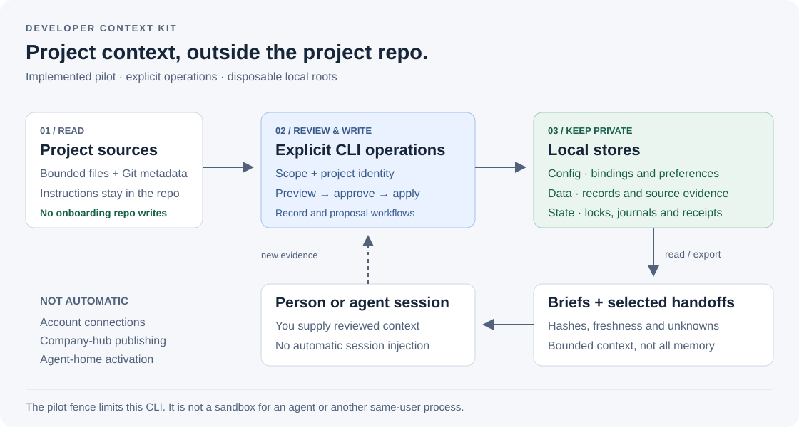

# devtwin

**Clone the developer.** devtwin keeps your project context, decisions and handoffs between coding-agent sessions, so the next session starts where the last one stopped.

[](https://github.com/sundharesan11/devtwin/actions/workflows/ci.yml)
[](LICENSE)
[](https://deepwiki.com/sundharesan11/devtwin)

[Website](https://sundharesan11.github.io/devtwin/) · [Docs](https://sundharesan11.github.io/devtwin/docs/) · [Getting started](docs/GETTING-STARTED.md) · [DeepWiki](https://deepwiki.com/sundharesan11/devtwin) · [Roadmap](docs/ROADMAP.md)

A repository tells an agent what the code is. It rarely says why a decision was made, what is still unknown, or where the last session stopped. devtwin keeps that knowledge as private, source-linked records outside the repository and turns them into a short, bounded brief for each new session.

## What it does

| Pillar | What you get |
| --- | --- |
| **Project context** | Onboard a repository read-only, then keep its facts, decisions, constraints, commands, unknowns and handoffs as reviewable records. Each record links to its sources by hash, so a brief can tell you when evidence has changed. Records are superseded, never silently overwritten. |
| **Every coding agent** | Bundled `devtwin-onboard`, `devtwin-resume` and `devtwin-record` skills give Claude Code and Codex the same context through the same CLI. |
| **Organization identity routing** *(planned)* | Each scope binds its own GitHub and Slack accounts, and devtwin checks the live identity before acting. This is designed, not built yet; see the [roadmap](docs/ROADMAP.md). |
| **Personal harness** | Clone it as a personal-harness template: a small private profile, skill templates you turn into your own private skills, and a watch on vendor announcements for your stack. See the [harness guide](docs/HARNESS.md). |

## How it works



1. **Read.** devtwin scans a bounded set of repository files (README, agent instructions, manifests) and Git metadata. It never writes to the repository.
2. **Review.** Every write is a preview first. You approve the exact plan fingerprint before anything is stored.
3. **Keep private.** Records live in local stores outside the repository, with private file modes.
4. **Brief.** `context brief` returns at most 12 items and 24 KiB, with sources, freshness and unknowns.
5. **Learn.** New decisions go back in as records, or out as a [selected-record handoff](docs/HANDOFF.md).

More in [Architecture](docs/ARCHITECTURE.md).

## Quick start

You need Node.js 22.13 or later and Git. There is nothing to install: devtwin has no third-party dependencies.

```sh
git clone https://github.com/sundharesan11/devtwin.git
cd devtwin
node bin/devtwin.mjs help
```

Every command prints one line of JSON, `{"ok": true, ...}` or `{"ok": false, "error": {...}}`. To call it from anywhere, add an alias with the checkout's absolute path to your shell profile:

```sh
alias devtwin="node $HOME/code/devtwin/bin/devtwin.mjs"
```

Then run the offline demo. It builds synthetic repositories, a disposable pilot and fake agent homes in a fresh temporary folder, and checks onboarding, records, briefs, handoffs, installs and the personal harness end to end:

```sh
DEMO_PARENT="$(mktemp -d /tmp/devtwin-demo.XXXXXX)"
DEMO_PARENT="$(cd "$DEMO_PARENT" && pwd -P)"
node scripts/acceptance.mjs \
  --pilot-root "$DEMO_PARENT/pilot" \
  --report "$DEMO_PARENT/acceptance.json"
```

Expect `"ok": true`, with 32 checks `passed` and `fresh-agent-smoke` `deferred` (it needs a real agent). The demo never touches your real agent homes or accounts.

Next steps:

- [Getting started](docs/GETTING-STARTED.md): the demo in detail, with troubleshooting.
- [Guided onboarding](docs/ONBOARDING.md): preview, approve, brief and record on a synthetic project, step by step.
- [Live activation](docs/LIVE.md): run devtwin on your own machine against real repositories and agent skill folders.
- [Migrating from devctx](docs/MIGRATING.md): `devtwin live migrate` moves a setup made under the old name.

## How it compares

| | Repo files (`AGENTS.md`, `CLAUDE.md`) | Hosted agent memory | devtwin |
| --- | --- | --- | --- |
| Where it lives | In the repository, shared with everyone who clones it | On the vendor's service | Local private stores, outside the repository |
| Works across agents | Depends on which file each agent reads | Usually one product | Claude Code and Codex through the same CLI |
| Sources and freshness | None | Usually none | Every record is hashed against its sources |
| History | Git history of one file | Varies | Immutable records with supersession |
| Writes | Anyone edits the file | Often automatic | Preview → approve → apply, every time |

devtwin complements repository instruction files rather than replacing them: repository instructions always take precedence over a brief.

## Status and requirements

- **Status.** devtwin is a local package candidate at version `0.0.0-local`. Live mode is implemented, and its first activation on a real machine passed, including fresh non-interactive Claude Code and Codex sessions that found the skills and read the brief. Backup and restore, session hooks and organization identity routing are on the [roadmap](docs/ROADMAP.md); known gaps are in [Limitations](docs/LIMITATIONS.md).
- **Install.** Run devtwin from a checkout. A global `devtwin` command is NOT currently installed by cloning; use the alias above. The npm name `devtwin` is reserved with a placeholder package; the CLI is not published to npm yet, and `package.json` stays `"private": true` to prevent accidental publication.
- **Requirements.** Node.js `>=22.13.0` and Git. macOS is the reference platform. CI also runs on Ubuntu, but Linux support is not claimed yet. Windows is unsupported.
- **Safety.** Every stateful command needs an explicit pilot file: a disposable pilot for evaluation, or a live config for one real machine. There is no automatic private-to-public synchronization, and the pilot fence is not a sandbox: it limits this CLI, not your agent or other processes. Read the [security model](docs/SECURITY-MODEL.md) before using private data.

## Contributing

Contributions are welcome. Start with [Contributing](CONTRIBUTING.md) for setup, tests and the rules for keeping examples public-safe. Report vulnerabilities privately as described in [Security](SECURITY.md). The [documentation index](docs/README.md) lists every guide and maintainer contract.

## License

[Apache-2.0](LICENSE); see [NOTICE](NOTICE). Third-party skill sources listed in the catalog keep their own licenses.
