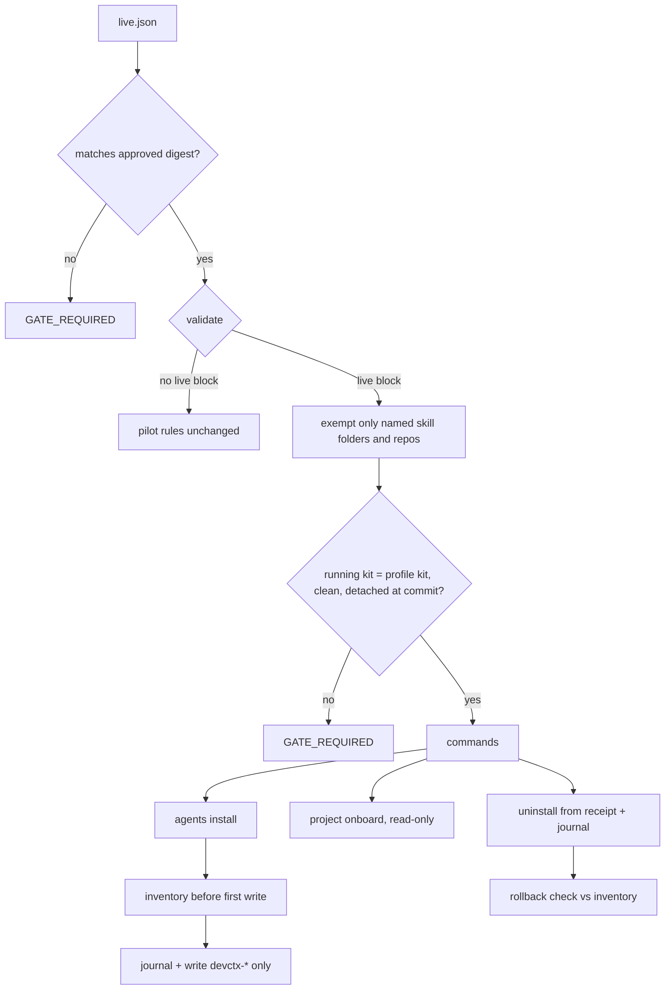

# Live Activation and First Real Project - Plan

## Goal Capsule

- **Objective:** deliver roadmap priority 2. Add a live mode that lets the owner run DCK against a real private store and real Claude and Codex skill folders, then activate it on the owner's machine and onboard one real project.
- **Authority:** the owner's decisions recorded as session-settled KTDs, then this plan, then `docs/ROADMAP.md`, `docs/SECURITY-MODEL.md` and the repository instructions.
- **Execution profile:** code units U1 to U7 are test-first and merge through the CI gate. U8 is an operational run on the owner's machine, after merge, with an approval at every write.
- **Stop conditions:** stop and ask when a change would weaken the disposable pilot fence, when a real write is not covered by a previewed and approved plan, when the client repository would change, or when evidence shows a settled decision cannot work.
- **Tail ownership:** the implementer owns review fixes, CI, the fast-forward merge and U8.

---

## Product Contract

### Summary

Add a declared live profile that names the exact real skill folders and read-only repositories DCK may use, with private state in `~/.devctx/store` and a pinned kit clone in `~/.devctx/kit`. Make bundled-skill install, status, uninstall and rollback checking safe on real folders that already hold foreign skills. Then activate on the owner's machine, onboard one client monorepo into scope `example`, prove fresh Claude and Codex sessions find the skills, and rehearse rollback.

### Problem Frame

DCK only runs inside a disposable pilot. `validate()` in `src/config/pilot.mjs` requires every agent home and repository to sit inside `pilotRoot` and away from protected paths such as `~/.claude` and `~/.agents`. The installers also refuse the real home. So the owner cannot use DCK on real work, and none of priority 2's exit evidence can be produced: a reviewed target and file preview, approval, preserved foreign skills, fresh sessions finding the intended skills, and verified rollback.

The real skill folders are not empty. The owner's Claude skill folder already holds about 150 foreign entries, many of them symlinks, and both real parent folders are mode 0755. Live mode must coexist with that state and never repair or adopt it.

### Requirements

**Live profile and fence**

- R1. A live profile declares a stable profile ID, the private store roots, one skill folder per agent, the read-only repositories, and the expected kit path and commit.
- R2. The disposable pilot keeps every current rule. Existing tests keep their expected outcomes, except the Codex layout change in R7 and the acceptance check count in U7.
- R3. In live mode, writes outside the store go only to `devctx-*` entries directly inside an allowlisted skill folder. Live mode never creates, removes or changes the mode of a skill folder or its parents.
- R4. A live profile is refused when:
  - the store or the profile file sits inside any Git worktree;
  - the kit is not the top level of its own clone, or sits inside `pilotRoot` or another worktree;
  - a skill folder is not exactly `<home>/.claude/skills` (or `$CLAUDE_CONFIG_DIR/skills` when that is set) or `<home>/.agents/skills`, does not already exist, or has a symlinked ancestor below the home;
  - a repository sits inside the store or the kit, or a skill folder overlaps a repository, the store, the kit or a forbidden path.

  The home is the process home (`os.homedir()`, which honors `$HOME`), never a command argument. The profile records it, and a later run with a different home is refused.
- R5. Live commands refuse with `GATE_REQUIRED` when the running kit's real path differs from the profile's, or its `HEAD` is not a clean, detached checkout of the profile's kit commit. The kit-change command is the one exception: it runs from the new kit, which must pass the same clean, detached check against the requested commit.
- R6. The profile changes only through approved commands. A profile on disk that differs from the last approved version is refused.
- R7. Codex skills install into `.agents/skills` in both modes, matching the source installer. The bundled and package installers both move from `.codex/skills`.

**Install and rollback**

- R8. Install never touches a foreign, modified, symlinked or same-named unowned entry. A conflict blocks only that agent, and the preview says why.
- R9. At the start of apply, before the first write, DCK records an inventory of each target skill folder. A read-only rollback check then fails on any difference in `devctx-*` entries and lists any change to foreign entries for the owner to review.
- R10. An incomplete install run for the profile blocks new applies until the owner approves a recovery plan. Before the first write, the run folder keeps copies of the old and new file bytes, and each started journal entry records the action and its file hashes. Recovery removes an interrupted create, completes or rolls back an interrupted update from the run folder's copies, and finishes an interrupted remove, always matching the journal's hashes, never the current kit's. A file that matches neither is reported and left.
- R11. An entry is removable only when its receipt matches a completed journal entry in the private store for the same profile. Uninstall works from those records alone and survives an approved kit change.
- R12. Per-agent selection (`--agent`) keeps working in live mode.

**Real project**

- R13. Onboarding a live repository outside the store works through the existing preview and approval flow and never writes to the repository.
- R14. The bundled skills accept `~/.devctx/live.json` after the user confirms it once per session, and warn when an installed receipt's kit commit differs from the commit checked out at `DEVCTX_KIT`.

**Activation evidence**

- R15. On the owner's machine:
  - preview, approval and apply for both agents, with foreign entries unchanged;
  - fresh Claude and Codex sessions, run read-only and answering the once-per-session confirmation, list the `devctx-*` skills and resolve the onboarded project;
  - one interactive session per agent, started by the owner from the same neutral folder, does the same;
  - uninstall passes the rollback check, and reinstall succeeds.
- R16. Activation sessions, scripted and interactive, must not write to the client repository: they run from a neutral working folder with only user-level settings. The repository snapshot hashes tracked and untracked files and `.git` outside `objects`, `logs` and `FETCH_HEAD`, and records ignored files by path, size and modification time.
- R17. Evidence that names private paths, clients or accounts stays in private state. The repository records only the date, commit and pass or fail.

### Scope Boundaries

- No global `devctx` command on `PATH`; agents use `DEVCTX_KIT`.
- No session start or end hooks (priority 3), no backup (priority 1, deferred by the owner), no migration from the owner's existing setup (priority 4).
- No adoption, repair or chmod of existing foreign skills or folders, and no writes to `~/.codex/skills`. Earlier pilot installs under `.codex/skills` are reported by status as leftovers and never touched.
- DCK never edits the client repository's Git configuration to get past a refusal.
- No Git tag or versioned release. The pin is a commit.
- Skill-builder and skill-source installs stay pilot-only.
- The personal-harness template stage is planned separately on branch `sundharesan11/dck-next-stage-plan`; this plan does not touch it.

#### Deferred to Follow-Up Work

- An automated kit upgrade. U4 adds the approved profile change; U6 documents the side-by-side clone.

### Acceptance Examples

- AE1. **Given** a fake home whose `.claude/skills` holds a foreign `devctx-resume` folder without a receipt, **when** the owner previews install, **then** Claude shows `conflict` with a reason, Codex proceeds, and apply writes nothing under `.claude/skills`.
- AE2. **Given** an install of both agents, **when** the owner uninstalls and runs the rollback check, **then** the check passes and top-level foreign entries are unchanged. The test also hashes the fake foreign trees directly.
- AE3. **Given** a live profile and the dev checkout as the running kit, **when** any live command runs, **then** it fails with `GATE_REQUIRED` naming the kit mismatch.
- AE4. **Given** an onboarded repository, **when** onboarding completes, **then** its snapshot as defined in R16 is identical to before.
- AE5. **Given** skills installed under kit A, **when** the owner approves a kit change to kit B, **then** uninstall and reinstall both succeed.

---

## Planning Contract

### Key Technical Decisions

- KTD1. **One folder for private state.** Everything lives under `~/.devctx` at mode 0700. (session-settled: user-directed — chosen over the XDG config/share/state split: one place to find and later back up.)
- KTD2. **Layout inside `~/.devctx`.** The store is `~/.devctx/store/{config,data,state,inputs}` with `pilotRoot` at `~/.devctx/store`. The kit clone is the sibling `~/.devctx/kit`. The profile is `~/.devctx/live.json`. The fence protects the running kit, so the kit cannot sit inside `pilotRoot`.
- KTD3. **Pinned clone at a reviewed main commit.** The live kit is a separate `git clone` checked out detached at the merged commit. (session-settled: user-directed — chosen over pointing agents at the dev checkout: development cannot change live behavior.)
- KTD4. **Live mode extends the pilot schema rather than adding a code path.** The pilot schema gains an optional `live` block, included in `pilotDigest`. When it is present, `validate()` exempts only the named skill folders and repositories from the "inside pilotRoot and not protected" rules, and `agentHomes` must be empty. Locks, journals and the other checks stay shared. (session-settled: user-approved — chosen over a separate live code path: the existing fence checks are proven.)
- KTD5. **Skill folders, not homes, are the write roots.** In live mode `assertWritable` and the install lock take the profile's skill folder as the allowed root and accept only `devctx-*` children. The real home is never a write root. Install code takes an injectable home so tests use fake homes.
- KTD6. **Codex uses `.agents/skills` only.** (session-settled: user-approved — chosen over also writing `~/.codex/skills`: current Codex documentation reads `.agents/skills`, and old copies stay untouched.) Cursor also reads `~/.agents/skills` and will see the skills. That is accepted and documented: the skills behave the same for any caller and keep every confirmation gate. `CODEX_HOME` is recorded and warned about, but does not change the target.
- KTD7. **Approved profile digest and stable profile ID.** `live init` writes a random profile ID once. Each approved profile command records the new profile digest in the store under the pilot lock. The digest catches accidental edits, not deliberate tampering by the same user; the docs say so. Receipts and journals bind to the profile ID, not to the kit or the repository list, so adding a repository or changing the kit keeps installs owned. The kit commit in a receipt is provenance only.
- KTD8. **Rollback is evidence, not automation.** Rollback is the reviewed uninstall plus the inventory check. Nothing is restored automatically.
- KTD9. **No backup in this stage.** (session-settled: user-directed — chosen over building backup first: the owner deferred it on 2026-10-16.) The docs state the risk, including that onboarding copies some client text into the store.
- KTD10. **Delivering `DEVCTX_KIT`.** It is exported from the owner's shell profile, and the bundled skills verify it. Writing agent settings files is outside the allowlist. GUI-launched agents may not inherit it; the runbook says how to check.
- KTD11. **First project.** The client monorepo `example-org/example-repo` goes in scope `example` and is read-only. (session-settled: user-directed — chosen over an example-repo-only scope: one scope for all Example Org work.)

### High-Level Technical Design



Layout of `~/.devctx` after activation:

```text
~/.devctx/            0700
  live.json           profile (pilot schema + live block)
  kit/                pinned clone, detached at the merged commit
  store/              pilotRoot
    config/ data/ state/ inputs/
```

### Risks

- **Real folders hold many foreign entries, and other tools may change them.** Status classes never act on foreign entries. The rollback check separates DCK differences from foreign churn, and U8 runs it immediately after uninstall.
- **Large monorepo limits.** `git status` may hit the 30 s timeout or the 16 MiB buffer. The preview surfaces this before any write.
- **Agents not inheriting `DEVCTX_KIT`.** The skills refuse clearly, and the runbook covers checking.
- **Codex discovery on the installed version.** U8 checks it before apply.
- **Repo-local Git LFS or filter config.** `locateWorktree` refuses repo-local `filter.*` and `diff.*` settings. U8 runs the onboarding preview first; a refusal stops activation for that repository.
- **Lost store.** Without backup, losing the store leaves installed `devctx-*` entries unowned. `docs/LIVE.md` gives a manual removal procedure.
- **No backup, and client text in the store.** Accepted per KTD9; the store is private at 0700.

---

## Implementation Units

### U1. Live profile schema and fence

- **Goal:** a pilot file with a `live` block validates a real store, skill folders and repositories, and nothing else.
- **Requirements:** R1, R2, R3, R4, R5, R6; KTD2, KTD4, KTD5, KTD7.
- **Dependencies:** none.
- **Files:** `schemas/pilot.schema.json`, `src/config/pilot.mjs`, `src/config/roots.mjs`, `test/live-profile.test.mjs` (new), `test/pilot.test.mjs`, `test/required-tests.json`.
- **Approach:** add a `live` object with `profileId`, `skillDirs` per agent, `kitRoot` and `kitCommit`, and add it to the digest keys. Take the home from the context, which defaults to the OS account. Add skill folders to the destination list for the overlap and forbidden checks. Add a running-kit seam to the context so tests can set the kit path and commit. Read a live profile through the private-file reader so its mode and owner are checked. Resolve all paths to real paths. Carve the named skill folders out of `protectedPaths()` only, not their parent homes. Check the kit through `gitQuery`: top level of its own clone, detached, clean, `HEAD` equal to `kitCommit`. Compare the profile digest with the approved digest in the store.
- **Execution note:** write the failing live-profile tests first; the existing pilot tests are the characterization guard.
- **Patterns to follow:** `validate()`, `protectedPaths()`, `assertWritable()`, `gitQuery` and the `makePilot` helper's `p.with(patch)`.
- **Test scenarios:**
  - A profile with a store under a temp home, existing skill folders at `<home>/.claude/skills` and `<home>/.agents/skills`, and a repository outside the store validates.
  - The same paths without a `live` block are refused exactly as today.
  - An unlisted folder, `<home>/.claude` itself, `<home>/.codex/skills`, or a missing skill folder is refused.
  - A store inside a Git worktree, a kit nested in another worktree or inside `pilotRoot`, and a repository inside the store or the kit are each refused.
  - A kit that is the top level of its own clone validates.
  - A symlinked `.claude` ancestor is refused with `PATH_UNSAFE`.
  - `CLAUDE_CONFIG_DIR` set elsewhere requires the Claude skill folder to be inside it. `CODEX_HOME` set produces a warning only.
  - Covers AE3. A running kit at a different path fails with `GATE_REQUIRED`.
  - A kit whose `HEAD` differs from `kitCommit`, or has local changes, fails with `GATE_REQUIRED`.
  - A profile edited by hand after approval fails with `GATE_REQUIRED`.
  - A skill folder inside a listed repository, such as `<repo>/.claude/skills`, is refused.
  - An integration test clones the committed kit into a temp folder, detaches it, and runs `bin/devctx.mjs` from there against a live profile.
- **Verification:** all pilot tests pass unchanged and the new tests pass.

### U2. Live-safe bundled install, status and uninstall

- **Goal:** the bundled installer works on real folders with foreign content, one agent at a time.
- **Requirements:** R3, R7, R8, R10, R11, R12; KTD5, KTD6, KTD7.
- **Dependencies:** U1.
- **Files:** `src/agents/install.mjs`, `src/agents/commands.mjs`, `src/agents/package-files.mjs`, `src/agents/package-install.mjs`, `src/storage/lock.mjs`, `test/agents.test.mjs`, `test/skill-install.test.mjs`, `test/live-install.test.mjs` (new).
- **Approach:**
  - Change `AGENT_HOMES.codex` to `.agents/skills`, and drop the package installer's now-redundant competing check there.
  - Replace the hard-coded real-home refusal in `planInstall` with a check that the target resolves to the profile's skill folder. Keep `safeHome` refusals for package and source installs.
  - Never create a skill folder in live mode, and never check or change parent modes on the bundled path.
  - Record profile ID, run ID, kit commit and file hashes in `.devctx-owned.json`, and the same in the journal.
  - Treat an entry as owned only when its receipt matches a completed journal entry for the profile and holds exactly `SKILL.md` and `.devctx-owned.json`.
  - Before the first write, copy the old and new file bytes into the run folder, and journal each action as started with its file hashes; journal it as completed after. Gate apply on incomplete bundled-install runs for the profile only. Add an approved recovery plan bounded by R10.
  - Status lists leftover bundled entries under the old `.codex/skills` path without acting on them.
- **Execution note:** start from AE1 as a failing test.
- **Patterns to follow:** `statusFor`, `finalizePlan`, `withPilotLock` and the package installer's `journals()` gate.
- **Test scenarios:**
  - Covers AE1. A foreign same-named folder yields `conflict` for that agent only.
  - A foreign symlink entry and a 0755 parent are left byte- and mode-identical after install.
  - `--agent codex` alone installs only into `.agents/skills`.
  - A crash injected after the folder is created, after `SKILL.md` is written, and after the receipt is written each leaves `RECOVERY_REQUIRED`. A new apply is refused, and an approved recovery clears it so a later apply succeeds.
  - A crash mid-update, followed by an approved kit change, recovers by matching the journal's hashes.
  - Recovery leaves a started entry alone when it holds a file matching neither the old nor the new hashes.
  - A forged receipt with no matching journal, or one naming an extra or traversal file, is treated as foreign.
  - Uninstall with the kit's `skills/` folder removed still plans and applies.
  - Covers AE5. After an approved kit change, uninstall and reinstall succeed.
  - Re-running install on an installed folder is a no-op with no journal.
  - Package-installer tests pass with the new Codex layout.
- **Verification:** new and updated agent tests pass, and pilot install behavior changes only in the Codex layout.

### U3. Inventory and rollback check

- **Goal:** prove rollback by comparing each skill folder against its pre-install inventory.
- **Requirements:** R9; KTD8.
- **Dependencies:** U2.
- **Files:** `src/agents/inventory.mjs` (new), `src/agents/install.mjs`, `src/agents/commands.mjs`, `src/cli.mjs`, `test/live-install.test.mjs`, `scripts/package-allowlist.json`.
- **Approach:** at the start of apply, before the first write, record each target folder's top-level entries with `lstat` only: name, type, mode, link target and modification time. Walk and hash `devctx-*` entries fully without following symlinks. Add a read-only `agents rollback-check --run-id <install run>` that compares the folder with that install run's inventory, fails on `devctx-*` differences, and lists foreign changes with timestamps.
- **Test scenarios:**
  - Covers AE2. Install then uninstall, then the check passes.
  - A leftover `devctx-*` file after uninstall fails the check.
  - A top-level foreign file edited after install is listed but does not fail the check.
  - A folder with more than 150 foreign entries, including symlinked trees, inventories without walking into them.
  - The check makes no writes.
- **Verification:** tests pass and the command appears in `help`.

### U4. Profile commands

- **Goal:** create and change a live profile only through preview and approval.
- **Requirements:** R1, R6; KTD2, KTD7.
- **Dependencies:** U1.
- **Files:** `src/config/live.mjs` (new), `src/config/commands.mjs`, `src/cli.mjs`, `test/live-profile.test.mjs`, `scripts/package-allowlist.json`.
- **Approach:** `live init` previews the profile and store layout from the account home, `--agent`, optional `--repo` and the running kit, then writes them on `--apply` with the plan fingerprint. `live add-repo` appends one repository. `live set-kit` runs from the new kit and changes the kit path and commit; its preview shows the old and new values. Each apply records the approved digest under the pilot lock. All refuse an existing non-empty store without a profile.
- **Test scenarios:**
  - `live init` preview writes nothing, and apply creates 0700 folders, the profile and the approved digest.
  - A stale fingerprint is refused.
  - `live add-repo` and `live set-kit` keep install receipts owned.
  - `live set-kit` from a kit with local changes, or at a commit other than the requested one, is refused.
  - A repository inside the store or the kit is refused.
- **Verification:** tests pass, and `init` and `scope add` work against the new store unchanged.

### U5. Read-only onboarding of a live repository

- **Goal:** prove onboarding a repository outside the store never writes to it.
- **Requirements:** R13, R16; KTD11.
- **Dependencies:** U1, U4.
- **Files:** `test/live-onboard.test.mjs` (new), `test/helpers.mjs`, `src/onboarding/onboard.mjs` if a gap appears.
- **Approach:** add a snapshot helper implementing the R16 snapshot. Run preview, apply and brief against a fixture repository outside `pilotRoot`, on a feature branch with a second worktree.
- **Execution note:** expected to be test work; change code only if a write is found.
- **Test scenarios:**
  - Covers AE4. The snapshot is identical before and after onboarding.
  - Resolving from the second worktree returns `worktree-not-confirmed`.
  - A dirty working tree is recorded as a warning, not refused.
- **Verification:** tests pass with no write to the fixture repository.

### U6. Bundled skills and documentation

- **Goal:** skills and docs describe live mode accurately.
- **Requirements:** R14, R17; KTD6, KTD9, KTD10.
- **Dependencies:** U1 to U4.
- **Files:** `skills/devctx-onboard/SKILL.md`, `skills/devctx-resume/SKILL.md`, `skills/devctx-record/SKILL.md`, `docs/LIVE.md` (new), `README.md`, `docs/LIMITATIONS.md`, `docs/GETTING-STARTED.md`, `docs/ROADMAP.md`, `docs/AGENT-PROTOCOL.md`, `docs/SECURITY-MODEL.md`, `docs/STORAGE.md`, `docs/RELEASING.md`, `docs/README.md`, `test/docs.test.mjs`, `scripts/package-allowlist.json`.
- **Approach:** skills offer `~/.devctx/live.json` for the user to confirm, keep every existing refusal, and compare an installed receipt's kit commit with the commit at `DEVCTX_KIT`. `docs/LIVE.md` is the runbook: clone and pin, `live init`, install preview and approval, `DEVCTX_KIT` export, scope and onboarding, read-only fresh-session checks, rollback check, side-by-side upgrade with `live set-kit`, Cursor visibility and the no-backup risk. Cover the digest's limit, manual removal after a lost store, and leftover `.codex/skills` copies. Correct each statement the research listed as made false, keeping test-pinned phrases that stay true.
- **Test scenarios:**
  - The docs test pins the new skill phrases: live profile path, confirm, kit commit warning.
  - The docs test pins the no-backup statement in `docs/LIMITATIONS.md`.
- **Verification:** docs tests and the package audit pass.

### U7. Acceptance coverage

- **Goal:** the offline acceptance run exercises live mode against a fake home.
- **Requirements:** R2, R8, R9.
- **Dependencies:** U2, U3, U4.
- **Files:** `scripts/acceptance.mjs`, `.github/workflows/ci.yml`, `test/ci.test.mjs`.
- **Approach:** move the existing foreign Codex fixture to `.agents/skills`. Keep the real-home refusal check as a pilot-mode check. Add live checks for init, install with a foreign entry present, rollback check, and uninstall from receipts. Update the hard-coded counts in `.github/workflows/ci.yml` and in the acceptance script's required list.
- **Test scenarios:**
  - Acceptance reports the new live checks as passed on a fresh temp root.
  - The CI test asserts the new count.
- **Verification:** acceptance passes locally, then on all four CI lanes.

### U8. Activation on the owner's machine

- **Goal:** produce the priority 2 exit evidence.
- **Requirements:** R15, R16, R17.
- **Dependencies:** U1 to U7 merged to main with green CI.
- **Files:** `docs/ROADMAP.md`, `docs/CI.md` (dated pass line only).
- **Approach:** follow `docs/LIVE.md`, with the owner present and the steps below in order.
  - Preflight, read-only: confirm the installed Claude and Codex versions read `~/.claude/skills` and `~/.agents/skills`, and `lstat` both folders. If one is missing or symlinked, stop; the owner creates or fixes it by hand as a separate decision.
  - Read-only Git check on example-repo that mirrors `locateWorktree`: repo-local `filter.*` and `diff.*` config, and a timed `status --porcelain`. Stop if either would be refused.
  - Ask the owner to close editors and Git tools watching example-repo for the run, then take the before snapshot of example-repo.
  - Clone the kit at the merged commit, then preview and apply `live init` with example-repo listed.
  - Add scope `example`, then show the example-repo onboarding preview before any skill install; stop if it is refused. Apply after approval.
  - Show the install preview for both agents and apply after owner approval.
  - Ask before editing the shell profile.
  - From a neutral working folder, run a fresh `claude -p --setting-sources user` session and `codex exec --sandbox read-only`, passing example-repo as `--cwd` to devctx and answering the kit confirmation in the prompt, to list `devctx-*` skills and resolve example-repo. The owner runs one interactive session per agent.
  - Uninstall, run the rollback check at once, reinstall after a fresh approval, and recheck discovery.
  - Snapshot example-repo right after onboarding apply and after the last session, and compare both with the before snapshot. Keep evidence in `~/.devctx/store/state/evidence/`.
- **Execution note:** operational, not code. Every write is a separate owner approval.
- **Test expectation:** none -- this unit is a guarded manual run; the evidence files are its proof.
- **Verification:** the evidence shows each R15 item. Any example-repo snapshot difference is listed by path, and the owner judges each one.

---

## Verification Contract

| Gate | Command or evidence | Applies to |
| --- | --- | --- |
| Unit and integration tests | `npm test` | U1 to U7 |
| Package audit | `npm run check:package`, with no agent worktrees inside the checkout | U1 to U7 |
| Whitespace | `git diff --check` | all |
| Acceptance | `node scripts/acceptance.mjs --pilot-root <new temp dir> --report <file>` | U7 |
| CI | all four Pilot CI lanes green on the branch, then on main | merge |
| Plan review | independent Claude review through Orca before implementation | plan |
| Diff review | `ce-code-review` plus an independent Claude diff review through Orca | merge |
| Activation evidence | private evidence files for R15 | U8 |

## Definition of Done

- U1 to U7 merged to main by fast-forward after all four CI lanes pass on the branch and on main.
- Plan and diff reviews completed, with material findings fixed.
- U8 evidence shows both agents installed with owner approval, foreign entries unchanged, fresh sessions discovering the skills, example-repo onboarded in `example` and unchanged, the rollback check passing, and reinstall working.
- Docs no longer claim live activation is unavailable, and they state the no-backup risk.
- No abandoned experimental code remains in the diff.
