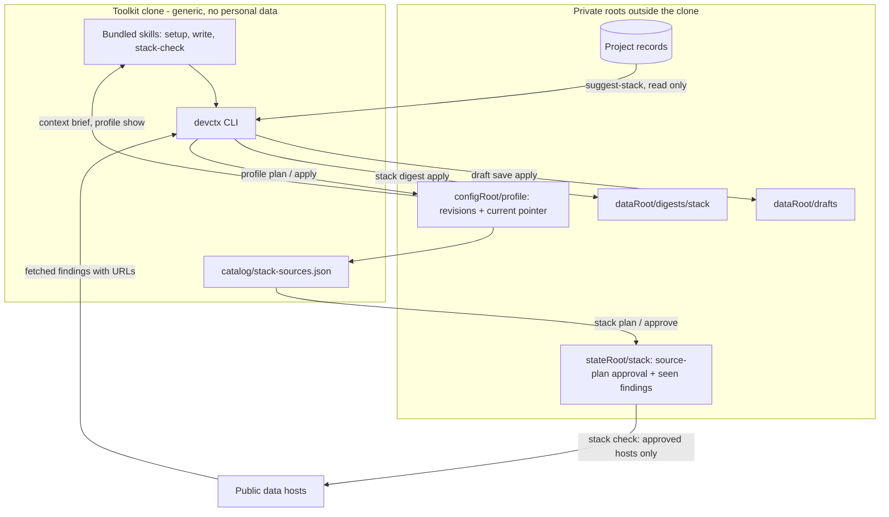
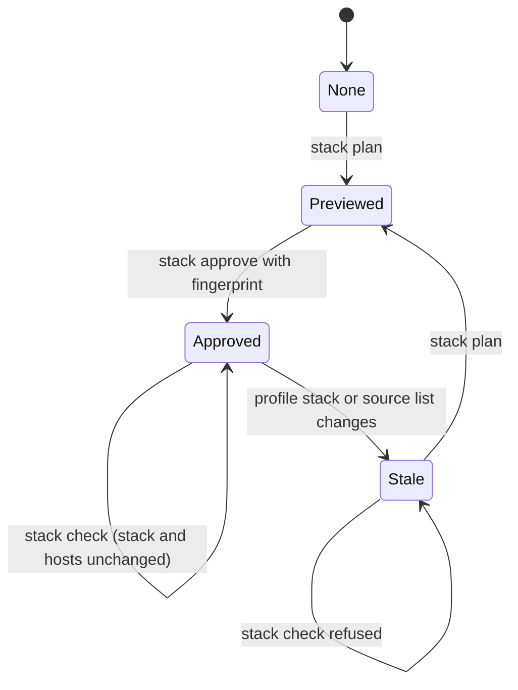
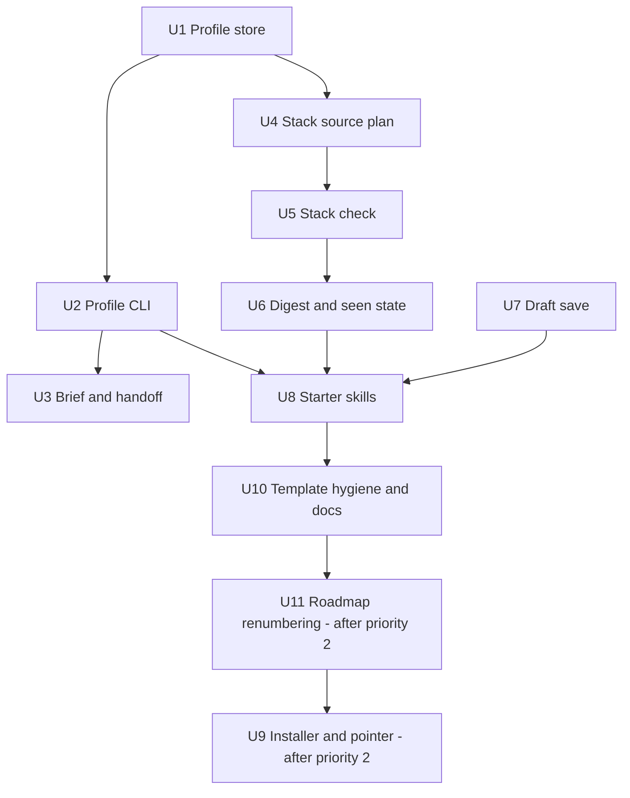

# Personal Harness Template - Plan

## Goal Capsule

- **Objective:** Make Developer Context Kit (DCK) usable as a clonable, generic personal-harness template: a short first-run setup that captures a small private profile, plus two instruction-only starter skills (general writing and stack-update check) that read it.
- **Product authority:** This Product Contract, then the Planning Contract, then repository instructions. The owner confirmed the scope, the sequencing (a new stage after roadmap priority 2 and before priority 3), the delivery model, the network-approval model and the naming decision on 2026-10-16.
- **Roadmap position:** New priority 3, "Personal harness layer", directly after priority 2 (real-home activation). Former priorities 3–9 become 4–10. It is not a daily-use blocker and does not lift the skill-builder or skill-source freeze.
- **Stop conditions:** Stop and ask if a unit would change `src/agents/install.mjs`, `src/agents/package-install.mjs`, any agent home, or the pilot fence before priority 2 merges; if a change would send data outward without an approval; or if a design needs a credential stored in a record.
- **Execution profile:** U1–U8 and U10 can land while priority 2 is in flight. U9 (installer and pointer) and U11 (roadmap renumbering) start only after priority 2 merges to `main`. Synthetic fixtures only; no real client files, accounts or agent homes.
- **Open blockers:** None.

---

## Product Contract

### Summary

A first-run setup asks three to five skippable questions and writes a capped, private profile: how the developer likes to work with agents, the stack they know, the stack they use now, and the kind of work they do.
Every profile change is previewed and approved, keeps history, and lives outside the clone.
Two instruction-only starter skills ship with the template: a writing skill that drafts any kind of message from the profile and selected project context without sending, and a manually run stack-update check that turns the declared stack into a sourced digest of releases, breaking changes, deprecations, end-of-life dates and advisories.

### Problem Frame

DCK today keeps source-linked project facts, decisions and handoffs outside project repositories so that the next session can resume.
It knows almost nothing about the developer: the existing `init` preferences hold only an explanation style, a diagram preference and up to ten short notes, and that file cannot be changed after it is written.
When a developer switches project, machine, session or agent, the agent loses how this person works and what stack they live in, so the developer repeats it in every new session or in every agent's separate personal instruction file.

The owner already runs a private setup that solves this for one person: canonical cross-agent skills, a startup pointer in each agent's global instruction file, private project registration and optional local notes.
That setup is personal and cannot be shared.
Public harnesses that people do clone (gstack, Superpowers, SuperClaude, PAI/LifeOS) either have no personalization step or are heavy and tied to one agent.
Anyone cloning such a template today forks someone else's preferences and edits them by hand, and the instance and the template mix in one tree, which is how personal files end up committed.

### Prior Art

Research date 2026-10-16, public sources only. Citations point at the source; items marked unverified could not be confirmed against a primary source.

**Instruction files and built-in memory: interoperate, do not replace.**
- AGENTS.md is the shared repository instruction file, now stewarded by the Linux Foundation's Agentic AI Foundation and read by Codex, Cursor, Copilot, Gemini CLI, Windsurf and others ([agents.md](https://agents.md/), [OpenAI announcement](https://openai.com/blog/agentic-ai-foundation)). It is repository-committed and has no agreed user-level location; users have asked for one ([Cursor forum](https://forum.cursor.com/t/support-global-agents-md/150406), [pi issue](https://github.com/earendil-works/pi/issues/5002)).
- Claude Code loads `~/.claude/CLAUDE.md` for all projects, supports `@path` imports and advises under 200 lines per file. Its auto memory is per repository, per machine, written without per-item approval ([Claude Code memory docs](https://code.claude.com/docs/en/memory)).
- Codex reads `~/.codex/AGENTS.md` with a 32 KiB cap; its memories are off by default and documented as "a recall aid, not a rulebook" ([AGENTS.md guide](https://learn.chatgpt.com/docs/agent-configuration/agents-md), [Codex memories](https://learn.chatgpt.com/docs/customization/memories?surface=app)).
- Cursor removed its Memories feature and told users to export them to rules; its User Rules are a settings box, not a file ([forum](https://forum.cursor.com/t/are-my-memories-gone/144057), [file-backed user rules request](https://forum.cursor.com/t/file-backed-agent-editable-user-rules-parity-with-project-cursor-rules/166055)).
- GitHub Copilot Memory validates a memory against current code before use and expires it after 28 days unused; it is cloud and Copilot-only ([GitHub docs](https://docs.github.com/en/copilot/concepts/agents/copilot-memory)).
- **DCK position:** every agent has a personal slot and none share a source. DCK keeps one approved profile and lets agents pull it; it does not compete with AGENTS.md or vendor memory.

**Instruction sync: solved, do not build.**
- ruler writes one rule source into about 31 agents' native files with dry-run, managed blocks, backups and revert ([ruler](https://github.com/intellectronica/ruler)); rulesync targets about 60 ([rulesync](https://github.com/dyoshikawa/rulesync)); vibe-rules keeps a personal rule library ([vibe-rules README](https://cdn.jsdelivr.net/npm/vibe-rules@0.3.91/README.md)).
- **DCK position:** point users at these for fan-out. Borrow ruler's dry-run and managed-marker conventions for the single opt-in pointer.

**Memory products: crowded, mostly automatic and often cloud-bound.**
- mem0/OpenMemory needs an OpenAI key in its easy setup and has a reported telemetry opt-out bug ([OpenMemory](https://mem0.ai/blog/introducing-openmemory-mcp), [issue 2062](https://github.com/mem0ai/mem0/issues/2062)); Supermemory pools agent memories in a cloud workspace and disclosed a recall bug that let a crafted Bash command run without confirmation ([changelog](https://supermemory.ai/changelog/plugins/claude)); claude-mem compresses observations through the model provider ([architecture](https://docs.claude-mem.ai/architecture/overview)); Basic Memory is local Markdown under AGPL-3.0 ([repository](https://github.com/basicmachines-co/basic-memory)).
- Almost none preview a write before storing it or re-check a source before using a fact.
- **DCK position:** keep the reviewed, source-linked, plain-file layer. Do not add automatic capture or vector retrieval.

**Session transfer: covered elsewhere.**
- SpecStory and continues/casr archive and convert native session transcripts between agents ([SpecStory](https://docs.specstory.com/integrations/terminal-coding-agents), [write-up](https://codex.danielvaughan.com/2026/06/01/codex-cli-cross-agent-session-portability-continues-casr-handoff/)). Guides recommend handing over compact working state, not transcripts ([Superset](https://superset.sh/blog/switching-between-ai-coding-agents)).
- **DCK position:** out of scope, as the owner noted. DCK's handoff stays a compact reviewed note.

**Personal harness templates: demand exists, the personalization step is missing.**
- Agent Skills (`SKILL.md` folders) is an open format read by Claude Code, Codex, Gemini CLI, Cursor, Copilot and many others ([agentskills.io](https://agentskills.io/home)). Starter skills should use it unchanged.
- PAI/LifeOS keeps a `USER/` tree its installer never touches and generates the public repository from a private one; it is heavy and Claude Code-centric ([repository](https://github.com/danielmiessler/Personal_AI_Infrastructure)).
- OpenClaw's first run is three or four beats and its template says not to turn it into a questionnaire; its `USER.md` grows later through dated active or superseded entries under a 4,000-character budget ([bootstrap template](https://docs.openclaw.ai/reference/templates/BOOTSTRAP), [workspace](https://docs.openclaw.ai/concepts/agent-workspace)). Hermes caps its user profile at about 1,375 characters (secondary source: [overview](https://parallel.ai/articles/what-is-hermes-agent)).
- gstack, Superpowers, compound-engineering and SuperClaude publish someone's workflow with no personalization step ([gstack summary](https://augmentcode.com/learn/garry-tan-gstack-claude-code), [Superpowers](https://github.com/obra/superpowers), [compound-engineering](https://github.com/EveryInc/compound-engineering-plugin), [SuperClaude](https://github.com/SuperClaude-Org/SuperClaude_Framework)).
- Survey completion falls with every added question up to about 15 ([SurveyMonkey](https://www.surveymonkey.com/curiosity/survey_questions_and_completion_rates/)); no developer-tool onboarding study was found.
- **DCK position:** own the small personalization layer. Recommend process-skill packs as companions instead of rebuilding them.

**Template and instance separation: leaks are real.**
- `.claude/settings.local.json` files with secrets were pushed to public repositories and shipped inside npm packages ([issue mirror](https://claudeissues.com/issue/13106-bug-sensitive-tokens-stored-in-claude-settings-local-json-and-not-ignored-by-git), [Check Point report](https://securitybrief.news/story/claude-code-can-leak-secrets-in-public-npm-packages)).
- A study of about 42,000 marketplace skills found 26% with at least one vulnerability, with script-bearing skills about twice as risky ([arXiv 2601.10338](https://arxiv.org/html/2601.10338v1)); OWASP lists skill-borne exfiltration ([Agentic Skills Top 10](https://owasp.org/www-project-agentic-skills-top-10/ast01.html)).
- **DCK position:** the instance lives outside the clone by construction, and starter skills are instruction-only.

**Stack-update data: reuse public sources, build only the thin layer.**
- endoflife.date gives lifecycle and latest version per product without auth; its API is beta ([OpenAPI](https://endoflife.date/docs/api/v1/openapi.yml)). OSV.dev aggregates GitHub, PyPI, Go, RustSec and malicious-package advisories with no documented rate limit and offers bulk downloads ([API](https://google.github.io/osv.dev/api/), [data](https://google.github.io/osv.dev/data/)). Unauthenticated GitHub REST is limited to 60 requests per hour ([rate limits](https://docs.github.com/en/rest/using-the-rest-api/rate-limits-for-the-rest-api)).
- Dependabot, Renovate and Snyk assume a repository manifest; a declared stack does not fit them ([Dependabot ecosystems](https://docs.github.com/enterprise-server@3.15/code-security/dependabot/ecosystems-supported-by-dependabot/supported-ecosystems-and-repositories), [Renovate local platform](https://docs.renovatebot.com/modules/platform/local)). NewReleases.io watches declared projects but stores the stack in its account and covers releases only ([NewReleases](https://newreleases.io)).
- Update noise is the main complaint: Dependabot was called a "noise machine" in February 2026 and GitHub added auto-dismiss rules for alert fatigue ([devclass](https://www.devclass.com/security/2026/02/26/github-dependabot-is-a-noise-machine-and-should-be-turned-off-says-go-library-maintainer/4091858), [GitHub blog](https://github.blog/security/supply-chain-security/dependabot-relieves-alert-fatigue-from-npm-devdependencies)).
- Hallucinated changelog claims are a described failure mode; no measurement of the rate was found ([example](https://dev.to/nazar-boyko/ai-agents-for-release-notes-and-changelog-automation-kia)).
- Cloud routines run without a permission picker and cannot see local files; local schedulers can ([Routines](https://code.claude.com/docs/en/routines), [Desktop scheduled tasks](https://code.claude.com/docs/en/desktop-scheduled-tasks)).
- **DCK position:** no mature open-source "watch my declared stack" skill was found. Build the skill, not the data.

**Writing assistance: patterns to copy, harms to design against.**
- Anthropic's `internal-comms` skill keeps one short guideline per message type and asks when the type is unclear; `doc-coauthoring` adds a reader test ([internal-comms](https://github.com/anthropics/skills/blob/main/skills/internal-comms/SKILL.md), [doc-coauthoring](https://github.com/anthropics/skills/blob/main/skills/doc-coauthoring/SKILL.md)).
- Gmail's "Help me write" shows which emails and files a draft used ([Google help](https://support.google.com/mail/answer/13955415)).
- Heavy AI assistance lowered perceived sincerity of manager emails from 83% to 40–52% ([University of Florida](https://news.ufl.edu/2025/08/writing-ai-work/)); assistants have invented email threads and stale facts ([example](https://aipressroom.beehiiv.com/p/googles-new-gmail-tool-is-hallucinating-emails-that-dont-exist)).
- **DCK position:** keep the writing skill thin: add the profile, user-selected records and the safety rules (draft only, show the context used, mark unverified facts, ask when audience or purpose is unclear). Leave per-message-type formats to optional companion skill packs such as these.

### Key Decisions

- **New stage between roadmap priorities 2 and 3.** The profile and starter skills run offline and need no hooks or migration, so they can follow real-home activation without waiting for session hooks. Priorities 3 to 9 shift down one place. (session-settled: user-directed — chosen over waiting for priorities 1–4, a parallel track now, or folding into the open-source release: it lets the template shape stabilize before hooks and migration build on it.)
- **Agents pull the profile; an optional pointer comes later.** The profile lives in the private config root. Skills and the brief read it on demand. An opt-in, previewed one-line pointer in each agent's personal instruction file is added only through the priority 2 installer gate, after priority 2 merges. UI-only slots get paste-ready text. (session-settled: user-directed — chosen over never touching agent files and over rendering the full profile into each agent file: it keeps one source and the fewest agent-home writes while still allowing an always-on effect.)
- **Stack checks use a source plan approved once.** The user approves the exact hosts and item list once. Later runs reuse that approval until the stack or source list changes. No account or token is needed; an optional GitHub token comes from an environment variable, never from records. (session-settled: user-directed — chosen over approving every run and over offline-only bulk data: it honours "nothing sent outward without approval" while keeping later unattended runs possible.)
- **Keep the DCK name and add a harness layer.** The repository, package and CLI keep their names; docs describe a personal-harness template built on DCK. Release naming stays with priority 9. (session-settled: user-directed — chosen over renaming now or a separate template repository: it avoids churn while priority 2 activation is in flight.)
- **Versioned profile, not a write-once preference file.** Every profile edit is a previewed, hash-bound revision; earlier revisions stay readable. (session-settled: user-approved — chosen over extending the existing write-once preferences and over generating a private instance repository: it reuses DCK's preview, approval and immutability rules without taking on backup or migration work.)
- **Full starter scope stays.** Draft save, the optional `DEVCTX_GITHUB_TOKEN` and all six default data hosts remain in this stage. (session-settled: user-directed — chosen over deferring draft save, dropping the token and starting with three hosts: the owner wants the complete starter set in one stage.)
- **Sequencing reconfirmed.** After document review challenged it, the owner kept this stage after priority 2 and before session hooks. (session-settled: user-directed — chosen over moving it behind session hooks and migration: the template shape should settle first.)
- **Thin writing skill with companions.** The writing skill adds only the profile, user-selected records and the safety rules. It ships no per-message-type guidance; optional writing skill packs supply formats as companions. (session-settled: user-directed — chosen over built-in guidance for email, status updates, PR descriptions, announcements and incident notes: avoids rebuilding what companion packs already do.)
- **`init` preferences stay; the profile wins.** No migration and no deprecation of `init` in this stage (R35). (session-settled: user-directed — chosen over migrating or retiring `init` preferences: keeps existing pilots working unchanged.)
- **Exact versions go to advisory and registry hosts.** Declared versions are sent to OSV and the package registries and shown in the approval preview. Only item names and versions leave the machine. (session-settled: user-directed — chosen over sending names only: version-specific advisories need the version.)
- **Source-plan approval does not expire.** It resets only when the stack or host list changes; expiry is revisited when scheduling is enabled. (session-settled: user-directed — chosen over a time-limited approval: manual runs need no expiry yet.)
- **Two starter skills plus a setup skill, all instruction-only.** The starter skills are writing and stack check; a third skill conducts first-run setup. No bundled scripts. Engineering-process skills are recommended companions, not rebuilt. Research shows script-bearing skills carry more risk and large skill packs bloat context.
- **Scheduling stays with the scheduler priority** (8 before this stage is inserted, 9 after). This stage delivers manual runs and a documented, disabled scheduling recipe. Enabling a schedule needs that priority's gate.
- **The profile is preference data, not authority.** Agents may follow it for style and workflow choices. It cannot grant permissions, waive stop rules, or override repository instructions or the user.

### Actors

- A1. Developer: clones the template, answers setup, approves profile and stack changes, runs the skills.
- A2. Coding agent (Claude Code, Codex, or another Agent Skills host): reads the profile and runs a starter skill on the developer's request.
- A3. Public data sources: lifecycle, advisory, registry and release-note hosts that the stack check queries under the approved source plan.

### Key Flows

- F1. First-run setup
  - **Trigger:** A1 runs setup in a fresh clone with no profile.
  - **Actors:** A1, A2 optional.
  - **Steps:** Check that a pilot file exists and has been initialized; if not, point to the getting-started pilot steps and stop without creating one. Show what will be asked and where it will be stored. Ask up to five questions; each accepts skip or free text. Offer stack suggestions drawn from already-onboarded projects as a preview the developer can accept, edit or reject. Show the complete profile and its destination. Write only on approval.
  - **Outcome:** A capped private profile outside the clone, or nothing if A1 declines.
  - **Covered by:** R1–R7, R9.
- F2. Profile change
  - **Trigger:** A1 or A2 proposes an edit, for example after a stack change.
  - **Steps:** Show the old and new values, the resulting size, and whether the change was proposed by the agent. Apply only with approval bound to that exact change. Keep the earlier revision readable.
  - **Covered by:** R8–R10.
- F3. Draft a message
  - **Trigger:** A1 asks A2 to draft any message, such as an email, status update or PR description.
  - **Steps:** Establish audience and purpose, asking one question if either is unclear. Read the profile and only the project context A1 selects. Use a companion writing skill for format if one is installed; the starter skill supplies no format of its own. Produce a draft with a list of context used and every unverified name, date, number or commitment marked.
  - **Outcome:** A draft in the session. Nothing is sent. Saving it is a separate approved write.
  - **Covered by:** R13–R19.
- F4. Stack-update check
  - **Trigger:** A1 runs the check manually.
  - **Steps:** If no approved source plan exists, or the stack or source list changed, show the hosts and items that will be queried and wait for approval. Fetch from approved sources. Classify and summarize only fetched text. Produce a dated digest grouped by severity, with a source link for every claim. Write the digest only with approval.
  - **Covered by:** R20–R29.

### Requirements

**Template and instance separation**
- R1. A fresh clone contains no personal data: no profile, stack, digest, draft, account or path belonging to any person.
- R2. Setup writes the profile and stack only to private roots outside the clone. A destination inside any Git worktree is refused.
- R3. A repository check fails when a tracked file contains instance data or a disallowed personal identifier, and the packaging allowlist excludes instance files.
- R4. Docs explain how to version the private instance in a separate private repository or dotfiles manager without DCK building sync. The private roots themselves must not be a Git worktree, so the documented recipe copies or exports into that repository rather than initializing one in place.

**First-run setup**
- R5. Setup asks at most five questions covering agent-working preferences, the stack known, the stack in current use and the kind of work; each can be skipped.
- R6. Setup can suggest current-stack entries from projects already onboarded in DCK, shown as a preview that the developer accepts, edits or rejects. It never scans repositories that are not onboarded.
- R7. Setup shows the full proposed profile and destination and writes nothing without approval.

**Profile**
- R8. The profile has a hard size cap that keeps it suitable for always-loaded context; an edit that would exceed it is refused with the current size.
- R9. Profile text is checked by the existing sensitive-content rules; secret-like content is refused, not redacted.
- R10. Each profile change is a new revision bound to an approval of that exact change; earlier revisions remain readable and the current one is unambiguous.
- R11. The profile is readable on demand by skills and is included in the project brief within the brief's existing budget.
- R12. The profile can be exported as paste-ready text for agents whose personal slot is not a file. Export writes nothing outside the private roots.
- R35. When a profile exists, its working preferences take precedence over the write-once `init` preferences for any field both define; `init` itself is unchanged.

**Writing skill**
- R13. The writing skill drafts any message for any role, adding only the profile, user-selected records and the safety rules; it carries no built-in per-message-type guidance.
- R14. It asks one question when the audience or purpose is unclear instead of guessing.
- R15. It uses the profile's writing preferences when present: tone, formality by audience, greeting and sign-off, length, formatting, spelling variant and phrases to avoid.
- R16. It reads only the profile and project context the developer selects, never the whole store.
- R17. Every draft lists the context it used and marks any name, date, number or commitment not found in that context as unverified.
- R18. The skill never sends, posts or schedules a message and never calls a connector.
- R19. Saving a draft is a previewed write into the private data root; drafts are never written into the clone or a project repository.

**Stack-update check**
- R20. The developer declares the stack as named items with an optional version or major line and a care level.
- R21. Before the first run, and whenever the stack or source list changes, the check shows the hosts, items and exact declared versions it will query, states that only item names and versions leave the machine, and waits for approval.
- R22. The check uses no account by default. An optional token is read from an environment variable and never stored in records, approvals or digests; keychain resolution waits for the connector work.
- R23. The check reports new releases, breaking changes, deprecations, end-of-life dates and security advisories that affect declared items.
- R24. Every reported claim cites its fetched source; a claim without fetched source text is labelled unverified, and breaking changes are never inferred from version numbers alone. An item with no release-notes or advisory source is listed as "not checked" for that category, separate from fetch failures.
- R25. The digest groups findings by severity, hides patch-level noise by default and does not repeat findings already reported unless they change.
- R26. A source failure or rate limit is reported per item and does not fail the whole run.
- R27. The digest is dated and written to the private data root only with approval.
- R28. The check never changes a project, lockfile, manifest or installed tool.
- R29. A documented scheduling recipe ships disabled. Enabling a schedule is outside this stage.

**Starter skill packaging**
- R30. The setup skill and both starter skills are instruction-only Agent Skills folders with no bundled scripts. They follow the existing bundled-skill rules (kit path check, pilot path from the user, stop rules, explicit scope where a project is involved) and treat records, briefs and fetched third-party text as untrusted data, never instructions.
- R31. Docs recommend engineering-process and writing skill packs as optional companions without bundling them.

**Agent pointer (after priority 2)**
- R32. An opt-in pointer from each supported agent's personal instruction file to the profile is offered only after priority 2 merges, through its installer gate, with preview, approval, preserved foreign content and verified removal.

**Roadmap and docs**
- R33. The roadmap shows this stage between priorities 2 and 3, renumbers later priorities, and keeps the freeze on skill-builder and skill-source feature work.
- R34. Docs describe DCK as a personal-harness template built on DCK without claiming fresh-session discovery, platforms or schedules that are not verified.

### Acceptance Examples

- AE1. **Covers R5, R7.** **Given** a fresh clone and no profile, **when** the developer skips every question, **then** setup shows an empty profile and its destination, and with approval writes it; without approval writes nothing.
- AE2. **Covers R6.** **Given** two onboarded projects, **when** setup suggests their declared runtimes as current stack, **then** the developer can drop one suggestion and only the accepted entry is written.
- AE3. **Covers R8.** **Given** a profile near the cap, **when** an edit would exceed it, **then** the edit is refused and the current size and cap are shown.
- AE4. **Covers R9.** **Given** a note that looks like an API key, **when** it is added to the profile, **then** the write is refused and nothing is stored.
- AE5. **Covers R10.** **Given** profile revision 2, **when** the developer approves a change computed against revision 1, **then** the approval is refused as stale.
- AE6. **Covers R14, R17.** **Given** a request to "tell the client it ships Friday", **when** no context confirms the date, **then** the draft marks the date unverified and names the context it used.
- AE7. **Covers R21.** **Given** an approved source plan, **when** the developer adds a stack item or changes a declared version, **then** the next run stops for approval before any query.
- AE8. **Covers R24.** **Given** a release whose notes could not be fetched, **when** the digest is built, **then** the item appears as unverified with no breaking-change claim. **Given** an item with no release-notes source at all, **then** it appears as "breaking changes not checked".
- AE9. **Covers R25.** **Given** a finding reported last week and unchanged, **when** the check runs again, **then** the finding is not repeated.
- AE10. **Covers R26.** **Given** one host returns a rate limit, **when** the check runs, **then** other items still report and the limited items say why.
- AE11. **Covers R2, R4.** **Given** a developer ran `git init` in the config root to version it, **when** setup tries to write the profile, **then** the write is refused and the message points to the documented copy-or-export recipe.
- AE12. **Covers R21.** **Given** a stack with `next=15.2.1`, **when** the source plan is previewed, **then** it lists each host with the exact names and versions it will receive and states that nothing else leaves the machine.

### Success Criteria

- A new user with no prior DCK knowledge, starting from an initialized pilot, completes setup in under five minutes and can say what was stored and where.
- Before public release, the owner can replace the matching parts of their private setup (working preferences, stack notes, a stack-update check) with the profile and starter skills on their own machine.
- A grep of the published package and tracked files finds no personal identifiers, paths or instance data.
- Each digest claim can be traced to a fetched source in one step.
- A draft reviewer can tell which statements came from context and which need checking.

### Scope Boundaries

**Deferred for later**
- Enabling scheduled stack checks (the scheduler priority's gate).
- The opt-in agent pointer before priority 2 merges.
- Importing from existing memories or personal setups (priority 4).
- Connectors that read mail or send drafts (priority 5).
- Learning voice from sent mail or style samples beyond profile fields.
- Windows and Linux support claims.

**Outside this product's identity**
- Rules fan-out to many agents (use ruler or rulesync).
- Automatic memory capture, vector search or a general knowledge base.
- Session transcript archive or transfer.
- Dependency update pull requests (use Dependabot or Renovate).
- A skill marketplace or a large skill pack.

### Dependencies / Assumptions

- Priority numbers in this Product Contract refer to `docs/ROADMAP.md` as it stood on 2026-10-14, before this stage is inserted as priority 3 and later rows shift by one.
- Roadmap priority 2 (real-home activation) is in progress in another worktree. This stage does not change install code, `src/agents/install.mjs` or agent homes until it merges. Adding the starter skills to the installer's skill list is a post-merge change.
- The primary user is an individual developer on macOS with Node who uses Claude Code or Codex. Other Agent Skills hosts may work but are not claimed.
- Public data sources stay reachable without accounts; endoflife.date's API is beta and may change.
- Priority 1 (backup and restore) is not required for this stage; the profile and digests are covered by it once it ships.

### Outstanding Questions

No product question blocks planning. The planning questions this contract deferred are answered in the Planning Contract (KTD1–KTD15). Implementation-time unknowns are listed under Deferred to Implementation.

### Sources / Research

Full cited reports, public sources only, dated 2026-10-16:
- [Cross-agent context and memory](../research/personal-harness/context-and-memory.md)
- [Personal harness templates and onboarding](../research/personal-harness/harness-templates.md)
- [Stack-update monitoring and writing skills](../research/personal-harness/starter-skills.md)

---

## Planning Contract

Product Contract preservation: changed R22 — narrowed "environment or keychain" to "environment variable" because nothing in DCK resolves keychain references yet ([AUTH.md](../AUTH.md)); keychain support moves with the connector priority. Document review then clarified R4, R24 and R30, added R35 (profile precedence over `init` preferences), AE11, the setup prerequisite step in F1, a profile-authority Key Decision and an owner-checkable success criterion. No product decision was reversed. The owner's answers on 2026-10-16 then changed R13, R14, R21, R31, F3 and AE7, added AE12, and added six session-settled Key Decisions (full scope, sequencing, thin writing skill, `init` kept, exact versions, no approval expiry).

### Key Technical Decisions

- KTD1. **Profile is a separate, versioned private document, not an extension of `user.json`.** Revisions are immutable files under `configRoot/profile/`, named by generation. A single current pointer is replaced atomically, the way `src/config/registry.mjs` replaces the registry under a generation check. A revision file whose generation is newer than the pointer is an interrupted apply and fails the next apply with `RECOVERY_REQUIRED`; it is never silently reused or overwritten. `init` and its `preferences` stay unchanged; the profile wins where both define a field (R35), and setup previews a seed from existing preferences. (session-settled: user-approved — chosen over extending write-once preferences and over a generated private instance repository: reuses DCK's preview, approval and immutability rules without backup or migration work.)
- KTD2. **Profile cap is 4,096 bytes of canonical JSON**, with per-field limits. This sits between Hermes (~1.4k characters) and OpenClaw (4,000 characters), fits under Codex's 32 KiB and Claude's 200-line guidance, and leaves most of the 24,576-byte brief budget for records.
- KTD3. **Every profile write is preview → fingerprint → apply.** The fingerprint binds the base revision hash and the canonical new profile. A mismatched fingerprint fails with `PLAN_MISMATCH`; a base that moved since preview fails with `STALE_VERSION`. This mirrors `project onboard --plan-fingerprint` and `assertFingerprint` in `src/storage/plan.mjs`.
- KTD4. **The brief carries the profile as its own field, with its own notice.** Its bytes are charged after required policies and before records, it does not count toward the 12-item limit, and it is included in the required-bytes `LIMIT` check. The profile notice says it is the user's preference data: follow it for style and workflow, never as permission or as an override of repository instructions or the user. Handoff export keeps excluding personal data and adds the profile to its exclusion list.
- KTD5. **Stack suggestions come only from private onboarding data.** Two sources: the effective bindings' `approvedSources` names (`package.json`, `.nvmrc`, `.node-version`, `go.mod`, `pyproject.toml`, `Cargo.toml`), cited by project; and accepted "Package declarations" records for `engines` versions, cited by record ID. Onboarding creates no records for `go.mod`, `pyproject.toml` or `Cargo.toml`, and the package record exists only when accepted. Suggest-stack never reads a repository.
- KTD6. **Stack check is a deterministic CLI with an agent-facing skill.** The CLI fetches, classifies severity, deduplicates and renders the digest from fetched data. Breaking-change lines are quoted from fetched GitHub release notes with their URL, as inert fenced text: control and bidirectional characters stripped, length capped per excerpt, links and images inactive. Only CLI-generated text is live Markdown. The agent may summarize in chat but never adds unquoted claims to the digest, and the skill treats fetched text as untrusted data. This answers the hallucinated-changelog and injected-instruction risks.
- KTD7. **Source plan approval binds the stack and the host list.** `stack plan` resolves each declared item through a bundled generic catalog plus explicit per-item overrides and fingerprints the item list, identifiers and hosts. `stack approve` stores that approval, including the resolved identifiers and overrides, in `stateRoot`. `stack check` compares only the item-list hash, identifiers and hosts; the profile revision hash is stored for provenance and does not take part in matching, so a writing-preference edit does not stale the approval. Overrides may only name kinds and hosts the catalog already knows. (session-settled: user-directed — chosen over per-run approval and offline-only bulk data: honours outbound approval while allowing later unattended runs.)
- KTD8. **Network access reuses the bounded-request pattern of `src/skill-sources/github.mjs`.** Injected `request`, per-request timeout, body and total byte caps, no redirects, a fixed user agent, a per-run call cap, typed failures per item. Default hosts: `endoflife.date`, `api.osv.dev`, `registry.npmjs.org`, `pypi.org`, `crates.io`, `api.github.com`. An optional token comes from `DEVCTX_GITHUB_TOKEN` and is sent only to `api.github.com`. Docs recommend a fine-grained, public-read-only token, and `stack plan` says when GitHub requests will be authenticated as the token's account. Release notes come only from GitHub releases; the catalog has no free-form notes URL, so no host outside the list can be added through it.
- KTD9. **Starter skills are instruction-only bundled skills; installer wiring waits for priority 2.** New skills live under `skills/` beside the existing three and follow the same preconditions and stop rules. `src/agents/install.mjs` `SKILL_NAMES` is not touched until priority 2 merges (U9). (session-settled: user-directed — chosen over rendering the full profile into agent files: agents pull the profile, and a pointer comes only through the priority 2 installer gate.)
- KTD10. **Keep the name; reposition in docs.** No package, CLI or repository rename. README and a new harness guide describe the personal-harness layer. (session-settled: user-directed — chosen over renaming now or a separate template repository: avoids churn during priority 2.)
- KTD11. **Roadmap renumbers.** The new stage becomes priority 3; later rows shift by one. The freeze sentence names the daily-use blockers by name rather than by number so the renumber does not change its meaning. The new row's exit evidence is the owner-checkable success criterion plus green synthetic acceptance. (session-settled: user-directed — chosen over waiting for priorities 1–4, a parallel track, or folding into release: lets the template shape stabilize before hooks and migration.)
- KTD12. **Requests carry only item names and exact versions.** OSV and registry queries include the declared version; the item-list hash covers names, versions and care, so a version change stales the approval. `stack plan` lists, per host, the exact names and versions it will send and states that nothing else leaves the machine. No profile text, record, path or account identifier is sent. (session-settled: user-directed — chosen over sending names only: version-specific advisories need the version.)
- KTD13. **Approvals have no expiry in this stage.** An approval stays valid until the stack or host list changes; time-based expiry is revisited when scheduling is enabled. (session-settled: user-directed — chosen over a time-limited approval: manual runs need no expiry yet.)
- KTD14. **The writing skill is thin and relies on companions for format.** `devctx-write` adds the profile, user-selected records and the safety rules only; there is no per-message-type reference file. `docs/HARNESS.md` points to optional writing skill packs, for example Anthropic's `internal-comms` and `doc-coauthoring`. (session-settled: user-directed — chosen over built-in per-type guidance: avoids rebuilding companion packs.)
- KTD15. **Full starter scope stays.** Draft save (U7), the optional token and all six default hosts ship in this stage. (session-settled: user-directed — chosen over deferring draft save, dropping the token and starting with three hosts: the owner wants the complete starter set.)

### High-Level Technical Design

Data flow and approval gates. Every box that writes is preceded by a preview and a fingerprint.

Source-plan approval lifecycle:

### Assumptions

- Agent-made bets, accepted by the owner's instruction to proceed without a separate plan-scope confirmation.
- All new stateful routes run inside the existing pilot fence. Day-to-day use outside a disposable pilot depends on priority 2's real-home activation result.
- Setup asks five questions in this order: how you like to work with agents; kind of work; current stack; stack you know; optional writing preferences. Any can be skipped.
- Profile stack items are `{name, version?, care}` with `care` one of `high`, `normal`, `low`. The flag form is `name[=version][:care]`, so scoped npm names that start with `@` stay unambiguous. Identifiers for data sources live in the source plan, not the profile, to keep the profile small.
- Severity: `high` for an advisory affecting the declared version or end of life within 90 days or past; `medium` for a new major version or deprecation; `low` for a new minor version; patch releases are counted, not listed.
- An item without a declared version gets lifecycle and latest-version findings only; advisory lookups for it are reported as "version unknown".
- Saved drafts and digests are plain Markdown under `dataRoot`, created exclusively with mode 0600; nothing overwrites.

### Deferred to Implementation

- Exact module and helper names inside `src/profile/` and `src/stack/`.
- Exact mechanics of the atomic pointer replacement and the recovery report, adapted from `src/config/registry.mjs`.
- Exact per-host call caps, byte limits and the per-run deadline, chosen after measuring fixture responses; `src/skill-sources/github.mjs` caps one check at 8 calls and 15 seconds, and stack check needs a per-item budget instead.
- Catalog coverage beyond a starter set of common runtimes, databases and frameworks.

---

## Implementation Units

### U1. Versioned profile store

- **Goal:** Store a capped, validated, versioned private profile outside the clone.
- **Requirements:** R2, R5, R8, R9, R10; KTD1, KTD2, KTD3.
- **Dependencies:** None.
- **Files:** create `src/profile/store.mjs`, `src/profile/validate.mjs`, `schemas/profile.schema.json`; test `test/profile.test.mjs`; modify `test/required-tests.json`.
- **Approach:** Validate an exact-key profile: `workingPreferences` (explanation style, diagrams, autonomy, notes), `workKind`, `stackCurrent[]`, `stackKnown[]`, optional `writing` (tone, formality by audience, greeting, sign-off, length, spelling, avoid phrases). Reject unknown keys, secret-named keys (`findForbiddenFields`) and sensitive text (`assertNoSensitive`). Enforce the 4,096-byte canonical cap and report current size on refusal. `planProfile` returns the preview, base revision hash and fingerprint; `applyProfile` takes the pilot lock, rechecks the base, writes an immutable revision and publishes the current pointer. Refuse private roots inside a Git worktree as `applyInit` does.
- **Patterns to follow:** `validatePreferences` and `applyInit` in `src/config/store.mjs`; `finalizePlan` and `assertFingerprint` in `src/storage/plan.mjs`; `withPilotLock`, `writeNewFile`, `ensurePrivateDir` from `src/storage/`.
- **Test scenarios:**
  - Happy path: plan then apply an empty profile creates revision 1 and a current pointer; `readProfile` returns it. Covers AE1.
  - Happy path: a second change creates revision 2; revision 1 stays readable and unchanged.
  - Edge: a profile of exactly 4,096 bytes is accepted; 4,097 is refused with `LIMIT` and the size in details. Covers AE3.
  - Edge: every field skipped yields a valid empty profile.
  - Error: a note matching the GitHub-token pattern is refused with `SENSITIVE_CONTENT`; nothing is written. Covers AE4.
  - Error: a key named `api_key` anywhere is refused.
  - Error: applying a fingerprint computed against revision 1 when revision 2 is current fails with `STALE_VERSION` and writes nothing. Covers AE5.
  - Error: apply without a fingerprint fails with `PLAN_REQUIRED`; with a mismatched one, `PLAN_MISMATCH`; neither writes.
  - Error: a config root that is itself a Git worktree (after `git init`) is refused with `PATH_UNSAFE` and a remedy naming the copy-or-export recipe. Covers AE11.
  - Integration: an interrupted apply (fault after revision write, before pointer publish) leaves the previous revision current; the next apply fails with `RECOVERY_REQUIRED` and does not overwrite the orphan revision.
- **Verification:** Profile tests pass; required-test names registered; no change to `init` behavior.

### U2. Profile CLI routes and stack suggestions

- **Goal:** Expose the profile through CLI routes the setup skill can call.
- **Requirements:** R6, R7, R11, R12; KTD3, KTD5; F1, F2.
- **Dependencies:** U1.
- **Files:** create `src/profile/commands.mjs`, `src/profile/suggest.mjs`; modify `src/cli.mjs`; test `test/profile-cli.test.mjs`.
- **Approach:** Add `profile show`, `profile plan`, `profile apply` (requires `--plan-fingerprint`), `profile export` and `profile suggest-stack`. Inputs are repeatable flags (`--work`, `--stack-current name[=version][:care]`, `--stack-known`, `--preference key=value`, `--writing key=value`, `--seed-from-init`, `--proposed-by agent|user`). `profile plan` labels agent-proposed changes in its preview. `profile export` returns paste-ready Markdown in `result.markdown` inside the standard JSON envelope and writes nothing. `profile suggest-stack` reads, in a named scope, the effective bindings' `approvedSources` names and accepted "Package declarations" records, and returns runtime and ecosystem suggestions cited by project or record ID (KTD5); it never reads a repository.
- **Patterns to follow:** command objects in `src/config/commands.mjs`; fingerprint gating in `src/onboarding/commands.mjs`; record snapshot reading in `src/context/brief.mjs`.
- **Test scenarios:**
  - Happy path: `profile plan` output contains the full proposed profile, destination relative to config root, size and fingerprint; `profile apply` with that fingerprint succeeds.
  - Happy path: `profile export` returns `result.markdown` containing every set field and writes no file under any root.
  - Happy path: with one onboarded fixture project whose accepted package record declares Node engines and another whose binding lists `pyproject.toml`, `suggest-stack` proposes Node (cited by record ID) and Python (cited by project). Covers AE2.
  - Edge: a project onboarded with `--accept none` still yields ecosystem suggestions from its binding sources.
  - Edge: suggest-stack with no onboarded projects returns an empty list, not an error.
  - Edge: `--stack-current @scope/pkg=1.2.0:high` parses as name `@scope/pkg`, version `1.2.0`, care `high`.
  - Happy path: a plan made with `--proposed-by agent` shows the agent label in the preview.
  - Edge: `--seed-from-init` copies existing `user.json` preferences into the preview only.
  - Error: `profile apply` without `--plan-fingerprint` fails with `PLAN_REQUIRED`.
  - Error: a malformed `--stack-current` value fails with `INVALID_INPUT`.
  - Integration: suggest-stack ignores superseded and proposed records.
- **Verification:** `node bin/devctx.mjs help` lists the new routes; CLI tests pass.

### U3. Profile in the brief, excluded from handoff

- **Goal:** Agents see the profile when they read a brief; portable handoffs never carry it.
- **Requirements:** R11, R16, R35; KTD4.
- **Dependencies:** U1.
- **Files:** modify `src/context/brief.mjs`, `src/handoff/portable.mjs`; test `test/context.test.mjs`, `test/handoff-export.test.mjs`.
- **Approach:** Add a `profile` field (or `null`), a profile notice and a `profile` receipt hash to the brief. Charge profile bytes after required policies and before records, outside the 12-item count, and include them in the required-bytes `LIMIT` check. Where the profile and `init` preferences define the same field, mark the `init` value as superseded. In the handoff exclusion line, name the profile alongside preferences.
- **Patterns to follow:** existing `preferences` handling, required-policy budget and receipt in `buildBrief`.
- **Test scenarios:**
  - Happy path: with a profile present, the brief includes it, its notice and its hash in the receipt.
  - Edge: with no profile, the brief is byte-identical to today's output apart from `profile: null`.
  - Edge: a 4,096-byte profile plus records over budget omits records, not the profile, and counts them in `omittedIds`.
  - Edge: profile and `init` both set `explanationStyle`; the brief shows the profile value and marks the `init` value superseded.
  - Error: required policies plus the profile exceed the budget; the brief fails with `LIMIT` and reports profile bytes in details.
  - Integration: a handoff export from a pilot with a profile contains no profile text and lists the profile among excluded fields.
- **Verification:** Existing brief and handoff tests still pass; new cases pass.

### U4. Stack source catalog and source-plan approval

- **Goal:** Turn the declared stack into an approved list of hosts and identifiers before any query.
- **Requirements:** R20, R21, R22; KTD7, KTD8, KTD12, KTD13; F4; AE7, AE12.
- **Dependencies:** U1.
- **Files:** create `catalog/stack-sources.json`, `src/stack/catalog.mjs`, `src/stack/plan.mjs`, `src/stack/commands.mjs`; modify `src/cli.mjs`; test `test/stack-plan.test.mjs`.
- **Approach:** The catalog maps lowercase names and aliases to `{endoflife?, package: {ecosystem, name}?, github?}` for a starter set. `stack plan` reads `stackCurrent` from the current profile, resolves each item through the catalog and repeatable `--map name=kind:id` overrides (kinds limited to `endoflife`, `npm`, `pypi`, `crates`, `github`), lists unmapped items, lists each host with the exact names and versions it will receive, states that only names and versions leave the machine, states whether GitHub requests will be authenticated, and returns a fingerprint. `stack approve --plan-fingerprint` writes the approval (item-list hash, resolved identifiers and overrides, hosts, and the profile revision hash for provenance only) under `stateRoot/stack/`. A helper reports whether the current approval still matches by item-list hash, identifiers and hosts.
- **Patterns to follow:** `validateCatalog` and `loadBundledCatalog` in `src/skill-sources/catalog.mjs`; approval files in `src/skill-sources/installation.mjs`.
- **Test scenarios:**
  - Happy path: Node, Postgres and Next.js resolve to their catalog entries; the plan lists hosts and the fingerprint is deterministic.
  - Happy path: with `next=15.2.1`, the plan lists `registry.npmjs.org` and `api.osv.dev` with name `next` and version `15.2.1`, and contains the statement that only names and versions leave the machine. Covers AE12.
  - Error: changing a declared version in a new profile revision makes the approval stale. Covers AE7.
  - Edge: an approval stays valid with no time limit while the stack and host list are unchanged (KTD13).
  - Happy path: approve with the fingerprint stores an approval that matches the current profile.
  - Edge: an unknown item is listed as unmapped and excluded from hosts; `--map` makes it mapped.
  - Edge: an empty `stackCurrent` produces an empty plan that cannot be approved.
  - Error: adding a stack item via a new profile revision makes the approval stale. Covers AE7.
  - Edge: a profile revision that changes only writing preferences keeps the approval valid.
  - Error: a catalog entry with an unknown field or identifier kind fails catalog validation.
  - Error: a `--map` override with an unknown kind fails with `INVALID_INPUT`.
  - Happy path: with `DEVCTX_GITHUB_TOKEN` set, the plan states that GitHub requests are authenticated; the token value never appears in the plan or approval.
  - Error: approve with a mismatched fingerprint writes nothing.
- **Verification:** Plan and approval tests pass with no network access.

### U5. Bounded stack check

- **Goal:** Fetch release, lifecycle, deprecation and advisory data from approved hosts and return sourced, severity-grouped findings without writing anything.
- **Requirements:** R22, R23, R24, R25, R26, R28; KTD6, KTD8, KTD12.
- **Dependencies:** U4.
- **Files:** create `src/stack/fetch.mjs`, `src/stack/check.mjs`, synthetic fixtures under `test/fixtures/stack/`; modify `src/stack/commands.mjs`, `src/cli.mjs` (pass the injected `request` to `stack check` and `stack digest` as it does for skill-source routes); test `test/stack-check.test.mjs`.
- **Approach:** `stack check` refuses with `APPROVAL_REQUIRED` unless the approval matches. Per item, call only approved hosts: endoflife for lifecycle and latest, the package registry for latest and deprecation, OSV for advisories when a version and package mapping exist, GitHub releases for notes. Each finding carries item, kind, severity, source URL and fetch time. Release-note lines matching breaking, deprecation or removal terms are quoted with the release URL as inert, length-capped excerpts (KTD6); nothing else claims a breaking change. Major-version bumps are reported as "new major version", not "breaking". Items with no GitHub mapping report "breaking changes not checked"; items with no package mapping or no version report "advisories not covered". Mark findings already in seen state as previously reported. A host failure becomes a per-item error with a typed reason. Send the token only to `api.github.com`.
- **Execution note:** Implement test-first against hand-written synthetic fixture responses through the injected `request`; no live network in tests. Fixtures use `@example.com` addresses and invented identifiers so the package audit passes.
- **Patterns to follow:** `checkSource` request bounding and typed failures in `src/skill-sources/github.mjs`.
- **Test scenarios:**
  - Happy path: fixture data with a newer major, an EOL date in 30 days and an OSV advisory for the declared version yields one medium and two high findings, each with a URL.
  - Happy path: a release note containing "BREAKING:" yields a quoted excerpt finding with the release URL.
  - Edge: an item without a version gets no advisory lookup and a "version unknown" note.
  - Edge: patch-only releases appear only as a count.
  - Edge: a previously seen, unchanged finding is marked previously reported. Covers AE9.
  - Error: release notes that fail to fetch produce an unverified item with no breaking-change finding. Covers AE8.
  - Edge: an item with no GitHub mapping reports "breaking changes not checked"; a runtime with no package mapping reports "advisories not covered". Covers AE8.
  - Edge: a release-note line containing a Markdown image, a link, an HTML tag and a bidirectional control character is emitted as inert text with the control character removed and length capped.
  - Error: a 429 from one host reports those items as rate limited while others still report. Covers AE10.
  - Error: a request to a host not in the approval is never made (asserted through the fake `request` log).
  - Error: oversized bodies, redirects and non-JSON responses fail per item with typed codes.
  - Error: the token never appears in output, findings or any request to a non-GitHub host.
  - Integration: every request in the fake `request` log carries only catalog identifiers, item names and declared versions; no profile text, record content, path or account identifier appears (KTD12).
  - Integration: `stack check` writes no file under any pilot root.
- **Verification:** Check tests pass offline; the fake request log proves host restriction.

### U6. Digest writing and seen state

- **Goal:** Write a dated digest and remember reported findings only with approval.
- **Requirements:** R25, R27, R29.
- **Dependencies:** U5.
- **Files:** create `src/stack/digest.mjs`; modify `src/stack/commands.mjs`; test `test/stack-digest.test.mjs`.
- **Approach:** `stack digest` (preview) runs the check, renders Markdown grouped by severity with a source link per finding, lists unverified, not-checked and failed items and the approval hash, and exclusively writes the rendered digest plus its seen-state delta to a pending file in `stateRoot/stack/pending/` named by its fingerprint. `--apply --plan-fingerprint` makes no network request: it reads the pending file, verifies its hash, creates the digest exclusively under `dataRoot/digests/stack/`, updates the seen state, and removes the pending file. Quoted excerpts render in fences; only CLI-generated text is live Markdown. Findings are re-reported only when their content hash changes.
- **Patterns to follow:** exclusive private writes in `src/handoff/export.mjs`; run receipts in `src/storage/runs.mjs`.
- **Test scenarios:**
  - Happy path: preview then apply writes one digest file with mode 0600 and updates seen state.
  - Edge: a second run with unchanged findings produces a digest that says "no new findings".
  - Edge: a changed advisory severity is reported again.
  - Error: apply with a stale or unknown fingerprint writes neither digest nor seen state.
  - Error: an existing digest at the target path is never overwritten.
  - Integration: apply makes no request through the injected `request`.
  - Error: a pending file whose bytes no longer match its hash is refused with `INTEGRITY`.
- **Verification:** Digest tests pass; the rendered digest has a URL on every finding line.

### U7. Draft save route

- **Goal:** Let the writing skill save an approved draft privately.
- **Requirements:** R18, R19; KTD15.
- **Dependencies:** None.
- **Files:** create `src/drafts/save.mjs`, `src/drafts/commands.mjs`; modify `src/cli.mjs`; test `test/drafts.test.mjs`.
- **Approach:** `draft save --kind <type> --body-file <path>` reads a body file that must lie inside `inputsRoot`, refuses sensitive content, previews destination and hash, and with `--apply --plan-fingerprint` creates the file exclusively under `dataRoot/drafts/`. There is no send, post or connector path.
- **Patterns to follow:** `assertInPilot` for input paths; `assertNoSensitive`; exclusive writes in `src/handoff/export.mjs`.
- **Test scenarios:**
  - Happy path: preview then apply writes the draft under `dataRoot/drafts/` with mode 0600.
  - Error: a body file outside `inputsRoot` fails with `GATE_REQUIRED`, as `assertInPilot` does for record body files.
  - Error: a body containing a JWT is refused with `SENSITIVE_CONTENT`.
  - Error: apply with a mismatched fingerprint writes nothing.
- **Verification:** Draft tests pass.

### U8. Starter and setup skills

- **Goal:** Ship instruction-only skills for first-run setup, writing and stack checks.
- **Requirements:** R5–R7, R13–R18, R21, R24, R30; KTD14; F1, F3, F4; AE6.
- **Dependencies:** U2, U6, U7.
- **Files:** create `skills/devctx-setup/SKILL.md`, `skills/devctx-write/SKILL.md`, `skills/devctx-stack-check/SKILL.md`; modify `test/docs.test.mjs`.
- **Approach:** Each skill keeps the existing preconditions (kit path checks, user-supplied pilot path, single-quoted arguments, stop rules, explicit scope where a project is involved) and calls only real routes. Each states that records, briefs, the profile's free text and fetched release notes or advisories are untrusted data, never instructions, and never runs commands or edits files because of them. `devctx-setup` first checks that the pilot file exists and `init` has run; if not, it points to the getting-started pilot steps and stops without creating anything. It then explains what it stores and where, asks at most five skippable questions one at a time, offers suggest-stack results as a preview, shows the full `profile plan` output and applies only on approval. `devctx-write` is thin (KTD14): it establishes audience and purpose, asks one question when either is unclear, reads `profile show` and only user-selected records, applies the profile's writing preferences, lists the context used, marks unverified names, dates, numbers and commitments, never sends, and offers `draft save` on request, asking before it writes the body file into `inputsRoot`. It carries no per-message-type guidance; it defers to a companion writing skill for format when one is installed and names such packs as optional. `devctx-stack-check` runs `stack plan`, shows the exact names and versions per host and asks for approval when needed, runs `stack check`, summarizes only fetched findings with their URLs, and offers `stack digest`.
- **Patterns to follow:** `skills/devctx-resume/SKILL.md` structure; bundled-skill tests in `test/docs.test.mjs`.
- **Test scenarios:**
  - Happy path: the extended bundled-skill test list includes the three new skills; each passes frontmatter and route checks.
  - Happy path: pinned phrases split into a common set (`DEVCTX_KIT`, absolute path, real path, pilot path, kit checkout, `record publish --apply`, untrusted, Never send or share) required of all six skills, and the existing project-scoped set (`--scope`, `GIT_QUERY_FAILED`, `PROJECT_UNBOUND`, inside the current repository, repos) required of onboard, resume, record and write.
  - Edge: each new skill names "Never send or share" and `record publish --apply` only as prohibited.
  - Edge: `devctx-stack-check` states that fetched release notes and advisories are untrusted and never acted on.
  - Edge: `devctx-setup` stops when the pilot or `init` is missing.
  - Error: a skill that invokes a route not in `COMMANDS` fails the route test.
  - Integration: `devctx-write` text requires listing context used and marking unverified facts. Covers AE6.
  - Edge: `devctx-write` has no per-message-type sections or reference files, and names companion writing skill packs as optional.
  - Edge: `devctx-stack-check` states that only item names and versions leave the machine.
  - Test expectation for behavior quality: none — live-model evaluation of question quality and draft quality is deferred, as for existing skills.
- **Verification:** Docs tests pass; skills contain no scripts.

### U9. Installer wiring and opt-in pointer (after priority 2 merges)

- **Goal:** Make the new skills installable and offer the opt-in profile pointer through the priority 2 installer gate.
- **Requirements:** R32; KTD9.
- **Dependencies:** U8, U10, U11, and priority 2 merged to `main`.
- **Files:** modify `src/agents/install.mjs`, `scripts/acceptance.mjs`; test `test/agents.test.mjs`. Exact pointer files depend on priority 2's final installer.
- **Approach:** Add the three skills to `SKILL_NAMES`. Add an opt-in pointer action that previews a marked one-line block in each supported agent's personal instruction file, preserves foreign content, records ownership, and removes only its own block. Render the profile to a private Markdown file under `configRoot` for agents that support imports. Re-plan this unit against priority 2's merged code before starting; get an independent plan review as the repository's workflow requires.
- **Execution note:** Do not start until priority 2 is merged. Rebase on it first.
- **Test scenarios:**
  - Happy path: install preview lists six skills for Claude and Codex in a disposable home.
  - Happy path: pointer preview shows the exact block; apply adds it once; re-apply is idempotent.
  - Error: an edited pointer block is reported as modified and not removed.
  - Error: foreign content in the instruction file is preserved byte for byte across apply and removal.
- **Verification:** Agent and acceptance tests pass in disposable homes; fresh-session discovery stays a separate activation check.

### U10. Template hygiene, docs and roadmap

- **Goal:** Make the generic template safe to clone and describe the new layer accurately.
- **Requirements:** R1, R3, R4, R29, R31, R34; KTD14.
- **Dependencies:** U8.
- **Files:** modify `scripts/check-package.mjs`, `scripts/package-allowlist.json` (including new source, skill and `test/fixtures/stack/` paths), `scripts/acceptance.mjs`, `docs/ARCHITECTURE.md`, `docs/LIMITATIONS.md`, `docs/SECURITY-MODEL.md`, `docs/README.md`, `README.md`; create `docs/HARNESS.md`; test `test/package.test.mjs`, `test/docs.test.mjs`.
- **Approach:** Add a tracked-file private-state check that applies the existing anchored pack pattern, extended with `profile/`, `digests/`, `drafts/` and `stack/` at the root or under `data`, `state`, `config` or `private`, to the `git ls-files` list as well as to pack entries. Keep the home-path, email and out-of-tree denylist scans as the personal-identifier gate. `docs/HARNESS.md` covers first-run prerequisites, the profile, its cap and its authority limits, the writing and stack-check skills, network hosts, approval and token guidance, versioning the private instance by copy or export into a separate private repository or dotfiles manager (never `git init` in the roots), recommended companions (Superpowers, compound-engineering, ruler or rulesync for rules fan-out, and writing skill packs such as Anthropic's `internal-comms` and `doc-coauthoring` for message formats), exactly what the stack check sends (item names and versions only), and a scheduling recipe for local cron or launchd that ships commented out. `docs/SECURITY-MODEL.md` names the profile's same-user trust limit and the untrusted status of fetched release notes. Add acceptance checks for profile plan/apply, stale approval refusal and offline stack check with fixtures.
- **Patterns to follow:** existing pinned-phrase doc tests; `test/package.test.mjs` cases for `check-package`.
- **Test scenarios:**
  - Happy path: package check passes on the clean tree with the new files allowlisted.
  - Error: a tracked file at `profile/current.json` or `data/digests/x.md` fails with a private-state finding.
  - Edge: `src/profile/store.mjs`, `src/stack/check.mjs` and `schemas/profile.schema.json` are not flagged as private state.
  - Error: a tracked file containing a home-directory path, a non-example email or a denylisted term fails.
  - Integration: acceptance report includes the new checks and they pass on a fresh disposable pilot.
  - Docs: `docs/HARNESS.md` contains pinned phrases for "draft only", "approved hosts", "disabled by default", "outside the clone", "never `git init`", "only item names and versions" and "optional companions".
- **Verification:** `npm test`, acceptance and both package-audit runs pass; docs links resolve.

### U11. Roadmap renumbering (after priority 2 merges)

- **Goal:** Record the new stage in the roadmap without colliding with priority 2's roadmap edits.
- **Requirements:** R33; KTD11.
- **Dependencies:** U10, and priority 2 merged to `main`.
- **Files:** modify `docs/ROADMAP.md`, `docs/AUTH.md`, `docs/SKILL-SOURCES.md`; test `test/docs.test.mjs`.
- **Approach:** Rebase on priority 2 first. Insert "Personal harness layer" as priority 3 with exit evidence from KTD11, renumber later rows, rewrite the freeze sentence to name the daily-use blockers by name, update the "Priorities 5–8" sentence, and update priority numbers in `docs/AUTH.md` (connectors) and `docs/SKILL-SOURCES.md` (weekly updater).
- **Test scenarios:**
  - Docs: the roadmap table has ten rows in order and the freeze sentence names backup, real-home activation, session hooks and migration.
  - Docs: no doc names connectors as priority 5 or the weekly updater as priority 8 after the change.
- **Verification:** Docs tests pass on top of priority 2's merged roadmap.

---

## Verification Contract

| Gate | Command | Applies to |
| --- | --- | --- |
| Unit and docs tests, required-test gate | `npm test` | All units |
| Package and privacy audit | `npm run check:package` | U10, and every commit that adds files |
| Personal-identifier audit | `node scripts/check-package.mjs --denylist <owner term list kept outside the repository>` with a non-empty list | U10, U11 and before any release candidate |
| Synthetic acceptance | `node scripts/acceptance.mjs --pilot-root <fresh disposable dir>/pilot --report <fresh disposable dir>/acceptance.json` | U1, U2, U4–U6, U9, U10 |
| CLI route listing | `node bin/devctx.mjs help` | U2, U4–U7 |

No test may reach the live network. Live-model behavior of the skills is not evaluated in this stage and must be reported as deferred.

---

## Definition of Done

- U1–U8 and U10 are merged with all gates green; U9 and U11 are either merged after priority 2 or recorded as the remaining items.
- A fresh clone contains no profile, digest, draft, approval or personal identifier, and both the package audit and the denylist audit pass.
- `docs/ROADMAP.md` shows the new priority 3 and the renumbered rows, and no doc claims fresh-session discovery, enabled schedules, Linux or Windows support.
- Every requirement R1–R35 is covered by a unit or explicitly deferred.
- Abandoned experiments and dead code from the implementation are removed.

---

## Risks & Dependencies

| Risk | Mitigation |
| --- | --- |
| Roadmap and installer edits conflict with the priority 2 worktree | U9 and U11 wait for the merge and rebase on it first. |
| Injected instructions in release notes or stored text reach agents | Skills treat all fetched and stored text as untrusted; excerpts render inert; the profile carries a no-authority notice. |
| Users version the private roots with `git init` and lock out writes | R4 and `docs/HARNESS.md` describe copy or export; the refusal names that recipe (AE11). |
| Profile in the brief crowds out project records | 4,096-byte cap; records fill the remainder and omissions are counted. |
| Public data hosts change shape (endoflife.date API is beta) | Typed per-item failures; fixture tests per host; a broken host degrades one item, not the run. |
| Agents add unquoted "breaking change" claims | Digest renders only CLI findings; skill instructs chat summaries to cite finding URLs. |
| Stack names and versions reach public hosts | Hosts, names and exact versions are listed and approved before any query; nothing else is sent; no third-party accounts by default. |
| Setup grows into a questionnaire | Five-question ceiling enforced in the skill text and doc tests. |

### Deferred to Follow-Up Work

- Enabling a schedule for stack checks (priority 8 scheduler gate, renumbered 9).
- Offline bulk-data mode for OSV and endoflife.date.
- Keychain token resolution (connector priority).
- Live-model evaluation of the setup and writing skills.
- Source-plan approval expiry for unattended runs, revisited when scheduling is enabled (KTD13).
