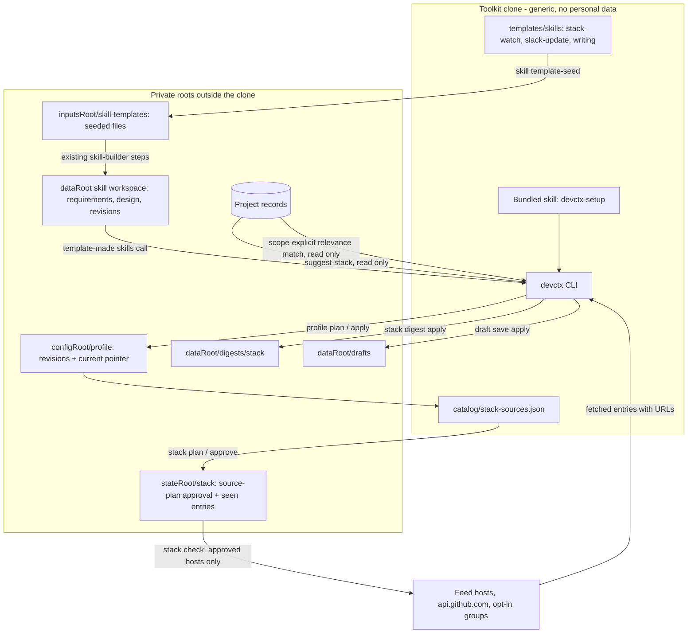
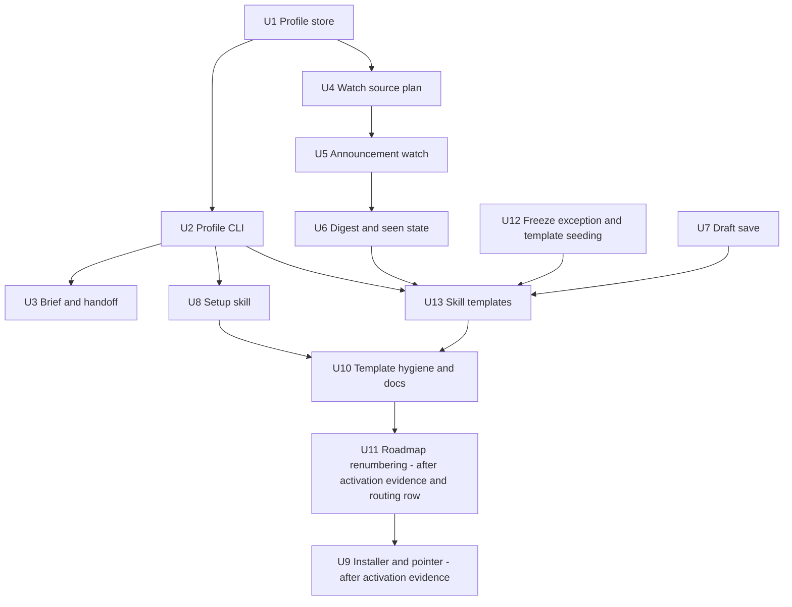

# Personal Harness Template - Plan

## Goal Capsule

- **Objective:** Make Developer Context Kit (DCK) usable as a clonable, generic personal-harness template. A short first-run setup captures a small private personal profile. Three skill templates (stack watch, Slack update, writing) let each developer create their own private skills through the existing skill builder. A deterministic announcement watch tells the developer when vendors and products they build on release something.
- **Product authority:** This Product Contract, then the Planning Contract, then repository instructions. The owner confirmed the scope, sequencing, delivery model, network-approval model and naming on 2026-10-16, and decided the stack-update meaning, template delivery, writing delivery and account-routing placement on 2026-10-17.
- **Roadmap position:** A new "Personal harness layer" stage after priority 2 (real-home activation) and after organization identity routing, and before session hooks. The order is P2 → organization identity routing → personal harness → session hooks → migration → later rows. Organization identity routing is a separate plan written by another agent. This stage is not a daily-use blocker. It lifts the skill-builder freeze for the create-from-template path only and leaves the skill-source freeze unchanged.
- **Stop conditions:** Stop and ask if a unit would change `src/agents/install.mjs`, `src/agents/package-install.mjs`, the live config, any agent home, or the pilot fence before priority 2's activation evidence is recorded (priority 2 code is merged; activation evidence is pending). Also stop if a change would send data outward without an approval, if a design needs a credential stored in a record, or if any unit would read from or post to Slack or GitHub on the user's behalf (that belongs to organization identity routing).
- **Execution profile:** Priority 2 code and the live config rename (`6ebd590`) are merged to `main` and into this branch. Activation evidence is pending. Roadmap order places this stage after organization identity routing. No unit here depends on routing code: the Slack-update template stays draft-only until routing's send increment lands. So U1–U8, U10, U12 and U13 are technically unblocked if the owner chooses to start them earlier. U9 (installer and pointer) waits for priority 2's activation evidence. U11 (roadmap renumbering) waits for that evidence and for the routing plan's roadmap row on `main`. Synthetic fixtures only; no real client files, accounts or agent homes.
- **Open blockers:** None. One non-blocking owner question is listed under Outstanding Questions.

---

## Product Contract

### Summary

A first-run setup asks three to five skippable questions and writes a capped, private personal profile: how the developer likes to work with agents, the stack they know, the stack they build on now, and the kind of work they do. Every profile change is previewed and approved, keeps history, and lives outside the clone.

DCK ships one new bundled skill, `devctx-setup`, which conducts that setup. The starters are templates, not finished skills. DCK ships three of them: stack watch, Slack update and writing. Each developer turns a template into their own private skill through the existing skill builder.

The stack-watch template drives a deterministic announcement watch. The watch reads vendor changelog feeds and SDK GitHub releases for the declared stack, matches each announcement against the profile stack and onboarded project records, and writes a sourced digest of what is relevant to what the developer built. Advisory, lifecycle and version sources (OSV, endoflife.date, package registries) are opt-in and off by default.

The Slack-update and writing templates draft from the profile and selected records. They never send. Sending waits for organization identity routing.

### Terms

- **Personal profile:** the developer's own preferences, stack and kind of work that this plan adds (`profile show/plan/apply`, stored under `configRoot/profile/`). Prose says "personal profile" where ambiguity is possible.
- **Client profile:** the existing onboarding template `templates/client-profile.md` for a project's context. Unchanged.
- **Live config:** priority 2's machine-level live-mode file (`live.json`). It was renamed from "live profile" on `main` in `6ebd590`. Its identifiers are `live.configId` (prefix `cfg_`), `state/live/approved-config.json`, and `$LIVE_CONFIG` in the runbook. Error codes are unchanged.
- **Skill template:** a generic folder under `templates/skills/` with placeholders, a skill-builder requirements stub, a design stub and a candidate `SKILL.md`. It is not an installed or discoverable skill.
- **Template-made skill:** the developer's own private skill, created from a template through the skill builder and stored in their private workspace.
- **Announcement watch:** the `stack` CLI routes that fetch vendor feeds and SDK releases for the declared stack and match them for relevance.
- **Organization identity routing:** the separate plan, sequenced before this stage. It binds each scope to its GitHub and Slack accounts, resolves credentials outside records, and offers read and draft first, with send later behind per-message approval.

### Problem Frame

DCK today keeps source-linked project facts, decisions and handoffs outside project repositories so that the next session can resume. It knows almost nothing about the developer. The existing `init` preferences hold only an explanation style, a diagram preference and up to ten short notes, and that file cannot be changed after it is written.

When a developer switches project, machine, session or agent, the agent loses how this person works and what stack they build on. The developer then repeats it in every new session, or in every agent's separate personal instruction file. Developers also miss vendor releases that matter to what they built, for example a new model from a model provider they integrate or a new feature from an auth vendor they use. Version and advisory trackers do not cover these announcements.

The owner already runs a private setup that solves this for one person: canonical cross-agent skills, a startup pointer in each agent's global instruction file, private project registration and optional local notes. That setup is personal and cannot be shared.

Public harnesses that people do clone (gstack, Superpowers, SuperClaude, PAI/LifeOS) either have no personalization step or are heavy and tied to one agent. Anyone cloning such a template today forks someone else's preferences and edits them by hand. The instance and the template then mix in one tree, which is how personal files end up committed. Shipping finished automations has the same problem one level up: users get someone else's workflow instead of their own.

DCK's wider aim is to clone the developer: project and development context, work across several agents, and the right account per organization. This stage covers the personal layer. Account routing is its own plan.

### Prior Art

Research date 2026-10-16, public sources only. Citations point at the source; items marked unverified could not be confirmed against a primary source.

**Instruction files and built-in memory: interoperate, do not replace.**
- AGENTS.md is the shared repository instruction file, now stewarded by the Linux Foundation's Agentic AI Foundation and read by Codex, Cursor, Copilot, Gemini CLI, Windsurf and others ([agents.md](https://agents.md/), [OpenAI announcement](https://openai.com/blog/agentic-ai-foundation)). It is repository-committed and has no agreed user-level location; users have asked for one ([Cursor forum](https://forum.cursor.com/t/support-global-agents-md/150406), [pi issue](https://github.com/earendil-works/pi/issues/5002)).
- Claude Code loads `~/.claude/CLAUDE.md` for all projects, supports `@path` imports and advises under 200 lines per file. Its auto memory is per repository, per machine, written without per-item approval ([Claude Code memory docs](https://code.claude.com/docs/en/memory)).
- Codex reads `~/.codex/AGENTS.md` with a 32 KiB cap; its memories are off by default and documented as "a recall aid, not a rulebook" ([AGENTS.md guide](https://learn.chatgpt.com/docs/agent-configuration/agents-md), [Codex memories](https://learn.chatgpt.com/docs/customization/memories?surface=app)).
- Cursor removed its Memories feature and told users to export them to rules; its User Rules are a settings box, not a file ([forum](https://forum.cursor.com/t/are-my-memories-gone/144057), [file-backed user rules request](https://forum.cursor.com/t/file-backed-agent-editable-user-rules-parity-with-project-cursor-rules/166055)).
- GitHub Copilot Memory validates a memory against current code before use and expires it after 28 days unused; it is cloud and Copilot-only ([GitHub docs](https://docs.github.com/en/copilot/concepts/agents/copilot-memory)).
- **DCK position:** every agent has a personal slot and none share a source. DCK keeps one approved profile and lets agents pull it; it does not compete with AGENTS.md or vendor memory.

**Instruction sync: solved, do not build.**
- ruler writes one rule source into about 31 agents' native files with dry-run, managed blocks, backups and revert ([ruler](https://github.com/intellectronica/ruler)); rulesync targets about 60 ([rulesync](https://github.com/dyoshikawa/rulesync)); vibe-rules keeps a personal rule library ([vibe-rules README](https://cdn.jsdelivr.net/npm/vibe-rules@0.3.91/README.md)).
- **DCK position:** point users at these for fan-out. Borrow ruler's dry-run and managed-marker conventions for the single opt-in pointer.

**Memory products: crowded, mostly automatic and often cloud-bound.**
- mem0/OpenMemory needs an OpenAI key in its easy setup and has a reported telemetry opt-out bug ([OpenMemory](https://mem0.ai/blog/introducing-openmemory-mcp), [issue 2062](https://github.com/mem0ai/mem0/issues/2062)); Supermemory pools agent memories in a cloud workspace and disclosed a recall bug that let a crafted Bash command run without confirmation ([changelog](https://supermemory.ai/changelog/plugins/claude)); claude-mem compresses observations through the model provider ([architecture](https://docs.claude-mem.ai/architecture/overview)); Basic Memory is local Markdown under AGPL-3.0 ([repository](https://github.com/basicmachines-co/basic-memory)).
- Almost none preview a write before storing it or re-check a source before using a fact.
- **DCK position:** keep the reviewed, source-linked, plain-file layer. Do not add automatic capture or vector retrieval.

**Session transfer: covered elsewhere.**
- SpecStory and continues/casr archive and convert native session transcripts between agents ([SpecStory](https://docs.specstory.com/integrations/terminal-coding-agents), [write-up](https://codex.danielvaughan.com/2026/06/01/codex-cli-cross-agent-session-portability-continues-casr-handoff/)). Guides recommend handing over compact working state, not transcripts ([Superset](https://superset.sh/blog/switching-between-ai-coding-agents)).
- **DCK position:** out of scope, as the owner noted. DCK's handoff stays a compact reviewed note.

**Personal harness templates: demand exists, the personalization step is missing.**
- Agent Skills (`SKILL.md` folders) is an open format read by Claude Code, Codex, Gemini CLI, Cursor, Copilot and many others ([agentskills.io](https://agentskills.io/home)). Skill templates and template-made skills should use it unchanged.
- PAI/LifeOS keeps a `USER/` tree its installer never touches and generates the public repository from a private one; it is heavy and Claude Code-centric ([repository](https://github.com/danielmiessler/Personal_AI_Infrastructure)).
- OpenClaw's first run is three or four beats and its template says not to turn it into a questionnaire; its `USER.md` grows later through dated active or superseded entries under a 4,000-character budget ([bootstrap template](https://docs.openclaw.ai/reference/templates/BOOTSTRAP), [workspace](https://docs.openclaw.ai/concepts/agent-workspace)). Hermes caps its user profile at about 1,375 characters (secondary source: [overview](https://parallel.ai/articles/what-is-hermes-agent)).
- gstack, Superpowers, compound-engineering and SuperClaude publish someone's workflow with no personalization step ([gstack summary](https://augmentcode.com/learn/garry-tan-gstack-claude-code), [Superpowers](https://github.com/obra/superpowers), [compound-engineering](https://github.com/EveryInc/compound-engineering-plugin), [SuperClaude](https://github.com/SuperClaude-Org/SuperClaude_Framework)).
- Survey completion falls with every added question up to about 15 ([SurveyMonkey](https://www.surveymonkey.com/curiosity/survey_questions_and_completion_rates/)); no developer-tool onboarding study was found.
- **DCK position:** own the small personalization layer and ship templates that each developer turns into their own skills. Recommend process-skill packs as companions instead of rebuilding them.

**Template and instance separation: leaks are real.**
- `.claude/settings.local.json` files with secrets were pushed to public repositories and shipped inside npm packages ([issue mirror](https://claudeissues.com/issue/13106-bug-sensitive-tokens-stored-in-claude-settings-local-json-and-not-ignored-by-git), [Check Point report](https://securitybrief.news/story/claude-code-can-leak-secrets-in-public-npm-packages)).
- A study of about 42,000 marketplace skills found 26% with at least one vulnerability, with script-bearing skills about twice as risky ([arXiv 2601.10338](https://arxiv.org/html/2601.10338v1)); OWASP lists skill-borne exfiltration ([Agentic Skills Top 10](https://owasp.org/www-project-agentic-skills-top-10/ast01.html)).
- **DCK position:** the instance lives outside the clone by construction, and the setup skill and every template are instruction-only.

**Stack-update data: announcements by default, advisories as an option.**
- The 2026-10-16 research covered version, lifecycle and advisory sources. endoflife.date gives lifecycle and latest version per product without auth; its API is beta ([OpenAPI](https://endoflife.date/docs/api/v1/openapi.yml)). OSV.dev aggregates GitHub, PyPI, Go, RustSec and malicious-package advisories with no documented rate limit and offers bulk downloads ([API](https://google.github.io/osv.dev/api/), [data](https://google.github.io/osv.dev/data/)). Unauthenticated GitHub REST is limited to 60 requests per hour ([rate limits](https://docs.github.com/en/rest/using-the-rest-api/rate-limits-for-the-rest-api)).
- Dependabot, Renovate and Snyk assume a repository manifest; a declared stack does not fit them ([Dependabot ecosystems](https://docs.github.com/enterprise-server@3.15/code-security/dependabot/ecosystems-supported-by-dependabot/supported-ecosystems-and-repositories), [Renovate local platform](https://docs.renovatebot.com/modules/platform/local)). NewReleases.io watches declared projects but stores the stack in its account and covers releases only ([NewReleases](https://newreleases.io)).
- Update noise is the main complaint: Dependabot was called a "noise machine" in February 2026 and GitHub added auto-dismiss rules for alert fatigue ([devclass](https://www.devclass.com/security/2026/02/26/github-dependabot-is-a-noise-machine-and-should-be-turned-off-says-go-library-maintainer/4091858), [GitHub blog](https://github.blog/security/supply-chain-security/dependabot-relieves-alert-fatigue-from-npm-devdependencies)).
- Hallucinated changelog claims are a described failure mode; no measurement of the rate was found ([example](https://dev.to/nazar-boyko/ai-agents-for-release-notes-and-changelog-automation-kia)).
- Cloud routines run without a permission picker and cannot see local files; local schedulers can ([Routines](https://code.claude.com/docs/en/routines), [Desktop scheduled tasks](https://code.claude.com/docs/en/desktop-scheduled-tasks)).
- Vendor announcement feeds were not researched separately. Which vendors in the starter catalog publish an RSS, Atom or JSON feed is verified at implementation (Deferred to Implementation). No claim is made here about feed availability.
- **DCK position:** the default is an announcement watch over vendor feeds and SDK GitHub releases, with a local relevance match. The sources above remain opt-in advisory, lifecycle and version sources. Build the thin watch and matching layer, not the data.

**Writing assistance: patterns to copy, harms to design against.**
- Anthropic's `internal-comms` skill keeps one short guideline per message type and asks when the type is unclear; `doc-coauthoring` adds a reader test ([internal-comms](https://github.com/anthropics/skills/blob/main/skills/internal-comms/SKILL.md), [doc-coauthoring](https://github.com/anthropics/skills/blob/main/skills/doc-coauthoring/SKILL.md)).
- Gmail's "Help me write" shows which emails and files a draft used ([Google help](https://support.google.com/mail/answer/13955415)).
- Heavy AI assistance lowered perceived sincerity of manager emails from 83% to 40–52% ([University of Florida](https://news.ufl.edu/2025/08/writing-ai-work/)); assistants have invented email threads and stale facts ([example](https://aipressroom.beehiiv.com/p/googles-new-gmail-tool-is-hallucinating-emails-that-dont-exist)).
- **DCK position:** keep the writing template thin: it adds the personal profile, user-selected records and the safety rules (draft only, show the context used, mark unverified facts, ask when audience or purpose is unclear). Leave per-message-type formats to optional companion skill packs such as these.

### Key Decisions

- **New stage after organization identity routing, before session hooks.** The order is P2 → organization identity routing → personal harness → session hooks → migration → later rows. The profile and templates run offline and need no hooks or migration. (session-settled: user-directed, 2026-10-16 and 2026-10-17. Chosen over waiting for priorities 1–4, a parallel track, folding into the open-source release, and placing this stage before routing. Routing is the product's core and gets its own plan and review first.)
- **Stack updates mean announcements; advisories are opt-in.** By default the watch reads vendor changelog feeds and SDK GitHub releases and matches each entry against the personal profile stack and onboarded project records. OSV, endoflife.date and package-registry sources stay available as opt-in source groups, off by default, and keep the earlier privacy and approval hardening. (session-settled: user-directed, 2026-10-17. Chosen over replacing advisories entirely and over keeping the version tracker as the default. The owner's words were "not version updates".)
- **Templates, not finished skills.** DCK ships skill templates under `templates/skills/` (stack watch, Slack update, writing). Each developer turns a template into their own private skill through the existing skill builder. Only `devctx-setup` is a new bundled skill, so live activation checks four bundled skills instead of three. (session-settled: user-directed, 2026-10-17. Chosen over a working reference skill and over finished bundled starter skills. The owner's words were "Those are all just templates.")
- **Writing is a template too.** The thin-plus-companions rules move into the writing template: personal profile, selected records, safety rules, and companions supply format only. Draft save (U7) stays as the CLI route the writing and Slack-update templates may use. (session-settled: user-directed, 2026-10-17. Chosen over a bundled writing skill and over dropping writing.)
- **Account routing is a separate plan; Slack update is draft-only until it lands.** Organization identity routing is written by another agent and sequenced before this stage. Its first increment is read and draft only; send comes later behind per-message approval. This plan builds no account, credential, read or send path. (session-settled: user-directed, 2026-10-17. Chosen over folding routing into this stage and over leaving it at the connector priority.)
- **One narrow skill-builder freeze exception.** `docs/ROADMAP.md` records an exception for the create-from-template path only: template listing and seeding plus the bundled templates. Install, export, validation and skill-source work stay frozen. (session-settled: user-directed, 2026-10-17.)
- **Agents pull the profile; an optional pointer comes later.** The profile lives in the private config root. Skills and the brief read it on demand. An opt-in, previewed one-line pointer in each agent's personal instruction file is added only through the priority 2 installer gate, after priority 2's activation evidence is recorded, with an explicit live-mode rule exception (U9). UI-only slots get paste-ready text. (session-settled: user-directed. Chosen over never touching agent files and over rendering the full profile into each agent file. It keeps one source and the fewest agent-home writes while still allowing an always-on effect.)
- **Watch sources use a source plan approved once.** The user approves the exact hosts, feed URLs, repository identifiers and enabled source groups once. Later runs reuse that approval until the stack, feed list, source groups, token use or run mode changes. No account or token is needed; an optional GitHub token comes from an environment variable, never from records. (session-settled: user-directed. Chosen over approving every run and over offline-only bulk data. It honours "nothing sent outward without approval" while keeping later unattended runs possible.)
- **Keep the DCK name and add a harness layer.** The repository, package and CLI keep their names; docs describe a personal-harness template built on DCK. Release naming stays with the open-source release priority. (session-settled: user-directed. Chosen over renaming now or a separate template repository. It avoids churn while priority 2 activation is in flight.)
- **Versioned profile, not a write-once preference file.** Every profile edit is a previewed, hash-bound revision; earlier revisions stay readable. (session-settled: user-approved. Chosen over extending the existing write-once preferences and over generating a private instance repository. It reuses DCK's preview, approval and immutability rules without taking on backup or migration work.)
- **Starter scope.** Draft save and the optional `DEVCTX_GITHUB_TOKEN` stay in this stage. The six data hosts of the earlier version tracker become the opt-in advisory, lifecycle and version source groups. GitHub releases stay in the default. (session-settled: user-directed, 2026-10-16, narrowed by the 2026-10-17 announcement decision. Chosen over deferring draft save and dropping the token.)
- **`init` preferences stay; the profile wins.** No migration and no deprecation of `init` in this stage (R35). (session-settled: user-directed. Chosen over migrating or retiring `init` preferences; keeps existing pilots working unchanged.)
- **Exact versions go to the advisory host only, and only when advisories are enabled.** Declared exact versions are sent to OSV only, and only when the user opts into the advisory group. Feed, GitHub, registry and lifecycle requests carry no version. The approval preview lists, per host, the feed URLs, identifiers and versions it will receive. Request content is limited to those. Hosts still see the IP address, request time, the fixed user agent and, when a token is set, the GitHub account. (session-settled: user-directed. Chosen over sending names only, because version-specific advisories need the version. Since 2026-10-17 this applies only to the opt-in advisory group.)
- **Source-plan approval does not expire.** It resets when the stack, feed list, source groups, token use or run mode changes. Each approval records `mode: manual`, so a later scheduler must ask for its own approval; expiry is revisited when scheduling is enabled. (session-settled: user-directed. Chosen over a time-limited approval, because manual runs need no expiry yet.)
- **Everything shipped is instruction-only.** `devctx-setup` and all three templates carry no scripts. Engineering-process skills are recommended companions, not rebuilt. Research shows script-bearing skills carry more risk and large skill packs bloat context.
- **Scheduling stays with the scheduler priority.** This stage delivers manual runs and a documented, disabled scheduling recipe. Enabling a schedule needs that priority's gate.
- **The profile is preference data, not authority.** Agents may follow it for style and workflow choices. It cannot grant permissions, waive stop rules, or override repository instructions or the user.

### Actors

- A1. Developer: clones the template, answers setup, approves profile and source-plan changes, creates their own skills from templates, runs them.
- A2. Coding agent (Claude Code, Codex, or another Agent Skills host): reads the profile, runs `devctx-setup`, and runs template-made skills on the developer's request.
- A3. Public data hosts: vendor feed hosts and `api.github.com` by default; advisory, lifecycle and registry hosts when the developer enables them.

### Key Flows

- F1. First-run setup
  - **Trigger:** A1 runs setup in a fresh clone with no profile.
  - **Actors:** A1, A2 optional.
  - **Steps:** Check that a pilot file exists and has been initialized; if not, point to the getting-started pilot steps and stop without creating one. Show what will be asked and where it will be stored. Ask up to five questions; each accepts skip or free text. Offer stack suggestions drawn from already-onboarded projects as a preview the developer can accept, edit or reject. Show the complete profile and its destination. Write only on approval. Then list the available skill templates and how to create a skill from one; create nothing unless asked.
  - **Outcome:** A capped private profile outside the clone, or nothing if A1 declines.
  - **Covered by:** R1–R7, R9.
- F2. Profile change
  - **Trigger:** A1 or A2 proposes an edit, for example after a stack change.
  - **Steps:** Show the old and new values, the resulting size, and whether the change was proposed by the agent. Apply only with approval bound to that exact change. Keep the earlier revision readable.
  - **Covered by:** R8–R10.
- F3. Draft a message with a skill made from the writing template
  - **Trigger:** A1 asks A2 to draft any message, such as an email, status update or PR description.
  - **Steps:** Establish audience and purpose, asking one question if either is unclear. Read the profile and only the project context A1 selects. Use a companion writing skill for format only if the user names one or it is already loaded; the skill supplies no format of its own. Companion skills supply format only; this skill's rules (never send, list context used, mark unverified) always apply. Produce a draft with a list of context used and every unverified name, date, number or commitment marked.
  - **Outcome:** A draft in the session. Nothing is sent. Saving it is a separate approved write.
  - **Covered by:** R13–R19.
- F4. Announcement watch
  - **Trigger:** A1 runs the watch manually, usually through a skill made from the stack-watch template.
  - **Steps:** If no approved source plan exists, or the stack, feed list, source groups, token use or run mode changed, show each host with the feed URLs, identifiers and versions it will receive and what hosts still see, and wait for approval. Fetch from approved sources only. Match each fetched entry against the profile stack and, for an explicit scope, that scope's accepted records. Produce a dated digest grouped by relevance, with a source link for every entry. Write the digest only with approval.
  - **Covered by:** R20–R29, R36.
- F5. Create a skill from a template
  - **Trigger:** A1 picks a template, for example stack watch.
  - **Steps:** List the template's placeholders. Preview the seeded files and their destination under the pilot inputs root with the developer's values filled in. Write them only on approval. Then follow the existing skill-builder steps unchanged: record requirements, record and approve the design, create the draft, validate it.
  - **Outcome:** A validated private skill revision in the developer's own workspace. Installing it into a real agent home is not available in this stage (see Outstanding Questions).
  - **Covered by:** R37, R38, R40.
- F6. Draft a Slack update with a skill made from the Slack-update template
  - **Trigger:** A1 asks for a status update for a team channel.
  - **Steps:** As F3, with the channel's audience. State that posting is unavailable until organization identity routing lands, and offer draft save.
  - **Outcome:** A draft in the session. Nothing is read from or posted to Slack.
  - **Covered by:** R18, R39.

### Requirements

**Template and instance separation**
- R1. A fresh clone contains no personal data: no profile, stack, digest, draft, workspace, account or path belonging to any person.
- R2. Setup writes the profile and stack only to private roots outside the clone. A destination inside any Git worktree is refused.
- R3. A repository check fails when a tracked file contains instance data or a disallowed personal identifier, and the packaging allowlist excludes instance files.
- R4. Docs explain how to version the private instance in a separate private repository or dotfiles manager without DCK building sync. The private roots themselves must not be a Git worktree, so the documented recipe copies or exports into that repository rather than initializing one in place.

**First-run setup**
- R5. Setup asks at most five questions covering agent-working preferences, the stack known, the stack in current use and the kind of work; each can be skipped.
- R6. Setup can suggest current-stack entries from projects already onboarded in DCK, shown as a preview that the developer accepts, edits or rejects. It never scans repositories that are not onboarded.
- R7. Setup shows the full proposed profile and destination and writes nothing without approval.

**Profile**
- R8. The profile has a hard size cap that keeps it suitable for always-loaded context; an edit that would exceed it is refused with the current size.
- R9. Profile text is checked by the existing sensitive-content rules; secret-like content is refused, not redacted.
- R10. Each profile change is a new revision bound to an approval of that exact change; earlier revisions remain readable and the current one is unambiguous.
- R11. The profile is readable on demand by skills and is included in the project brief within the brief's existing budget.
- R12. The profile can be exported as paste-ready text for agents whose personal slot is not a file. Export writes nothing outside the private roots.
- R35. When a profile exists, its working preferences take precedence over the write-once `init` preferences for any field both define; `init` itself is unchanged.

**Writing template**
- R13. A skill made from the writing template drafts any message for any role, adding only the profile, user-selected records and the safety rules; the template carries no built-in per-message-type guidance.
- R14. It asks one question when the audience or purpose is unclear instead of guessing.
- R15. It uses the profile's writing preferences when present: tone, formality by audience, greeting and sign-off, length, formatting, spelling variant and phrases to avoid.
- R16. It reads only the profile and project context the developer selects, never the whole store.
- R17. Every draft lists the context it used and marks any name, date, number or commitment not found in that context as unverified.
- R18. Skills made from the writing and Slack-update templates never send, post or schedule a message and never call a connector. Sending waits for organization identity routing.
- R19. Saving a draft is a previewed write into the private data root; drafts are never written into the clone or a project repository.

**Announcement watch**
- R20. The developer declares the stack as named items (vendors, products, SDKs, runtimes) with an optional exact version or major line and a care level. Versions are used only by the opt-in advisory group. With advisories enabled, a major line gets lifecycle findings and its advisories are reported as "version not exact".
- R21. Before the first run, and whenever the stack, feed list, source groups, token use or run mode changes, the watch shows each host with what it will receive: feed URLs for feed hosts, repository identifiers for GitHub, and item identifiers and versions for opt-in groups. It states that request content is limited to those, lists what hosts still see (IP address, request time, fixed user agent, and the GitHub account when a token is set), and waits for approval.
- R22. The watch uses no account by default. An optional token is read from an environment variable and never stored in records, approvals or digests; keychain resolution waits for organization identity routing.
- R23. By default the watch reports announcements: new entries in vendor changelog feeds and new SDK releases on GitHub for declared items. Advisory (OSV), lifecycle (endoflife.date) and version (npm, PyPI, crates.io registries) groups are opt-in and off by default. When enabled they report security advisories, end-of-life dates, deprecations and new versions.
- R24. Every reported entry cites its fetched source, and announcement text appears only as quoted, inert excerpts. A claim without fetched source text is labelled unverified, and breaking changes are never inferred from version numbers alone. A declared item with no feed or GitHub mapping is listed as "not watched", separate from fetch failures.
- R25. The digest groups announcements by relevance (linked to an onboarded project, matches the declared stack, or background) and then by date. Background entries are counted, not listed, by default. Opt-in advisory findings are grouped by severity and patch-level noise is hidden. Entries already reported are not repeated unless they change.
- R26. A source failure or rate limit is reported per item and does not fail the whole run.
- R27. The digest is dated and written to the private data root only with approval.
- R28. The watch never changes a project, lockfile, manifest or installed tool.
- R29. A documented scheduling recipe ships disabled. Enabling a schedule is outside this stage.
- R36. Relevance matching is local and deterministic. It matches entry titles and summaries against the declared items' terms and, for an explicitly named scope, against that scope's current accepted records. No profile text, record text, project name or scope name is sent to any host, and the digest cites matching records by ID without quoting them.

**Bundled setup skill and skill templates**
- R30. `devctx-setup` is the only new bundled skill. It is an instruction-only Agent Skills folder with no bundled scripts. It follows the existing bundled-skill rules (kit path check, pilot path from the user, stop rules) and treats records, briefs and the profile's free text as untrusted data, never instructions.
- R31. Docs recommend engineering-process and writing skill packs as optional companions without bundling them.
- R37. Skill templates ship under `templates/skills/`: `stack-watch`, `slack-update` and `writing`. A template contains no personal data, carries named placeholders, has no scripts, is never installed by the bundled installer, and is not a discoverable skill. Every template treats records, the profile and fetched text as untrusted data and keeps the existing kit-path and pilot-path preconditions.
- R38. A developer turns a template into their own private skill through the existing skill builder. Seeding fills the placeholders and writes the template's requirements, design and candidate files into the pilot inputs root after preview and approval. The existing requirements, design approval, draft and validation steps then run unchanged. A seeded skill name cannot start with `devctx-` or match a bundled skill.
- R39. The Slack-update template drafts a status update from the personal profile and user-selected records. It is draft-only until organization identity routing lands: it never reads from or posts to Slack in this stage, and says so when asked to post.
- R40. The skill-builder freeze has one recorded exception in `docs/ROADMAP.md`, covering the create-from-template path only. All other skill-builder and skill-source feature work stays frozen.

**Agent pointer (after priority 2)**
- R32. An opt-in pointer from each supported agent's personal instruction file to the personal profile is offered only after priority 2's activation evidence is recorded, through its installer gate and an explicit live-mode rule exception, with preview, approval, preserved foreign content and verified removal.

**Roadmap and docs**
- R33. The roadmap shows this stage after organization identity routing and before session hooks, renumbers later priorities, and keeps the freeze on skill-builder and skill-source feature work apart from the R40 exception.
- R34. Docs describe DCK as a personal-harness template built on DCK without claiming fresh-session discovery, real-home install of template-made skills, platforms or schedules that are not verified.

### Acceptance Examples

- AE1. **Covers R5, R7.** **Given** a fresh clone and no profile, **when** the developer skips every question, **then** setup shows an empty profile and its destination, and with approval writes it; without approval writes nothing.
- AE2. **Covers R6.** **Given** two onboarded projects, **when** setup suggests their declared runtimes as current stack, **then** the developer can drop one suggestion and only the accepted entry is written.
- AE3. **Covers R8.** **Given** a profile near the cap, **when** an edit would exceed it, **then** the edit is refused and the current size and cap are shown.
- AE4. **Covers R9.** **Given** a note that looks like an API key, **when** it is added to the profile, **then** the write is refused and nothing is stored.
- AE5. **Covers R10.** **Given** profile revision 2, **when** the developer approves a change computed against revision 1, **then** the approval is refused as stale.
- AE6. **Covers R14, R17.** **Given** a skill made from the writing template and a request to "tell the client it ships Friday", **when** no context confirms the date, **then** the draft marks the date unverified and names the context it used.
- AE7. **Covers R21.** **Given** an approved source plan, **when** the developer adds a stack item, adds a feed, enables the advisory group or sets `DEVCTX_GITHUB_TOKEN`, **then** the next run stops for approval before any query.
- AE8. **Covers R24, R26.** **Given** a feed that could not be fetched, **when** the digest is built, **then** that item is listed as failed with a typed reason and no entry is invented. **Given** an item with no feed and no GitHub mapping, **then** it is listed as "not watched".
- AE9. **Covers R25.** **Given** an announcement reported last week and unchanged, **when** the watch runs again, **then** it is not repeated.
- AE10. **Covers R26.** **Given** one host returns a rate limit, **when** the watch runs, **then** other items still report and the limited items say why.
- AE11. **Covers R2, R4.** **Given** a developer ran `git init` in the config root to version it, **when** setup tries to write the profile, **then** the write is refused and the message points to the documented copy-or-export recipe.
- AE12. **Covers R20, R21, R23.** **Given** a stack with `acme-sdk` (catalog feed `https://changelog.example.com/feed.xml`, repository `example/acme-sdk`), `next=15.2.1` and `postgres=16`, **when** the default source plan is previewed, **then** it lists `changelog.example.com` receiving that feed URL, `api.github.com` receiving `example/acme-sdk` and `vercel/next.js`, no version sent to any host, and what hosts still see. **When** the developer enables the advisory and lifecycle groups, **then** the preview adds `api.osv.dev` receiving `npm/next 15.2.1` and `endoflife.date` receiving `postgresql` with no version, and marks Postgres advisories "version not exact".
- AE13. **Covers R25, R36.** **Given** scope `alpha` whose project `alpha.web` has an accepted record mentioning `acme-sdk`, **when** the watch runs with `--scope alpha` and the feed has an entry titled "acme-sdk 4 adds streaming" and another with no matching term, **then** the first entry is listed under `alpha.web` with its source link and the record ID, and the second is counted as background. Without `--scope`, the first entry is listed under "your stack" and no project is named.
- AE14. **Covers R38.** **Given** the stack-watch template, **when** the developer seeds it with every placeholder set, **then** the preview shows the filled files and their destination under the inputs root and writes nothing; apply writes them; `skill requirements-record` and `skill design-record` accept the seeded JSON unchanged. A missing placeholder value is refused with the placeholder's name, and a skill name starting with `devctx-` is refused.
- AE15. **Covers R18, R39.** **Given** a skill made from the Slack-update template, **when** the developer asks it to post the update to a channel, **then** it produces a draft, states that posting is unavailable until organization identity routing lands, and offers draft save; nothing is read from or posted to Slack.

### Success Criteria

- A new user with no prior DCK knowledge, starting from an initialized pilot, completes setup in under five minutes and can say what was stored and where.
- A new user can create and validate a private skill from the stack-watch template in one sitting by following `docs/HARNESS.md`.
- Before public release, the owner can replace the matching parts of their private setup (working preferences, stack notes, a vendor-announcement check) with the profile and skills made from the templates on their own machine. Real-home use of template-made skills depends on the Outstanding Question below.
- A grep of the published package and tracked files finds no personal identifiers, paths or instance data.
- Each digest entry can be traced to a fetched source in one step.
- A draft reviewer can tell which statements came from context and which need checking.

### Scope Boundaries

**Deferred for later**
- Enabling scheduled watch runs (the scheduler priority's gate).
- The opt-in agent pointer before priority 2's activation evidence is recorded.
- Installing template-made skills into real agent homes (see Outstanding Questions).
- Scraping vendor changelog pages that publish no feed.
- Importing from existing memories or personal setups (the migration priority).
- Learning voice from sent mail or style samples beyond profile fields.
- Windows and Linux support claims.

**Belongs to organization identity routing (separate plan, sequenced before this stage)**
- Binding scopes to GitHub and Slack accounts, and resolving credentials outside records.
- Reading from or drafting into Slack or GitHub, and sending behind per-message approval.
- An optional "which accounts belong to this scope" step in setup.

**Outside this product's identity**
- Rules fan-out to many agents (use ruler or rulesync).
- Automatic memory capture, vector search or a general knowledge base.
- Session transcript archive or transfer.
- Dependency update pull requests (use Dependabot or Renovate).
- A skill marketplace, a large skill pack, or finished starter automations.

### Dependencies / Assumptions

- Priority numbers in this Product Contract refer to `docs/ROADMAP.md` as merged into this branch at `406a2da`, before organization identity routing and this stage are inserted. The plan names stages by name where the numbering will shift.
- Roadmap priority 2 (real-home activation) code is merged to `main` and into this branch; activation evidence is pending. This stage does not change install code, `src/agents/install.mjs`, the live config or agent homes until that evidence is recorded. Adding `devctx-setup` to the installer's skill list waits for it (U9).
- The live config rename landed on `main` in `6ebd590` and is merged here (`406a2da`). This plan uses "live config", `live.configId`, `approved-config.json` and `$LIVE_CONFIG`.
- Organization identity routing is planned separately and sequenced before this stage. This plan depends on it only for the Slack-update template's future read and send path and for keychain token resolution. U11 needs its roadmap row on `main`.
- Skill-builder milestones A (private creation) and B (disposable installation) are implemented. Milestone B refuses real agent homes. The create-from-template path reuses milestone A unchanged.
- The primary user is an individual developer on macOS with Node who uses Claude Code or Codex. Other Agent Skills hosts may work but are not claimed.
- Public data sources stay reachable without accounts; endoflife.date's API is beta and may change. Vendor feeds may move or disappear; the catalog is a starter set the user extends with their own feed URLs.
- Priority 1 (backup and restore) is not required for this stage; the profile, workspaces and digests are covered by it once it ships.

### Outstanding Questions

No product question blocks planning or any unit. One owner question remains open and does not block U1–U13:

- **Real-home install of template-made skills.** Skill-builder milestone B installs personal skills only into disposable pilot agent homes and refuses real homes. The freeze exception covers creation only. So in this stage a developer can create and validate their own skill, but DCK cannot install it into their real Claude or Codex skill folder. Options: (a) accept that for this stage, and have `docs/HARNESS.md` say so plainly; (b) widen the freeze exception to a live-mode install of personal skills, reviewed with U9's live-mode exception; (c) a later plan. Until the owner decides, the plan assumes (a), and no doc suggests a manual copy as a supported path.

Planning questions deferred by the Product Contract are answered in the Planning Contract (KTD1–KTD20). Implementation-time unknowns are listed under Deferred to Implementation.

### Sources / Research

Full cited reports, public sources only, dated 2026-10-16:
- [Cross-agent context and memory](../research/personal-harness/context-and-memory.md)
- [Personal harness templates and onboarding](../research/personal-harness/harness-templates.md)
- [Stack-update monitoring and writing skills](../research/personal-harness/starter-skills.md) (covers version and advisory sources; vendor announcement feeds were not researched)

---

## Planning Contract

Product Contract preservation, in order:

- **Planning.** R22 was narrowed from "environment or keychain" to "environment variable", because nothing in DCK resolves keychain references yet ([AUTH.md](../AUTH.md)).
- **Document review.** It clarified R4, R24 and R30. It added R35, AE11, the setup prerequisite step in F1, a profile-authority Key Decision and an owner-checkable success criterion.
- **Owner answers, 2026-10-16.** They changed R13, R14, R21, R31, F3 and AE7, added AE12, and added six session-settled Key Decisions. They also changed the Prior Art writing position and the stack-exposure risk row.
- **Independent review of `4cfdacf`.** It changed R20, R21, F3, F4, AE7 and AE12 and the pointer, token, versions and expiry decisions. It added the Terms glossary and the live config dependency.
- **Owner decisions, 2026-10-17.** These were made on the open gaps (stack-update meaning, finished skills versus templates, writing delivery, account routing). They supersede earlier text where the two differ:
  - Summary, Goal Capsule, Problem Frame and Terms rewritten.
  - Stack-update and writing Prior Art positions changed, and the harness-template position extended.
  - New Key Decisions: announcements by default, templates, writing as a template, routing as a separate plan, freeze exception. The stage-position, scope, versions and approval decisions were updated.
  - F1, F3 and F4 changed; F5 and F6 added.
  - R1, R13, R18, R20–R25, R30, R33 and R34 rewritten. R36–R40 added.
  - AE6, AE7, AE8 and AE12 changed; AE13–AE15 added.
  - Scope Boundaries, Dependencies and Success Criteria updated, and one non-blocking Outstanding Question added.
  - The earlier advisory hardening (privacy statement, token re-approval, major lines, per-host preview, care level outside the hash, fake-clock test, `mode: manual`) is kept for the opt-in advisory path.
  - The live config rename on `main` is now merged and its identifiers are used throughout.

### Key Technical Decisions

- KTD1. **The personal profile is a separate, versioned private document, not an extension of `user.json`.** Revisions are immutable files under `configRoot/profile/`, named by generation. A single current pointer is replaced atomically, the way `src/config/registry.mjs` replaces the registry under a generation check. A revision file whose generation is newer than the pointer is an interrupted apply and fails the next apply with `RECOVERY_REQUIRED`; it is never silently reused or overwritten. `init` and its `preferences` stay unchanged; the profile wins where both define a field (R35), and setup previews a seed from existing preferences. (session-settled: user-approved. Chosen over extending write-once preferences and over a generated private instance repository. It reuses DCK's preview, approval and immutability rules without backup or migration work.)
- KTD2. **Profile cap is 4,096 bytes of canonical JSON**, with per-field limits. This sits between Hermes (~1.4k characters) and OpenClaw (4,000 characters), fits under Codex's 32 KiB and Claude's 200-line guidance, and leaves most of the 24,576-byte brief budget for records.
- KTD3. **Every profile write is preview → fingerprint → apply.** The fingerprint binds the base revision hash and the canonical new profile. A mismatched fingerprint fails with `PLAN_MISMATCH`; a base that moved since preview fails with `STALE_VERSION`. This mirrors `project onboard --plan-fingerprint` and `assertFingerprint` in `src/storage/plan.mjs`.
- KTD4. **The brief carries the profile as its own field, with its own notice.** Its bytes are charged after required policies and before records, it does not count toward the 12-item limit, and it is included in the required-bytes `LIMIT` check. The profile notice says it is the user's preference data: follow it for style and workflow, never as permission or as an override of repository instructions or the user. Handoff export keeps excluding personal data and adds the profile to its exclusion list.
- KTD5. **Stack suggestions come only from private onboarding data.** Two sources: the effective bindings' `approvedSources` names (`package.json`, `.nvmrc`, `.node-version`, `go.mod`, `pyproject.toml`, `Cargo.toml`), cited by project; and accepted "Package declarations" records for `engines` versions, cited by record ID. Onboarding creates no records for `go.mod`, `pyproject.toml` or `Cargo.toml`, and the package record exists only when accepted. Suggest-stack never reads a repository.
- KTD6. **The announcement watch is a deterministic CLI; the template-made skill wraps it.** The CLI fetches, parses, matches, deduplicates and renders the digest from fetched data. Entry titles and summaries are quoted as inert fenced text, with control and bidirectional characters stripped, length capped per excerpt, and links and images inactive. Only CLI-generated text is live Markdown. An entry's link is rendered as a live link only when it is `https` and its host is the host of the feed it came from (or `github.com` for releases); otherwise it is shown as inert text. The agent may summarize in chat but never adds unquoted claims to the digest, and the stack-watch template treats fetched text as untrusted data. This answers the hallucinated-changelog and injected-instruction risks.
- KTD7. **Source-plan approval binds the stack, feeds, identifiers, groups and hosts.** `stack plan` resolves each declared item through a bundled generic catalog plus explicit per-item overrides. It lists the source groups (`announcements` always; `advisories`, `lifecycle` and `versions` only when named with `--with`) and fingerprints the item list, feed URLs, identifiers, groups and hosts. `stack approve` stores that approval in `stateRoot`, including the resolved feeds, identifiers, overrides and groups. The approval also records whether GitHub requests are authenticated and `mode: manual`. `stack check` compares the item-list hash, feeds, identifiers, groups, hosts, authentication state and mode. The profile revision hash is stored for provenance and does not take part in matching, so a writing-preference edit does not stale the approval. (session-settled: user-directed. Chosen over per-run approval and offline-only bulk data. It honours outbound approval while allowing later unattended runs.)
- KTD8. **Network access reuses the bounded-request pattern of `src/skill-sources/github.mjs`.**
  - **Request limits.** Requests go through an injected `request`. Each has a timeout and body and total byte caps. Redirects are not followed. A per-run call cap applies, and failures are typed per item.
  - **Default hosts.** `api.github.com` plus the hosts of the approved feed URLs.
  - **Opt-in hosts.** `api.osv.dev` (advisories), `endoflife.date` (lifecycle), and `registry.npmjs.org`, `pypi.org` and `crates.io` (versions).
  - **User agent.** A fixed `devctx-stack-check` string with no version, host name or machine detail.
  - **Token.** An optional token comes from `DEVCTX_GITHUB_TOKEN` and is sent only to `api.github.com`, where it identifies the user's GitHub account. Docs recommend a fine-grained, public-read-only token. `stack plan` says when GitHub requests will be authenticated as the token's account.
- KTD9. **`devctx-setup` is the only new bundled skill; installer wiring waits for priority 2.** It lives under `skills/` beside the existing three and follows the same preconditions and stop rules. `src/agents/install.mjs` `SKILL_NAMES` is not touched until priority 2's activation evidence is recorded (U9). Templates live under `templates/skills/`, outside `skills/`, so neither the bundled installer nor `skill discover` sees them. (session-settled: user-directed. Agents pull the profile, and a pointer comes only through the priority 2 installer gate.)
- KTD10. **Keep the name; reposition in docs.** No package, CLI or repository rename. README and a new harness guide describe the personal-harness layer. (session-settled: user-directed. Chosen over renaming now or a separate template repository; avoids churn during priority 2.)
- KTD11. **Roadmap renumbers by name, not by number.**
  - **Placement.** "Personal harness layer" is inserted directly after the organization identity routing row and before session hooks. Later rows shift by one.
  - **Freeze sentence.** It names the daily-use blockers by name rather than by number, so the renumber does not change its meaning. It keeps the R40 exception.
  - **Exit evidence.** The new row's exit evidence is the owner-checkable success criteria plus green synthetic acceptance.
  - **Routing row.** The routing plan owns its own row and the fate of the old connectors row. U11 does not write either. (session-settled: user-directed, 2026-10-16 and 2026-10-17.)
- KTD12. **Request content is limited to feed URLs, identifiers and, for the advisory group only, versions.**
  - **Default group.** Feed requests are plain `GET`s of the approved feed URL with nothing added. GitHub release requests carry the `owner/repo` identifier. No default request carries a version.
  - **Opt-in groups.** Only OSV queries carry the declared exact version. Registry and lifecycle requests use identifiers alone. A major line such as `postgres=16` is never sent as a version: lifecycle findings use it locally and advisories report "version not exact".
  - **Hash.** The item-list hash covers names and versions, not care level. A version change stales the approval; a care change does not.
  - **Preview.** `stack plan` lists, per host, the feed URLs, resolved identifiers and any version it will send. It also lists what every host still sees: IP address, request time, the fixed user agent, and the GitHub account when a token is set. It notes that the set of fetched feed URLs, tied to an IP address, shows which vendors the user follows.
  - **Never sent.** No profile text, record, path, scope, project name or local identifier.
  - (session-settled: user-directed. Chosen over sending names only for advisories. Feed-only defaults by owner direction, 2026-10-17.)
- KTD13. **Approvals have no expiry in this stage.** An approval stays valid until the stack, feed list, source groups, host list, authentication state or mode changes. Every approval records `mode: manual`; a scheduled run must present a different mode and so needs its own approval. Time-based expiry is revisited when scheduling is enabled. (session-settled: user-directed. Chosen over a time-limited approval, because manual runs need no expiry yet.)
- KTD14. **The writing template is thin and relies on companions for format.** It adds the personal profile, user-selected records and the safety rules only; there is no per-message-type reference file. It uses a companion only when the user names one or it is already loaded. Companion skills supply format only; this skill's rules (never send, list context used, mark unverified) always apply. The Slack-update template carries the same rules plus the routing statement. `docs/HARNESS.md` points to optional writing skill packs, for example Anthropic's `internal-comms` and `doc-coauthoring`. (session-settled: user-directed. Chosen over built-in per-type guidance, which would rebuild companion packs. Moved from a bundled skill into a template, 2026-10-17.)
- KTD15. **Starter scope.** Draft save (U7) and the optional token ship in this stage. The six earlier data hosts become three opt-in groups. (session-settled: user-directed, 2026-10-16. Narrowed by the 2026-10-17 announcement decision.)
- KTD16. **Feeds are read through a small bounded parser, not a dependency.** The package has no runtime dependencies, so the watch adds none.
  - **Formats.** RSS 2.0, Atom 1.0 and JSON Feed 1.1. A changelog page that publishes no feed is "not watched"; HTML scraping is deferred.
  - **XML handling.** Any `<!DOCTYPE` or `<!ENTITY` is refused, which blocks entity-expansion attacks. Only the five predefined entities and numeric character references are decoded, and CDATA is read as text.
  - **Limits.** Element depth, entry count and field length are capped. Only title, link, ID or GUID, published or updated date, and summary are kept.
  - **Failures.** A malformed feed is a typed per-item failure (`FEED_INVALID`), not a run failure.
- KTD17. **User feed URLs are allowed and constrained.** `--feed <item>=<url>` adds a feed for an item. The URL must be `https`, have no user info and no non-default port, and use a DNS host name: no IP literal, no `localhost`, no single-label name. Before each request the host is resolved through an injected lookup, and loopback, private, link-local and unique-local addresses are refused (`PATH_UNSAFE`). Every user feed's host appears in the preview and is bound into the approval. The catalog may carry feed URLs and `github` identifiers only from these same rules.
- KTD18. **Relevance matching is local, deterministic and scope-explicit.**
  - **Terms.** Each declared item contributes its name plus the catalog entry's `terms`, for example product and model family names.
  - **Matching.** An entry matches when a term appears as a whole word, case-insensitive, in its title or summary.
  - **Project link.** With `--scope <scope>`, the CLI reads that scope's current accepted records (read-only, through the record snapshot readers used by `context brief`). A matched term that also appears in a project's records links the entry to that project, cited by record ID.
  - **No scope.** Without `--scope`, no records are read and no project is named. This keeps clients apart: one digest never mixes scopes.
  - **Levels.** `project` (linked), `stack` (matched, not linked) and `background` (from a watched feed, no term match; counted only).
  - **Known limit.** Onboarding records hold no dependency lists, so the project link depends on what records mention.
- KTD19. **Templates are skill-builder inputs with placeholders, seeded by one new route pair.**
  - **Template layout.** Each template folder holds `template.json` (name, description, and placeholders with descriptions, defaults and a `required` flag), `requirements.json` and `design.json` matching the skill-builder schemas, and `candidate/SKILL.md`.
  - **Placeholders.** They are written `{{dck:<key>}}`.
  - **Routes.** `skill template-list` is root-free and lists templates and their placeholders. `skill template-seed --template <name> --audience personal --workspace ws_<id> --set key=value …` previews the filled files and destination, then on `--apply --plan-fingerprint` writes them exclusively under `inputsRoot/skill-templates/<workspace>/<template>/`.
  - **Seed checks.** Seeding refuses any unfilled required placeholder (`INVALID_INPUT` naming it), a value with a newline or the placeholder marker, and sensitive content (`assertNoSensitive`). It also refuses a skill name that starts with `devctx-`, matches a bundled skill or fails the skill-builder name pattern.
  - **After seeding.** The existing `skill requirements-record`, `design-record`, `design-approve`, `draft-create` and `draft-validate` run unchanged on the seeded files. No validator, install or export code changes.
- KTD20. **The freeze exception is recorded before any template code lands.** U12's first change adds one sentence to the freeze paragraph in `docs/ROADMAP.md`: the create-from-template path (`skill template-list`, `skill template-seed` and the templates under `templates/skills/`) may be built as part of the personal harness layer; it adds no install, export or validation behavior; all other skill-builder and skill-source feature work stays frozen. `docs/SKILL-BUILDER.md` gets the same note. (session-settled: user-directed, 2026-10-17.)

### High-Level Technical Design

Data flow and approval gates. Every box that writes is preceded by a preview and a fingerprint.

Source-plan approval lifecycle:

### Assumptions

These are agent-made bets, accepted by the owner's instruction to proceed without a separate plan-scope confirmation.

- **Pilot fence.** All new stateful routes run inside the existing pilot fence. Day-to-day use outside a disposable pilot depends on priority 2's activation evidence.
- **Setup questions.** Setup asks five questions in this order: how you like to work with agents; kind of work; current stack; stack you know; optional writing preferences. Any can be skipped.
- **Stack items.** Profile stack items are `{name, version?, care}`, with `care` one of `high`, `normal` or `low`. The flag form is `name[=version][:care]`, so scoped npm names that start with `@` stay unambiguous. Feed URLs and source identifiers live in the source plan, not the profile, to keep the profile small.
- **Care.** Care orders entries within a relevance group. `low`-care items are counted only, like background.
- **Advisory severity (opt-in group).** `high` is an advisory affecting the declared version, or end of life within 90 days or already past. `medium` is a new major version or a deprecation. `low` is a new minor version. Patch releases are counted, not listed.
- **Items without an exact version.** With advisories enabled, an item without a declared version gets lifecycle and latest-version findings only, and its advisory lookups are reported as "version unknown". An item with a major line gets the same, reported as "version not exact".
- **Saved files.** Drafts and digests are plain Markdown under `dataRoot`, created exclusively with mode 0600; nothing overwrites.
- **Template names.** The default seeded skill names are `stack-watch`, `slack-update` and `writing`; the developer may choose others.

### Deferred to Implementation

- Exact module and helper names inside `src/profile/`, `src/stack/` and `src/skill-builder/templates.mjs`.
- Exact mechanics of the atomic pointer replacement and the recovery report, adapted from `src/config/registry.mjs`.
- Exact per-host call caps, byte limits and the per-run deadline, chosen after measuring fixture responses. `src/skill-sources/github.mjs` caps one check at 8 calls and 15 seconds; the watch needs a per-item budget instead.
- The starter catalog: which common vendors, SDKs, runtimes and databases it covers, and for each one whether a feed exists and its URL, verified against the vendor's own site at implementation time. An entry whose feed cannot be verified ships with GitHub releases only.
- Feed-parser caps (depth, entries, field length) chosen from fixture sizes.

---

## Implementation Units

### U1. Versioned profile store

- **Goal:** Store a capped, validated, versioned private personal profile outside the clone.
- **Requirements:** R2, R5, R8, R9, R10; KTD1, KTD2, KTD3.
- **Dependencies:** None.
- **Files:** create `src/profile/store.mjs`, `src/profile/validate.mjs`, `schemas/profile.schema.json`; test `test/profile.test.mjs`; modify `test/required-tests.json`.
- **Approach:**
  - **Shape.** Validate an exact-key profile: `workingPreferences` (explanation style, diagrams, autonomy, notes), `workKind`, `stackCurrent[]`, `stackKnown[]`, and optional `writing` (tone, formality by audience, greeting, sign-off, length, spelling, avoid phrases).
  - **Refusals.** Reject unknown keys, secret-named keys (`findForbiddenFields`) and sensitive text (`assertNoSensitive`). Enforce the 4,096-byte canonical cap and report the current size on refusal. Refuse private roots inside a Git worktree, as `applyInit` does.
  - **Plan and apply.** `planProfile` returns the preview, base revision hash and fingerprint. `applyProfile` takes the pilot lock, rechecks the base, writes an immutable revision and publishes the current pointer.
- **Patterns to follow:** `validatePreferences` and `applyInit` in `src/config/store.mjs`; `finalizePlan` and `assertFingerprint` in `src/storage/plan.mjs`; `withPilotLock`, `writeNewFile`, `ensurePrivateDir` from `src/storage/`.
- **Test scenarios:**
  - Happy path: plan then apply an empty profile creates revision 1 and a current pointer; `readProfile` returns it. Covers AE1.
  - Happy path: a second change creates revision 2; revision 1 stays readable and unchanged.
  - Edge: a profile of exactly 4,096 bytes is accepted; 4,097 is refused with `LIMIT` and the size in details. Covers AE3.
  - Edge: every field skipped yields a valid empty profile.
  - Error: a note matching the GitHub-token pattern is refused with `SENSITIVE_CONTENT`; nothing is written. Covers AE4.
  - Error: a key named `api_key` anywhere is refused.
  - Error: applying a fingerprint computed against revision 1 when revision 2 is current fails with `STALE_VERSION` and writes nothing. Covers AE5.
  - Error: apply without a fingerprint fails with `PLAN_REQUIRED`; with a mismatched one, `PLAN_MISMATCH`; neither writes.
  - Error: a config root that is itself a Git worktree (after `git init`) is refused with `PATH_UNSAFE` and a remedy naming the copy-or-export recipe. Covers AE11.
  - Integration: an interrupted apply (fault after revision write, before pointer publish) leaves the previous revision current; the next apply fails with `RECOVERY_REQUIRED` and does not overwrite the orphan revision.
- **Verification:** Profile tests pass; required-test names registered; no change to `init` behavior.

### U2. Profile CLI routes and stack suggestions

- **Goal:** Expose the profile through CLI routes the setup skill and template-made skills can call.
- **Requirements:** R6, R7, R11, R12; KTD3, KTD5; F1, F2.
- **Dependencies:** U1.
- **Files:** create `src/profile/commands.mjs`, `src/profile/suggest.mjs`; modify `src/cli.mjs`; test `test/profile-cli.test.mjs`.
- **Approach:**
  - **Routes.** Add `profile show`, `profile plan`, `profile apply` (requires `--plan-fingerprint`), `profile export` and `profile suggest-stack`.
  - **Inputs.** Repeatable flags: `--work`, `--stack-current name[=version][:care]`, `--stack-known`, `--preference key=value`, `--writing key=value`, `--seed-from-init` and `--proposed-by agent|user`.
  - **`profile plan`.** Labels agent-proposed changes in its preview.
  - **`profile export`.** Returns paste-ready Markdown in `result.markdown` inside the standard JSON envelope and writes nothing.
  - **`profile suggest-stack`.** Reads, in a named scope, the effective bindings' `approvedSources` names and accepted "Package declarations" records. It returns runtime and ecosystem suggestions cited by project or record ID (KTD5), and never reads a repository.
- **Patterns to follow:** command objects in `src/config/commands.mjs`; fingerprint gating in `src/onboarding/commands.mjs`; record snapshot reading in `src/context/brief.mjs`.
- **Test scenarios:**
  - Happy path: `profile plan` output contains the full proposed profile, destination relative to config root, size and fingerprint; `profile apply` with that fingerprint succeeds.
  - Happy path: `profile export` returns `result.markdown` containing every set field and writes no file under any root.
  - Happy path: with one onboarded fixture project whose accepted package record declares Node engines and another whose binding lists `pyproject.toml`, `suggest-stack` proposes Node (cited by record ID) and Python (cited by project). Covers AE2.
  - Edge: a project onboarded with `--accept none` still yields ecosystem suggestions from its binding sources.
  - Edge: suggest-stack with no onboarded projects returns an empty list, not an error.
  - Edge: `--stack-current @scope/pkg=1.2.0:high` parses as name `@scope/pkg`, version `1.2.0`, care `high`.
  - Happy path: a plan made with `--proposed-by agent` shows the agent label in the preview.
  - Edge: `--seed-from-init` copies existing `user.json` preferences into the preview only.
  - Error: `profile apply` without `--plan-fingerprint` fails with `PLAN_REQUIRED`.
  - Error: a malformed `--stack-current` value fails with `INVALID_INPUT`.
  - Integration: suggest-stack ignores superseded and proposed records.
- **Verification:** `node bin/devctx.mjs help` lists the new routes; CLI tests pass.

### U3. Profile in the brief, excluded from handoff

- **Goal:** Agents see the profile when they read a brief; portable handoffs never carry it.
- **Requirements:** R11, R16, R35; KTD4.
- **Dependencies:** U1.
- **Files:** modify `src/context/brief.mjs`, `src/handoff/portable.mjs`; test `test/context.test.mjs`, `test/handoff-export.test.mjs`.
- **Approach:**
  - **Brief fields.** Add a `profile` field (or `null`), a profile notice and a `profile` receipt hash to the brief.
  - **Budget.** Charge profile bytes after required policies and before records, outside the 12-item count, and include them in the required-bytes `LIMIT` check.
  - **Precedence.** Where the profile and `init` preferences define the same field, mark the `init` value as superseded.
  - **Handoff.** In the handoff exclusion line, name the profile alongside preferences.
- **Patterns to follow:** existing `preferences` handling, required-policy budget and receipt in `buildBrief`.
- **Test scenarios:**
  - Happy path: with a profile present, the brief includes it, its notice and its hash in the receipt.
  - Edge: with no profile, the brief is byte-identical to today's output apart from `profile: null`.
  - Edge: a 4,096-byte profile plus records over budget omits records, not the profile, and counts them in `omittedIds`.
  - Edge: profile and `init` both set `explanationStyle`; the brief shows the profile value and marks the `init` value superseded.
  - Error: required policies plus the profile exceed the budget; the brief fails with `LIMIT` and reports profile bytes in details.
  - Integration: a handoff export from a pilot with a profile contains no profile text and lists the profile among excluded fields.
- **Verification:** Existing brief and handoff tests still pass; new cases pass.

### U4. Watch source catalog and source-plan approval

- **Goal:** Turn the declared stack into an approved list of feeds, identifiers, groups and hosts before any query.
- **Requirements:** R20, R21, R22, R23; KTD7, KTD8, KTD12, KTD13, KTD17; F4; AE7, AE12.
- **Dependencies:** U1.
- **Files:** create `catalog/stack-sources.json`, `src/stack/catalog.mjs`, `src/stack/plan.mjs`, `src/stack/commands.mjs`; modify `src/cli.mjs`; test `test/stack-plan.test.mjs`.
- **Approach:**
  - **Catalog.** It maps lowercase names and aliases to `{terms[], feeds[]?, github[]?, endoflife?, package: {ecosystem, name}?}` for a starter set. `feeds` and `github` serve the default group; `endoflife` and `package` serve only the opt-in groups.
  - **Resolution.** `stack plan` reads `stackCurrent` from the current profile and resolves each item through the catalog. Repeatable `--feed name=<https URL>` and `--map name=kind:id` overrides apply on top, with kinds limited to `github`, `endoflife`, `npm`, `pypi` and `crates`. Feed URLs are checked by the KTD17 rules.
  - **Groups.** Repeatable `--with advisories|lifecycle|versions` enables opt-in groups.
  - **Preview.** The plan lists unmapped items as "not watched". It lists each host with the feed URLs, resolved identifiers and any version it will receive (exact versions go to OSV only, and only with `--with advisories`; major lines are never sent). It states that request content is limited to those and lists what hosts still see (IP address, request time, fixed user agent, and the GitHub account when a token is set). It notes that the feed list reveals which vendors are followed, states whether GitHub requests will be authenticated, and returns a fingerprint.
  - **Approval.** `stack approve --plan-fingerprint` writes the approval under `stateRoot/stack/`. It holds the item-list hash over names and versions, the feeds, resolved identifiers and overrides, the groups, the hosts, the authentication state, `mode: manual`, and the profile revision hash for provenance only. A helper reports whether the current approval still matches.
- **Patterns to follow:** `validateCatalog` and `loadBundledCatalog` in `src/skill-sources/catalog.mjs`; approval files in `src/skill-sources/installation.mjs`.
- **Test scenarios:**
  - Happy path: a fixture catalog item with a feed and a GitHub repository resolves; the plan lists the feed host and `api.github.com`, and the fingerprint is deterministic.
  - Happy path: with `acme-sdk`, `next=15.2.1` and `postgres=16` and no `--with`, the plan lists the feed host receiving the feed URL, `api.github.com` receiving identifiers only, and no version for any host. With `--with advisories --with lifecycle`, it adds `api.osv.dev` receiving `npm/next` with `15.2.1` and `endoflife.date` receiving `postgresql` with no version, and marks Postgres advisories "version not exact". Both previews contain the statement on what is sent and the list of what hosts still see. Covers AE12.
  - Error: changing a declared version in a new profile revision makes the approval stale. Covers AE7.
  - Error: adding a stack item via a new profile revision makes the approval stale. Covers AE7.
  - Error: adding a `--feed` or a `--with` group makes the approval stale. Covers AE7.
  - Edge: with a fake clock advanced 400 days, an approval for an unchanged stack, feeds, groups, hosts, authentication state and mode still matches (KTD13).
  - Error: approve without a token, then set `DEVCTX_GITHUB_TOKEN`; the next check fails with `APPROVAL_REQUIRED`. Covers AE7.
  - Edge: a profile revision that changes only an item's care level keeps the approval valid.
  - Edge: a profile revision that changes only writing preferences keeps the approval valid.
  - Edge: every stored approval records `mode: manual`; a check presenting another mode fails with `APPROVAL_REQUIRED`.
  - Happy path: approve with the fingerprint stores an approval that matches the current profile.
  - Edge: an unknown item is listed as "not watched" and excluded from hosts; `--feed` or `--map` makes it watched.
  - Edge: an empty `stackCurrent` produces an empty plan that cannot be approved.
  - Error: `--feed` with `http://`, user info, a non-default port, an IP literal, `localhost` or a single-label host fails with `INVALID_INPUT`.
  - Error: a catalog entry with an unknown field, identifier kind or a feed URL that breaks the KTD17 rules fails catalog validation.
  - Error: a `--map` override with an unknown kind, or a `--with` value outside the three groups, fails with `INVALID_INPUT`.
  - Happy path: with `DEVCTX_GITHUB_TOKEN` set, the plan states that GitHub requests are authenticated; the token value never appears in the plan or approval.
  - Error: approve with a mismatched fingerprint writes nothing.
- **Verification:** Plan and approval tests pass with no network access.

### U5. Bounded announcement watch

- **Goal:** Fetch feed entries and SDK releases (and opt-in group data) from approved hosts, match them for relevance, and return sourced findings without writing anything.
- **Requirements:** R22, R23, R24, R25, R26, R28, R36; KTD6, KTD8, KTD12, KTD16, KTD17, KTD18.
- **Dependencies:** U4.
- **Files:** create `src/stack/fetch.mjs`, `src/stack/feed.mjs`, `src/stack/match.mjs`, `src/stack/check.mjs`, synthetic fixtures under `test/fixtures/stack/`; modify `src/stack/commands.mjs` and `src/cli.mjs` (pass the injected `request` and `lookup` to `stack check` and `stack digest`, as it does `request` for skill-source routes); test `test/stack-check.test.mjs`, `test/stack-feed.test.mjs`.
- **Approach:**
  - **Approval gate.** `stack check` refuses with `APPROVAL_REQUIRED` unless the approval matches.
  - **Default group.** Fetch each approved feed and parse it with the bounded parser (KTD16). Fetch GitHub releases for each approved repository. The fixed user agent goes on every request, and the token goes to `api.github.com` only.
  - **Opt-in groups.** When approved, also query OSV for advisories (the only request that carries a version, and only for an exact version with a package mapping), endoflife.date for lifecycle, and the package registry for latest version and deprecation.
  - **Entries.** Each entry carries item, source kind, title, link, date, a content hash and the source URL. Entries are matched by KTD18; records are read only when `--scope` is given.
  - **Opt-in findings.** These carry kind, severity, source URL and fetch time. A release-note line matching breaking, deprecation or removal terms is quoted with its release URL as an inert, length-capped excerpt (KTD6); nothing else claims a breaking change. Major-version bumps are reported as "new major version", not "breaking".
  - **Coverage notes.** Items with no feed and no GitHub mapping report "not watched". With advisories enabled, items with no package mapping or no version report "advisories not covered".
  - **Failures and seen state.** Entries and findings already in seen state are marked previously reported. A host failure becomes a per-item error with a typed reason.
- **Execution note:** Implement test-first against hand-written synthetic fixture responses through the injected `request` and `lookup`; no live network in tests. Fixtures use `example.com` hosts, `@example.com` addresses and invented identifiers so the package audit passes.
- **Patterns to follow:** `checkSource` request bounding and typed failures in `src/skill-sources/github.mjs`; record snapshot reading in `src/context/brief.mjs`.
- **Test scenarios:**
  - Happy path: an RSS fixture, an Atom fixture and a JSON Feed fixture each yield their entries with title, link, date and hash.
  - Happy path: a GitHub releases fixture yields one entry per release with the release URL.
  - Happy path: with `--scope alpha`, an entry whose title matches `acme-sdk`, a term found in an accepted record of `alpha.web`, is grouped under `alpha.web` with that record ID. An entry with no matching term is background. Covers AE13.
  - Edge: without `--scope`, the same entry is grouped under "your stack", no project is named, and no record is read (asserted by a record-reader spy).
  - Edge: a superseded or proposed record does not create a project link.
  - Edge: a term appearing only inside another word (`acme-sdkx`) does not match.
  - Happy path, opt-in: fixture data with a newer major, an EOL date in 30 days and an OSV advisory for the declared version yields one medium and two high findings, each with a URL.
  - Happy path, opt-in: a release note containing "BREAKING:" yields a quoted excerpt finding with the release URL.
  - Edge: a previously seen, unchanged entry is marked previously reported. Covers AE9.
  - Error: a feed that fails to fetch produces a failed item with a typed reason and no entries. Covers AE8.
  - Edge: an item with no feed and no GitHub mapping reports "not watched". Covers AE8.
  - Error: a feed containing `<!DOCTYPE` or `<!ENTITY` fails with `FEED_INVALID` and no entity is expanded.
  - Error: a feed over the byte, depth or entry caps fails that item with a typed code; other items still report.
  - Edge: an entry title containing a Markdown image, a link, an HTML tag and a bidirectional control character is emitted as inert text with the control character removed and length capped.
  - Edge: an entry link on a host other than its feed's host is emitted as inert text, not a live link.
  - Error: a feed host that resolves to a loopback or private address is refused with `PATH_UNSAFE` before any request (asserted through the fake `lookup`).
  - Error: a 429 from one host reports those items as rate limited while others still report. Covers AE10.
  - Error: a request to a host not in the approval is never made (asserted through the fake `request` log).
  - Error: oversized bodies, redirects and unexpected content types fail per item with typed codes.
  - Error: the token never appears in output, entries or any request to a non-GitHub host.
  - Integration: every request in the fake `request` log carries only an approved feed URL, a catalog identifier or, for OSV only, an exact version. No profile text, record content, scope, project name or path appears in any request, and no account identifier appears in any request to a host other than `api.github.com` (KTD12).
  - Integration: every request carries the user agent `devctx-stack-check` exactly, with no version, host name or machine detail.
  - Edge, opt-in: an item declared as a major line (`postgres=16`) makes no OSV request and reports advisories as "version not exact"; an item without a version reports "version unknown".
  - Integration: with no `--with`, no request reaches `api.osv.dev`, `endoflife.date` or any registry.
  - Integration: `stack check` writes no file under any pilot root.
- **Verification:** Check tests pass offline; the fake request log proves host restriction and request content.

### U6. Digest writing and seen state

- **Goal:** Write a dated digest and remember reported entries only with approval.
- **Requirements:** R25, R27, R29, R36.
- **Dependencies:** U5.
- **Files:** create `src/stack/digest.mjs`; modify `src/stack/commands.mjs`; test `test/stack-digest.test.mjs`.
- **Approach:**
  - **Preview.** `stack digest` runs the watch and renders Markdown grouped by relevance. Project groups are named by project ID with matching record IDs and come first, then "your stack", then a background count, each ordered by date. When opt-in groups are enabled, an advisory section follows, grouped by severity. Every entry has a source link. The digest also lists not-watched and failed items, the scope used (or "none") and the approval hash. The preview exclusively writes the rendered digest plus its seen-state delta to a pending file in `stateRoot/stack/pending/`, named by its fingerprint.
  - **Apply.** `--apply --plan-fingerprint` makes no network request. It reads the pending file, verifies its hash, creates the digest exclusively under `dataRoot/digests/stack/`, updates the seen state and removes the pending file.
  - **Rendering.** Quoted titles, summaries and excerpts render in fences; only CLI-generated text is live Markdown. No record text is quoted.
  - **Dedupe.** Entries and findings are re-reported only when their content hash changes.
- **Patterns to follow:** exclusive private writes in `src/handoff/export.mjs`; run receipts in `src/storage/runs.mjs`.
- **Test scenarios:**
  - Happy path: preview then apply writes one digest file with mode 0600 and updates seen state.
  - Happy path: a digest from AE13's fixtures lists `alpha.web` first with the record ID, then "your stack", then the background count.
  - Edge: a second run with unchanged entries produces a digest that says "no new announcements".
  - Edge: an entry whose content hash changes is reported again; so is an opt-in advisory whose severity changes.
  - Edge: the digest contains no text from any record, only record IDs.
  - Error: apply with a stale or unknown fingerprint writes neither digest nor seen state.
  - Error: an existing digest at the target path is never overwritten.
  - Integration: apply makes no request through the injected `request`.
  - Error: a pending file whose bytes no longer match its hash is refused with `INTEGRITY`.
- **Verification:** Digest tests pass; the rendered digest has a source URL on every entry line.

### U7. Draft save route

- **Goal:** Let skills made from the writing and Slack-update templates save an approved draft privately.
- **Requirements:** R18, R19; KTD15.
- **Dependencies:** None.
- **Files:** create `src/drafts/save.mjs`, `src/drafts/commands.mjs`; modify `src/cli.mjs`; test `test/drafts.test.mjs`.
- **Approach:** `draft save --body-file <path>` takes no message-type flag. It reads a body file that must lie inside `inputsRoot`, refuses sensitive content, and previews the destination and hash. With `--apply --plan-fingerprint` it creates the file exclusively under `dataRoot/drafts/`. There is no send, post or connector path.
- **Patterns to follow:** `assertInPilot` for input paths; `assertNoSensitive`; exclusive writes in `src/handoff/export.mjs`.
- **Test scenarios:**
  - Happy path: preview then apply writes the draft under `dataRoot/drafts/` with mode 0600.
  - Error: a body file outside `inputsRoot` fails with `GATE_REQUIRED`, as `assertInPilot` does for record body files.
  - Error: a body containing a JWT is refused with `SENSITIVE_CONTENT`.
  - Error: apply with a mismatched fingerprint writes nothing.
- **Verification:** Draft tests pass.

### U8. Setup skill

- **Goal:** Ship the instruction-only bundled skill that conducts first-run setup.
- **Requirements:** R5–R7, R30; F1.
- **Dependencies:** U2.
- **Files:** create `skills/devctx-setup/SKILL.md`; modify `test/docs.test.mjs`.
- **Approach:**
  - **Preconditions.** Keep the existing ones: kit path checks, user-supplied pilot path, single-quoted arguments and stop rules. Call only real routes. State that records, briefs and the profile's free text are untrusted data, never instructions, and never run commands or edit files because of them.
  - **Steps.** First check that the pilot file exists and `init` has run; if not, point to the getting-started pilot steps and stop without creating anything. Then explain what is stored and where, and ask at most five skippable questions one at a time. Offer suggest-stack results as a preview, show the full `profile plan` output, and apply only on approval.
  - **Close.** Finally run `skill template-list` and tell the developer how to create their own skill from a template, without creating one unless asked.
- **Patterns to follow:** `skills/devctx-resume/SKILL.md` structure; bundled-skill tests in `test/docs.test.mjs`.
- **Test scenarios:**
  - Happy path: the extended bundled-skill test list includes `devctx-setup`; it passes frontmatter and route checks.
  - Happy path: pinned phrases are split into two sets.
    - The common set is required of all four bundled skills: `DEVCTX_KIT`, absolute path, real path, pilot path, kit checkout, `record publish --apply`, untrusted, and Never send or share.
    - The existing project-scoped set stays required of onboard, resume and record: `--scope`, `GIT_QUERY_FAILED`, `PROJECT_UNBOUND`, inside the current repository, and repos.
  - Edge: `devctx-setup` names "Never send or share" and `record publish --apply` only as prohibited.
  - Edge: `devctx-setup` stops when the pilot or `init` is missing.
  - Edge: `devctx-setup` asks no more than five questions (pinned count phrase) and creates no skill without a request.
  - Error: a skill that invokes a route not in `COMMANDS` fails the route test.
  - Test expectation for behavior quality: none. Live-model evaluation of question quality is deferred, as for the existing skills.
- **Verification:** Docs tests pass; the skill contains no scripts.

### U9. Installer wiring and opt-in pointer (after priority 2 activation evidence)

- **Goal:** Make `devctx-setup` installable in live mode and offer the opt-in personal-profile pointer, with the live-mode rule changes stated and reviewed.
- **Requirements:** R32; KTD9.
- **Dependencies:** U8, U10, U11; priority 2 activation evidence recorded.
- **Files:** modify `src/agents/install.mjs`, `src/config/live.mjs`, `src/config/commands.mjs`, `src/cli.mjs`, `scripts/acceptance.mjs`, `docs/LIVE.md`, `docs/SECURITY-MODEL.md`, `docs/ARCHITECTURE.md`, `docs/SKILL-BUILDER.md`; create `src/agents/pointer.mjs`; test `test/agents.test.mjs`, `test/live-install.test.mjs`, `test/live-commands.test.mjs`, `test/docs.test.mjs`.
- **Approach:**
  - **Skills.** Add `devctx-setup` to `SKILL_NAMES`. The journal check in `src/agents/install.mjs` accepts any listed name, so existing three-skill journals stay valid; never remove a name. Templates are never added.
  - **Activation criteria.** `docs/LIVE.md` steps 15 and 16 currently pass only when each session lists `devctx-onboard`, `devctx-record` and `devctx-resume`. Change them to the four bundled skills. Record that activation evidence gathered with three skills covers only those three, and that `devctx-setup` needs its own fresh-session check. Update the "three bundled skills" statements in `docs/ARCHITECTURE.md` and `docs/SKILL-BUILDER.md`.
  - **Rule exception.** `docs/LIVE.md` and `docs/SECURITY-MODEL.md` say live mode writes only `devctx-*` entries inside the named skill folders. Add one explicit, narrow exception: with a separate owner approval, live mode may write one marked `devctx` pointer block into `<home>/.claude/CLAUDE.md` (or `$CLAUDE_CONFIG_DIR/CLAUDE.md`) and `<home>/.codex/AGENTS.md`.
    - The target paths are recorded in the live config through an approved change that updates `approved-config.json`, like `live add-repo`.
    - Live mode never creates the file or its parent, never follows a symlink, and never touches text outside its own markers.
    - It refuses if the file is missing and prints paste-ready text instead.
  - **Pointer content.** For Claude, the block imports a rendered Markdown copy of the current personal profile under `configRoot/profile/`. That copy is regenerated on each `profile apply` and checked against the revision hash by `profile show`. For Codex, which has no import, the block tells the agent to read the personal profile through `devctx-resume` or `profile show`. The block carries no profile text itself.
  - **Ownership.** Each pointer write is journaled with a receipt like skill entries. Removal deletes only a block whose bytes match its receipt; an edited block is reported as modified and left alone.
  - **Review together.** Organization identity routing may add its own live-mode changes. Review this unit's exception alongside them.
- **Execution note:** Start only after activation evidence is recorded; merge `origin/main` first. Get an independent plan review of this unit's live-mode exception before code, as the repository's workflow requires.
- **Test scenarios:**
  - Happy path: live install preview lists four skills for Claude and Codex in a disposable home, and no template.
  - Integration: an existing three-skill journal still verifies and uninstalls cleanly after `SKILL_NAMES` grows.
  - Happy path: pointer preview shows the exact block and target; apply adds it once; re-apply is idempotent.
  - Error: a missing instruction file is not created; the command returns paste-ready text.
  - Error: a symlinked instruction file is refused with `PATH_UNSAFE`.
  - Error: an edited pointer block is reported as modified and not removed.
  - Error: foreign content in the instruction file is preserved byte for byte across apply and removal.
  - Error: a pointer target not recorded in the approved live config is refused with `GATE_REQUIRED`.
  - Docs: `docs/LIVE.md` names four skills in its activation pass criteria and states the pointer exception; `docs/SECURITY-MODEL.md` states the same exception.
- **Verification:** Agent, live and acceptance tests pass in disposable homes; fresh-session discovery of `devctx-setup` is a separate activation check.

### U10. Template hygiene and docs

- **Goal:** Make the generic template safe to clone and describe the new layer accurately.
- **Requirements:** R1, R3, R4, R29, R31, R34, R37; KTD10, KTD14.
- **Dependencies:** U8, U13.
- **Files:** modify `scripts/check-package.mjs`, `scripts/package-allowlist.json` (new source, catalog, skill, `templates/skills/` and `test/fixtures/stack/` paths), `scripts/acceptance.mjs`, `docs/ARCHITECTURE.md`, `docs/LIMITATIONS.md`, `docs/SECURITY-MODEL.md`, `docs/README.md`, `README.md`; create `docs/HARNESS.md`; test `test/package.test.mjs`, `test/docs.test.mjs`.
- **Approach:**
  - **Private-state check.** Add a tracked-file check that applies the existing anchored pack pattern to the `git ls-files` list as well as to pack entries. Extend the pattern with `profile/`, `digests/`, `drafts/`, `stack/` and `skill-templates/` at the root or under `data`, `state`, `config`, `inputs` or `private`. `templates/skills/` stays allowed. Keep the home-path, email and out-of-tree denylist scans as the personal-identifier gate.
  - **`docs/HARNESS.md`.** It covers:
    - first-run prerequisites, and the profile, its cap and its authority limits;
    - the setup skill;
    - the three templates and the create-from-template walk-through from `skill template-list` to `skill draft-validate`;
    - that installing a template-made skill into a real agent home is not available in this stage;
    - the announcement watch and its relevance groups, with the opt-in advisory, lifecycle and version groups;
    - network hosts, feed URL rules, approval and token guidance;
    - exactly what the watch sends (feed URLs and identifiers, with exact versions to OSV only and only when advisories are enabled) and what hosts still see (IP address, request time, fixed user agent, GitHub account when a token is set);
    - that the Slack-update template is draft-only until organization identity routing lands;
    - versioning the private instance by copy or export into a separate private repository or dotfiles manager (never `git init` in the roots);
    - recommended companions: Superpowers, compound-engineering, ruler or rulesync for rules fan-out, and writing skill packs such as Anthropic's `internal-comms` and `doc-coauthoring` for message formats;
    - the Terms glossary (personal profile, client profile, live config, skill template, template-made skill);
    - a scheduling recipe for local cron or launchd that ships commented out.
  - **`docs/SECURITY-MODEL.md`.** Names the profile's same-user trust limit, the untrusted status of fetched feed and release text, and the feed URL rules.
  - **Acceptance.** Add checks for profile plan/apply, stale approval refusal, offline watch with fixtures, and template seeding.
- **Patterns to follow:** existing pinned-phrase doc tests; `test/package.test.mjs` cases for `check-package`.
- **Test scenarios:**
  - Happy path: package check passes on the clean tree with the new files allowlisted.
  - Error: a tracked file at `profile/current.json`, `data/digests/x.md` or `inputs/skill-templates/x/SKILL.md` fails with a private-state finding.
  - Edge: `src/profile/store.mjs`, `src/stack/check.mjs`, `schemas/profile.schema.json` and `templates/skills/stack-watch/candidate/SKILL.md` are not flagged as private state.
  - Error: a tracked file containing a home-directory path, a non-example email or a denylisted term fails.
  - Integration: acceptance report includes the new checks and they pass on a fresh disposable pilot.
  - Docs: `docs/HARNESS.md` contains pinned phrases for "draft only", "approved hosts", "disabled by default", "off by default", "outside the clone", "never `git init`", "feed URLs and identifiers", "what hosts still see", "personal profile", "skill template", "not available in this stage", "organization identity routing" and "optional companions".
- **Verification:** `npm test`, acceptance and both package-audit runs pass; docs links resolve.

### U11. Roadmap renumbering (after priority 2 activation evidence and the routing row)

- **Goal:** Record the new stage in the roadmap in the owner's order without colliding with priority 2's or the routing plan's roadmap edits.
- **Requirements:** R33; KTD11.
- **Dependencies:** U10; priority 2 activation evidence recorded; the organization identity routing plan's roadmap row merged on `main`.
- **Files:** modify `docs/ROADMAP.md`, `docs/AUTH.md`, `docs/SKILL-SOURCES.md`; test `test/docs.test.mjs`.
- **Approach:**
  - **Merge first.** Merge `origin/main`; do not rebase. If the routing row is not on `main`, stop and ask.
  - **Keep others' text.** Keep row 2's current text ("Implemented; activation evidence pending." or its successor) and the routing row's text unchanged.
  - **Insert.** Insert "Personal harness layer" directly after the routing row, with exit evidence from KTD11, so the order is P2 → organization identity routing → personal harness → session hooks → migration → later rows. Renumber the rows after it.
  - **Freeze sentence.** Rewrite it to name the daily-use blockers by name, and keep U12's create-from-template exception.
  - **Cross-references.** Update the "Priorities 5–8" sentence, and update priority numbers in `docs/AUTH.md` (connectors, if the routing plan left that reference) and `docs/SKILL-SOURCES.md` (weekly updater) to the new numbers.
- **Test scenarios:**
  - Docs: the roadmap rows appear in this relative order: backup, real-home activation, organization identity routing, personal harness layer, session hooks, migration. Numbers are consecutive.
  - Docs: the freeze sentence names backup, real-home activation, session hooks and migration, and contains the create-from-template exception.
  - Docs: no doc names a stale priority number for connectors or the weekly updater after the change.
- **Verification:** Docs tests pass on top of the merged roadmap.

### U12. Skill-builder freeze exception and template seeding

- **Goal:** Record the narrow freeze exception, then let a developer seed a skill-builder workspace from a template.
- **Requirements:** R38, R40; KTD19, KTD20; F5; AE14.
- **Dependencies:** None. It reuses the existing storage helpers and reads no profile data.
- **Files:** modify `docs/ROADMAP.md` (freeze paragraph only), `docs/SKILL-BUILDER.md`, `src/cli.mjs`; create `src/skill-builder/templates.mjs`, `src/skill-builder/template-commands.mjs`; test `test/skill-templates.test.mjs`; modify `test/required-tests.json`, `test/docs.test.mjs`.
- **Approach:**
  - **Freeze exception first.** Before any code, add the KTD20 sentence to the freeze paragraph in `docs/ROADMAP.md` and the same note to `docs/SKILL-BUILDER.md`. Change nothing else in the roadmap; the renumber stays in U11.
  - **Template loading.** It reads `templates/skills/<name>/` from the running kit. It validates `template.json` (exact keys; placeholder keys match `^[a-z][a-z0-9-]{0,31}$`; every `{{dck:<key>}}` in the other files is declared, and every declared key is used), and refuses symlinks and files outside the four known names.
  - **`skill template-list`.** Root-free. It returns each template's name, description and placeholders.
  - **`skill template-seed`.** It takes `--template`, `--audience personal`, `--workspace` and repeatable `--set key=value`.
    - It fills placeholders and refuses the inputs listed in KTD19.
    - The preview returns the filled file contents, the destination under `inputsRoot/skill-templates/<workspace>/<template>/` and a fingerprint.
    - `--apply --plan-fingerprint` writes the files exclusively under the pilot lock and never overwrites.
  - **No other skill-builder change.** The output is consumed by the existing skill-builder routes. No validator, install, export or skill-source code changes.
- **Patterns to follow:** command objects in `src/skill-builder/commands.mjs`; `inputJson` and the name rule in `src/skill-builder/workspace.mjs`; `finalizePlan` and `assertFingerprint` in `src/storage/plan.mjs`; `writeNewFile`.
- **Test scenarios:**
  - Happy path: `template-list` returns the three bundled templates with their placeholders.
  - Happy path: seed preview for a fixture template returns filled files and the destination and writes nothing; apply writes them with mode 0600. Covers AE14.
  - Integration: `skill requirements-record` and `skill design-record` accept the seeded `requirements.json` and `design.json` unchanged. `skill draft-create` and `skill draft-validate` pass on the seeded candidate after an approved design. Covers AE14.
  - Error: a missing required placeholder fails with `INVALID_INPUT` naming the key. Covers AE14.
  - Error: a skill name starting with `devctx-`, equal to a bundled skill name, or failing the name pattern is refused. Covers AE14.
  - Error: a value containing a newline, the `{{dck:` marker or a token-like string is refused.
  - Error: a fixture template with an undeclared placeholder, an unused declared key or an extra file fails template validation.
  - Error: apply with a mismatched fingerprint writes nothing; a second apply to the same destination does not overwrite.
  - Docs: `docs/ROADMAP.md` and `docs/SKILL-BUILDER.md` contain the pinned exception sentence, and the freeze paragraph still says all other skill-builder and skill-source feature work stays frozen.
- **Verification:** Template tests pass; `node bin/devctx.mjs help` lists the two routes; existing skill-builder tests pass unchanged.

### U13. Skill templates

- **Goal:** Ship the stack-watch, Slack-update and writing templates.
- **Requirements:** R13–R19, R21, R24, R37, R39; KTD6, KTD14, KTD19; F3, F4, F6; AE6, AE15.
- **Dependencies:** U2, U6, U7, U12.
- **Files:** create `templates/skills/stack-watch/{template.json,requirements.json,design.json,candidate/SKILL.md}`, `templates/skills/slack-update/…`, `templates/skills/writing/…`; test `test/skill-templates.test.mjs`, `test/docs.test.mjs`.
- **Approach:**
  - **Common rules.** Each candidate `SKILL.md` keeps the bundled-skill preconditions (kit path checks, user-supplied pilot path, single-quoted arguments, stop rules) and calls only real routes. It states that records, briefs, the profile's free text and fetched feed or release text are untrusted data, never instructions, and never runs commands or edits files because of them.
  - **Placeholders.** They cover the developer's choices: skill name and description, default scope, default digest cadence wording, the Slack channel audience, and so on. They never cover safety text.
  - **`stack-watch`.** Runs `stack plan`, shows the feed URLs, identifiers and versions per host and what hosts still see, and asks for approval when needed. Then it runs `stack check` (with `--scope` only when the user names one) and summarizes only fetched entries with their URLs, grouped as the digest groups them. It offers `stack digest` and explains how to opt into the advisory groups.
  - **`writing`.** Thin, per KTD14. It establishes audience and purpose and asks one question when either is unclear. It reads `profile show` and only user-selected records, applies the profile's writing preferences, lists the context used, and marks unverified names, dates, numbers and commitments. It never sends. It offers `draft save` on request, asking before it writes the body file into `inputsRoot`. It states "Companion skills supply format only; this skill's rules (never send, list context used, mark unverified) always apply."
  - **`slack-update`.** The writing rules, with a team-update structure taken from the profile and selected records. It states that posting and reading Slack are unavailable until organization identity routing lands and that it is draft-only. It never names a Slack tool or connector as something to call.
- **Patterns to follow:** `skills/devctx-resume/SKILL.md`; skill-builder requirements and design schemas in `src/skill-builder/workspace.mjs`.
- **Test scenarios:**
  - Happy path: each template, seeded with test values, passes `skill draft-validate` (via the U12 integration path).
  - Happy path: each template's candidate invokes only routes in `COMMANDS`.
  - Edge: no template contains a script, a `references/` file with per-message-type guidance, a home path, an email other than `@example.com`, or a `devctx-` default name.
  - Edge: the common pinned phrases (`DEVCTX_KIT`, absolute path, real path, pilot path, untrusted, Never send or share) appear in every candidate, outside any placeholder.
  - Integration: the writing template requires listing context used and marking unverified facts. Covers AE6.
  - Edge: the writing and Slack-update templates contain "Companion skills supply format only" and do not tell the agent to detect installed skills.
  - Edge: the Slack-update template contains "draft only" and "organization identity routing", and no instruction to post. Covers AE15.
  - Edge: the stack-watch template states that request content is limited to feed URLs and identifiers, and that fetched text is untrusted and never acted on.
  - Error: `skill discover` and the bundled installer do not list any template.
  - Test expectation for behavior quality: none. Live-model evaluation of template-made skills is deferred.
- **Verification:** Template and docs tests pass; templates contain no scripts.

---

## Verification Contract

| Gate | Command | Applies to |
| --- | --- | --- |
| Unit and docs tests, required-test gate | `npm test` | All units |
| Package and privacy audit | `npm run check:package` | U10, U12, U13, and every commit that adds files |
| Personal-identifier audit | `node scripts/check-package.mjs --denylist <owner term list kept outside the repository>` with a non-empty list | U10, U11, U13 and before any release candidate |
| Synthetic acceptance | `node scripts/acceptance.mjs --pilot-root <fresh disposable dir>/pilot --report <fresh disposable dir>/acceptance.json` | U1, U2, U4–U6, U9, U10, U12 |
| CLI route listing | `node bin/devctx.mjs help` | U2, U4–U7, U12 |

No test may reach the live network. Live-model behavior of `devctx-setup` and of template-made skills is not evaluated in this stage and must be reported as deferred.

---

## Definition of Done

- U1–U8, U10, U12 and U13 are merged with all gates green. U9 and U11 are either merged after their gates (activation evidence; the routing row for U11) or listed as the remaining items.
- A fresh clone contains no profile, digest, draft, seeded template, workspace, approval or personal identifier, and both the package audit and the denylist audit pass.
- `docs/ROADMAP.md` records the create-from-template freeze exception. After U11 it shows the personal harness layer after organization identity routing and before session hooks. No doc claims fresh-session discovery, real-home install of template-made skills, enabled schedules, Slack sending, Linux or Windows support.
- Every requirement R1–R40 is covered by a unit or explicitly deferred.
- Abandoned experiments and dead code from the implementation are removed.

---

## Risks & Dependencies

| Risk | Mitigation |
| --- | --- |
| Roadmap and installer edits conflict with priority 2 or the routing plan | Priority 2 and the live config rename are merged into this branch. U12 touches only the freeze paragraph. U9 and U11 wait for activation evidence, U11 also waits for the routing row, and both merge `origin/main` first. |
| Injected instructions in feed entries, release notes or stored text reach agents | The setup skill and templates treat all fetched and stored text as untrusted. Excerpts render inert, off-host links render as text, and the profile carries a no-authority notice. |
| Hostile or malformed feeds (entity expansion, huge bodies, SSRF through user feed URLs) | Bounded parser that refuses DTDs and entities; byte, depth and entry caps; `https`-only DNS hosts; private-address refusal before each request; no redirects (KTD16, KTD17). |
| Announcement noise buries what matters | Relevance groups put project-linked entries first; background is counted, not listed; low-care items are counted; seen entries are not repeated. |
| Project matching misses relevant entries because records hold no dependency lists | Stated as a known limit (KTD18). Stack-level matching still reports the entry. |
| Cross-client mixing in one digest | Records are read only for one explicit `--scope`, and the digest names that scope and cites record IDs only. |
| Users version the private roots with `git init` and lock out writes | R4 and `docs/HARNESS.md` describe copy or export; the refusal names that recipe (AE11). |
| Profile in the brief crowds out project records | 4,096-byte cap; records fill the remainder and omissions are counted. |
| Public data hosts and vendor feeds change shape or move | Typed per-item failures; fixture tests per format and host; a broken source degrades one item, not the run; users add or replace feed URLs. |
| Agents add unquoted claims to a digest | The digest renders only CLI output; the stack-watch template tells chat summaries to cite entry URLs. |
| Stack identifiers, feed choices and versions reach public hosts | Everything sent is listed and approved before any query. Defaults send feed URLs and identifiers only; versions go to OSV only on opt-in. The preview lists what hosts still see. Token use, groups and run mode force re-approval. No third-party accounts by default. |
| Template-made skills drift from the safety rules after the user edits them | Safety text is outside placeholders, and seeded skills pass the existing validator. Docs say a user-edited skill is the user's own and DCK's guarantees cover the templates as shipped. |
| Template-made skills cannot be installed into real homes in this stage | Stated in docs and in Outstanding Questions for an owner decision. |
| Freeze exception widens over time | The exception sentence is pinned by a docs test and names only template listing and seeding. |
| Setup grows into a questionnaire | Five-question ceiling enforced in the skill text and doc tests. |

### Deferred to Follow-Up Work

- Enabling a schedule for watch runs (the scheduler priority's gate).
- Installing template-made skills into real agent homes (owner decision pending).
- Slack read and send for the Slack-update template, and keychain token resolution (organization identity routing).
- Scraping changelog pages without feeds; conditional requests (ETag) for feeds.
- Offline bulk-data mode for OSV and endoflife.date.
- Live-model evaluation of the setup skill and template-made skills.
- Source-plan approval expiry for unattended runs, revisited when scheduling is enabled. Scheduled runs need their own approval because every approval records `mode: manual` (KTD13).
