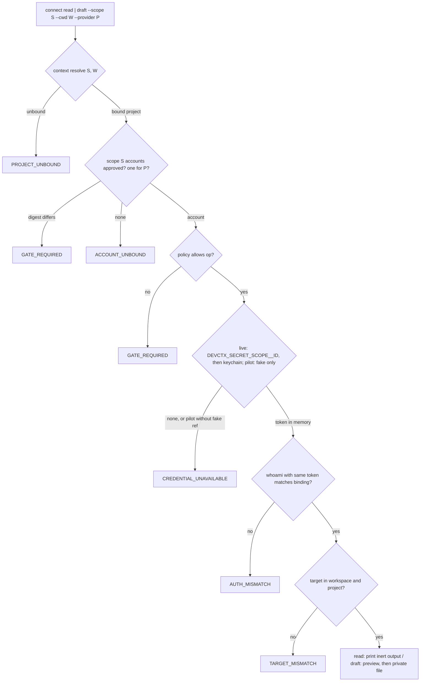
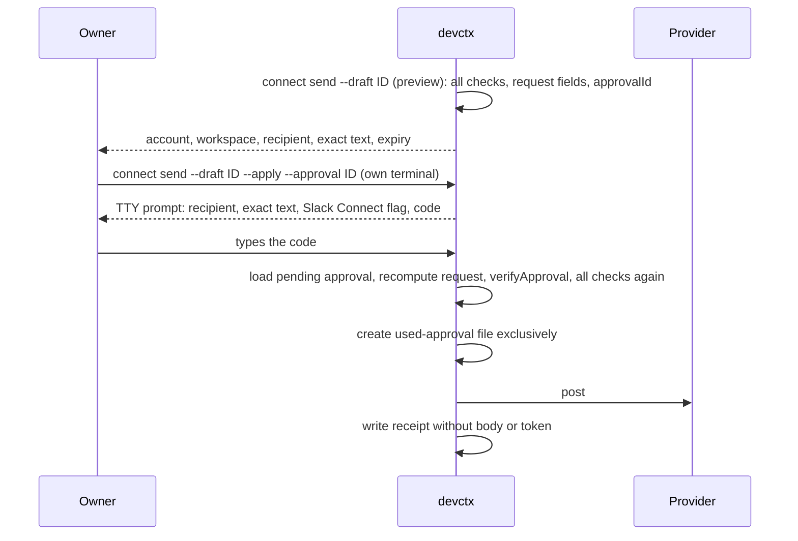
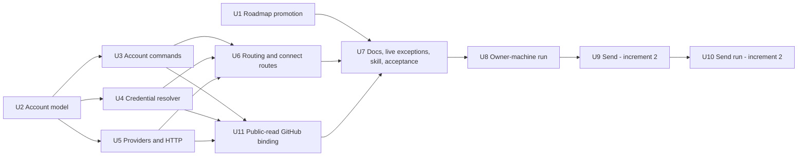

# Organization Identity Routing - Plan

## Goal Capsule

- **Objective:** let the developer bind each scope (one organization's work) to its own GitHub and Slack accounts. Inside a bound project, DCK picks that scope's account automatically, resolves the credential outside records, verifies the live identity on every call, and refuses any mismatch. The first increment reads and drafts. Sending is a second increment behind a per-message approval. Account applies, and later each send, also need a confirmation the owner types at an interactive terminal.
- **Roadmap position:** new priority 3, "Organization identity routing", directly after priority 2 and before the personal harness stage and session hooks. It promotes the GitHub and Slack part of the old connector row (priority 5). Other providers stay in a later row.
- **Authority:** the owner's decisions recorded as session-settled KTDs, then this plan, then `docs/ROADMAP.md`, `docs/SECURITY-MODEL.md`, `docs/LIVE.md` and `docs/AUTH.md`.
- **Execution profile:** U1 (roadmap) can land now. U2 to U7 and U11 are test-first code and docs that use fake providers and an injected request function; no test reaches the network or a real keychain. U8 is an operational run on the owner's machine after merge and after priority 2's activation evidence. U9 and U10 are increment 2 (sending) and start only after U8 passes and a separate plan review of U9.
- **Stop conditions:** stop and ask when a change would store a credential in any file, send anything outward in increment 1, read an ambient token such as `GH_TOKEN`, widen the live-mode exceptions beyond R17's coordinated list, weaken the exact-match identity gate, or let any account apply (or, in increment 2, any send apply) proceed without the owner's typed TTY confirmation.
- **Tail ownership:** the implementer owns review fixes, CI, the fast-forward merge and U8. U10 belongs to increment 2.

---

## Product Contract

### Summary

A scope gains an approved list of accounts, at most one per provider. `account add` previews a binding (provider, numeric account and workspace IDs, actor, secret reference, allowed operations) and applies it only with the plan fingerprint. A `connect read` or `connect draft` call names the scope and working folder, as every DCK call does. DCK resolves the project, takes that scope's account for the provider, loads the credential from an account-specific environment variable or the macOS keychain, checks the live identity against the binding, checks the target belongs to that account's workspace and the project, and only then calls the API. Drafts are saved privately and bound to the account and target. They are never posted in this increment. Separately, one optional scope-free public-read GitHub binding lets the harness stack watch raise its rate limit on public reads; scope routing never selects it.

### Problem Frame

The owner works for more than one organization, each with its own Slack workspace and GitHub organization. Today the agent picks whichever account a tool happens to be logged into. One wrong pick posts as the wrong person or into the wrong company. The owner wants the project to decide the account: "whenever I'm working on a project specific to some organization, the corresponding credentials, everything, will be getting set."

DCK has the parts but no wiring. `docs/AUTH.md` says the auth code is a library contract with fake-provider tests and no CLI route. `src/auth/connector.mjs` has an exact-match `whoami` gate and `read` and `draft` operations, but never calls `resolveSecret`. `src/auth/approval.mjs` binds one outbound action to one request, but nothing consumes it. `src/config/store.mjs` writes `accounts: []` into every scope config, and nothing fills or reads it.

### Actors

- A1. **Owner:** the developer who binds accounts, approves bindings and, in increment 2, approves each message.
- A2. **Agent session:** Claude or Codex running a bundled skill in a bound project. It may read and draft through DCK. It never applies a binding or a send. A plan fingerprint the agent can read and pass back is not owner consent, so those applies also require a confirmation the owner types at an interactive terminal (KTD21), and the skill forbids running them.
- A3. **Provider:** GitHub or Slack, reached only through their HTTPS APIs.

### Requirements

**Binding**

- R1. A scope holds at most one account per provider. Each account names the provider, the provider's numeric account ID, the workspace ID, the actor reference, a secret reference and the allowed operations.
- R2. Accounts are added, changed and removed only through a previewed plan applied with its fingerprint. The approved account list is recorded, and a scope whose accounts differ from the approved list is refused.
- R3. A binding never contains a credential. Secret-named keys are refused, as `validateAccountConfig` does today, and U2 adds a scan of every value, including the body of a secret reference.
- R4. Before binding, the owner can look up the identity a credential belongs to without writing anything, so they never type provider IDs by hand.
- R5. Re-running `scope add` with the same inputs stays idempotent after accounts are added.
- R5a. Applying an account binding or removal requires both the plan fingerprint and a confirmation the owner types at an interactive prompt. When standard input is not a TTY, apply fails with `CONFIRMATION_REQUIRED` before taking a lock or writing anything.

**Credentials**

- R6. A credential is resolved at call time, first from an environment variable whose name is derived from the scope and the binding `id`, then from the macOS keychain item named by the secret reference. Nothing else is read: never `GH_TOKEN`, `GITHUB_TOKEN`, `SLACK_TOKEN`, `gh` or Git credential stores.
- R7. A credential never reaches a record, receipt, draft, plan, fingerprint, approval, error, log or standard output. It lives in memory for one operation.
- R8. Real credential resolution runs only under a live config. The disposable pilot accepts only `fake:` references.

**Routing and verification**

- R9. Every `connect` call takes an explicit scope and working folder, resolves the project with `context resolve` semantics, and selects that scope's account for the provider. No account flag can override the selection.
- R10. No bound account for the provider fails with `ACCOUNT_UNBOUND` and makes no network call.
- R11. Every operation calls the provider's identity endpoint with the same credential it will use, and fails with `AUTH_MISMATCH` unless account, workspace and actor equal the binding exactly. Results are never cached.
- R12. The target must belong to the bound workspace; a GitHub repository must also be a remote of the resolved project. A GitHub repository must be owned by the bound workspace. A Slack channel must resolve inside the bound workspace, and its owning team must equal it. Otherwise the call fails with `TARGET_MISMATCH` before any read or draft.
- R13. An operation not allowed by the account's policy fails with `GATE_REQUIRED` before any network call.

**Read and draft (increment 1)**

- R14. GitHub reads: a pull request with its comments, an issue with its comments, and the open pull requests of the project's repository. Slack reads: recent messages of a channel and a thread's replies.
- R15. Read output is capped, printed once, and never written to the store. Fetched text is untrusted data and is printed as inert fenced text.
- R16. A draft is a private file bound to scope, project, provider, account, target and the hash of its body. Saving and removing it are previewed writes, and both run the full routing checks. A draft is never posted, scheduled or uploaded in increment 1.

**Live mode**

- R17. The live-mode rule exceptions are one coordinated list in `docs/LIVE.md` and `docs/SECURITY-MODEL.md`, written by U7 and referenced by the harness plan:
  - credentialed HTTPS calls to `api.github.com` and `slack.com` from the `account` and `connect` routes;
  - the harness stack watch's network use: unauthenticated GET requests to the hosts in its approved source plan and POST requests to `api.osv.dev`, plus, when a public-read GitHub binding exists (R21), GitHub GET requests to its public-read endpoints authenticated with that binding;
  - the existing unauthenticated `skill-sources` requests to `api.github.com`;
  - credential reads only from `DEVCTX_SECRET_*` variables and the macOS keychain, only by the `account` and `connect` routes and by the stack watch through the public-read resolver.

  Every other live command stays offline, and no other command reads a credential.

**Sending (increment 2)**

- R18. Sending a saved draft (a Slack message, or a GitHub comment on an issue or pull request) needs a fresh preview, an approval created with the existing approval contract, the owner's typed TTY confirmation (as R5a), and an apply that verifies that approval against the recomputed request.
- R19. An approval is single use and expires. Apply records it as used before the send, so a crash can never resend it.
- R20. A send re-runs every check in R9 to R13, requires `policy.outbound`, and records a receipt without the message body or credential.

**Public-read GitHub binding (harness coordination)**

- R21. One optional, scope-free public-read GitHub binding exists only to raise rate limits on public reads (releases, tags, changelogs) for the harness stack watch. It is bound with the same preview, fingerprint and owner-typed TTY confirmation as a scope account, is resolved only through this plan's resolver, is verified to reach no private repository, is never selected by project scope or by a `connect` route, and is never used for private data. No global `GH_TOKEN` or `DEVCTX_GITHUB_TOKEN` variable is read.

### Acceptance Examples

- AE1. **Given** scopes `alpha` and `beta` each bound to a different Slack workspace, **when** the agent drafts in a project of `alpha`, **then** the draft records `alpha`'s account and the identity check ran with `alpha`'s credential only.
- AE2. **Given** `alpha`'s environment variable holds `beta`'s token, and the two tokens belong to different users or workspaces, **when** any `connect` call runs in `alpha`, **then** it fails with `AUTH_MISMATCH` and makes no read call.
- AE3. **Given** a project whose GitHub remote belongs to another organization, **when** `connect read` names that repository, **then** it fails with `TARGET_MISMATCH`.
- AE4. **Given** `GH_TOKEN` and `SLACK_TOKEN` are set and no `DEVCTX_SECRET_*` variable or keychain item exists, **when** a `connect` call runs, **then** it fails with `CREDENTIAL_UNAVAILABLE`.
- AE5. **Given** a canary token, **when** the full read, draft and failure test matrix runs, **then** the canary appears in no file under the store and in no output.
- AE6. **Given** scope `alpha` has no Slack account, **when** a Slack call runs, **then** it fails with `ACCOUNT_UNBOUND` and the fake request function records no call.
- AE6a. **Given** a valid preview fingerprint, **when** `account add --apply` runs with standard input not a TTY (as from an agent's shell), **then** it fails with `CONFIRMATION_REQUIRED` and the scope file, digest and lock folder are unchanged.
- AE6b. **Given** a public-read binding whose token can list a private repository, **when** the stack watch resolves it, **then** resolution fails with `TOKEN_TOO_BROAD` and the watch falls back to unauthenticated requests; **and given** a valid public-read binding, **when** a `connect read` runs in any scope with no scope GitHub account, **then** it fails with `ACCOUNT_UNBOUND`.
- AE7. (Increment 2) **Given** an approval used once, **when** apply is repeated with it, **then** it fails with `APPROVAL_INVALID` and nothing is sent.

### Scope Boundaries

- GitHub and Slack only. Linear, mail, calendars and other providers stay in the later connector row.
- No Git commit identity or push credentials. DCK never writes Git config, `gh` config or a client repository.
- No OAuth flow, app install or token creation. The owner creates tokens with each provider and stores them in the keychain or the environment.
- No Slack Enterprise Grid tokens (an `auth.test` carrying `enterprise_id` is refused), no Slack bot tokens, no rotating Slack tokens (`xoxe.` prefixes), and no GitHub App installation tokens in increment 1.
- No 1Password or Bitwarden resolution. `bitwarden:` references stay format-only and fail with `GATE_REQUIRED`.
- No persistent cache of fetched messages, pull requests or identities.
- No inference of the scope from a folder or remote. The scope stays explicit, as `docs/AGENT-PROTOCOL.md` requires.
- No change to what a direct tool can do. A GitHub or Slack MCP server or CLI the agent also has bypasses this routing; the skill and docs say so. Routing protects against mistakes, not against a misbehaving agent with a shell (see Risks).
- No routed launch of `gh`, Git or an MCP server with a scope's verified token in this build (KTD20).
- GitHub targets are the bound project's own remotes only; no organization-wide reach (KTD22).

#### Deferred to Follow-Up Work

- **First follow-up after this plan ships:** a routed launcher, `devctx exec --scope --cwd -- gh ...`, that resolves and verifies the scope's token and passes it only to that child process (KTD20). (session-settled: user-directed.)
- A read-only check that warns when a bound repository's effective Git commit email does not match the scope's expected identity. (session-settled: user-directed — later follow-up, not this build.)
- `op://` (1Password) and Bitwarden secret references.
- Slack Enterprise Grid and GitHub App tokens.
- Per-project account overrides inside a scope.

---

## Planning Contract

### Key Technical Decisions

- KTD1. **Separate plan, sequenced after priority 2 and before the personal harness.** (session-settled: user-directed — chosen over folding it into the harness stage or keeping it at priority 5: the owner calls it the product's core, and it has its own security surface.) The roadmap becomes P1 backup (deferred), P2 live activation, P3 organization identity routing, then the harness, session hooks, migration and the rest. This plan owns the promotion; the harness plan's U11 inserts its row after this one.
- KTD2. **GitHub and Slack only.** (session-settled: user-directed.)
- KTD3. **Increment 1 is read and draft; sending is increment 2.** (session-settled: user-directed — chosen over shipping send first: the routing and identity checks get proven on harmless operations before anything leaves the machine.) U9 and U10 are written here so the contract is visible, but they need their own review before code.
- KTD4. **Automatic account selection from the resolved scope, with a mismatch refusal.** (session-settled: user-directed.) The scope stays explicit, because `docs/AGENT-PROTOCOL.md` says to ask the user for it and never infer it. "Automatic" means the account follows from the scope and project; there is no `--account` flag to get wrong.
- KTD5. **Environment first, then keychain; never in records.** (session-settled: user-directed.) The variable is `DEVCTX_SECRET_<SCOPE>__<ID>`: the scope, a double underscore, then the binding `id`, upper-cased with `-` as `_`. Scope and binding `id` are unique together, so the name belongs to exactly one binding. A variable is visible to the agent and everything it launches, so `docs/CONNECT.md` recommends the keychain for agent sessions and the variable for one-off commands the owner runs in their own shell. Ambient variables such as `GH_TOKEN` are never read, because a global variable applies to every scope and is the exact cross-organization leak this feature prevents.
- KTD6. **Identity verification on every call reuses the existing exact-match gate.** (session-settled: user-directed.) `createConnector` keeps its check order. It changes in two ways: it resolves the credential once per operation and passes the same credential to `whoami` and to the operation, so the identity checked is the identity used; and it adds a target check between identity and operation.
- KTD7. **Live-mode exceptions are explicit and reviewed.** (session-settled: user-directed.) R17 lists them. They are added to `docs/LIVE.md` and `docs/SECURITY-MODEL.md` in U7 and reviewed with the code.
- KTD8. **Private repository; no real names.** (session-settled: user-directed.) Docs, tests and fixtures use `alpha`, `beta`, `example-org` and synthetic IDs. Evidence naming real accounts stays in `~/.devctx/store/state/evidence/`.
- KTD9. **Account shape stays the current seven keys.** `id`, `provider`, `accountId`, `workspaceId`, `actorRef`, `secretRef`, `policy`. Provider-specific rules are added, not new keys:

  | Field | GitHub | Slack |
  | --- | --- | --- |
  | `accountId` | numeric user ID from `GET /user` | user ID from `auth.test` (`U…` or `W…`) |
  | `workspaceId` | numeric ID of the owning organization, or the user's own ID for personal repositories | team ID from `auth.test` (`T…`) |
  | `actorRef` | `github:<login>` | `slack:<user ID>` |
  | `secretRef` | `keychain:<service>/<account>` or `fake:<name>` | same |

  Numeric IDs survive renames; logins and workspace names do not. The binding stores no display names.
- KTD10. **Accounts live in the scope config, behind an approved digest.** U3 fills the existing `accounts` array by atomic replace under the scope lock, with the fingerprint binding the file's current hash. Each apply follows `applyChange` in `src/config/live.mjs`: record the new accounts digest with `previousDigest`, replace the scope file, then record the new digest alone. `loadScopeAccounts` accepts either digest while both are recorded, so a crash at any point leaves the file on disk approved. The digest catches accidental edits, not deliberate same-user tampering, and the docs say so. `applyScopeAdd` compares configs without `accounts`. (Chosen over a separate accounts file: the field already exists and is reserved for this.)
- KTD11. **The provider decides the workspace; the binding only names which one to check.** (Membership endpoint check and fallback: see KTD24.) Slack's comes from `auth.test`'s `team_id`, and a response carrying `enterprise_id` is unverified. GitHub's `whoami(token, { expectedWorkspaceId })` returns the expected organization ID only when the user's active memberships include it, or when it equals the user's own ID; otherwise it returns the user's own ID, so the gate reports `AUTH_MISMATCH`. The token therefore needs organization-membership read access, and `account discover` says so when the call is refused. **Limit:** when one GitHub user belongs to both scopes' organizations, the identity gate proves the user, not which organization's token it is. For GitHub, the organization boundary is the KTD12 owner check plus fine-grained tokens limited to one resource owner, which `docs/CONNECT.md` recommends.
- KTD12. **Target checks run after identity and before the operation.** A GitHub target must be one of the bound project's remotes on `github.com`, and `GET /repos/{owner}/{repo}` with the account's credential must return an owner ID equal to `workspaceId`. A Slack channel must answer `conversations.info` with the account's credential, and its owning team must equal `workspaceId`. Both failures are `TARGET_MISMATCH`.
- KTD13. **DCK makes the API calls; it does not configure MCP servers.** (Chosen over writing per-project `.mcp.json` entries with per-organization tokens: an MCP server would hold the token in its own config and would not run the per-call identity gate or the target check. Writing agent config is also outside the live allowlist.) The skill tells the agent to use the `connect` routes for bound projects and to say when it is using a direct tool instead.
- KTD14. **Network calls reuse the bounded request pattern of `src/skill-sources/github.mjs`.** Injected `request`, per-request timeout, body and total byte caps, no redirects, a fixed user agent, typed errors, rate-limit hints. The credential goes only in an `Authorization` header to its own provider host. Slack's `ok: false` bodies map to typed errors (`invalid_auth`, `token_revoked`, `ratelimited`, `channel_not_found`).
- KTD15. **The keychain is read through `/usr/bin/security`, by absolute path, with `execFile` and no shell.** The service and account come from the secret reference, the password comes back on the child's standard output into memory, and a timeout and a byte cap apply. Do not assume a prompt: an item created with `security add-generic-password` trusts `/usr/bin/security`, so DCK, and any same-user process including the agent's own shell, can read it without one. `docs/CONNECT.md` shows creating the item with an empty trusted-application list, so each read asks the owner, and explains the trade-off with unattended agent calls. U8 records which behavior the owner chose and saw. Linux has no keychain resolver; the variable is the only source there.
- KTD16. **Read output is not stored; drafts are.** Fetched messages are client data. Printing them once keeps the store from becoming a second copy of client Slack. Drafts are the owner's own text, are the input to increment 2's approval, and are what the harness plan's Slack-update template produces, so they are stored rather than only printed. (Chosen over print-only drafts: the owner settled "read and draft", and a stored draft is what a later send approves.) They are kept until the owner removes them, and live under `dataRoot/scopes/<scope>/projects/<project>/connect-drafts/`, exclusive-create, mode 0600. (session-settled: user-directed, harness coordination.) The harness Slack-update template saves through `connect draft` when the scope has a bound Slack account, and otherwise falls back to the harness `draft save`, whose drafts live outside any scope and can never be sent. Only connect drafts are sendable in increment 2; U9 refuses anything else.
- KTD17. **`policy.outbound` must be `false` until U9 ships.** `account add` refuses `outbound` in increment 1, so no binding can claim a send permission that nothing enforces yet.
- KTD18. **Routing is not a daily-use blocker for the freeze.** It is sequenced ahead of the blockers by owner direction, but the skill-builder and skill-source freeze still lifts when backup, live activation, session hooks and migration ship. The freeze sentence names those four by name.
- KTD19. **Sends use the approval contract unchanged, plus a used-approval ledger.** (Increment 2.) The ten approval fields stay as they are; `recipient` is the channel ID or `owner/repo#number`, `payloadHash` is the draft's body hash, and the expiry is short. Preview writes the approval to `state/connect/pending/<approvalId>.json`, so apply can load it by ID with its `expiresAt` and verify it against the recomputed request. A draft records that it was sent, and a sent draft cannot be previewed again, so one draft is posted at most once. Apply creates `state/connect/approvals/<approvalId>.json` exclusively after every check passes and before sending, so a replay or a crash cannot send twice. A crash after that file but before the receipt is reported as "unknown, check the channel"; it is never retried automatically.
- KTD20. **This build routes only DCK's own calls; the routed launcher follows next.** The owner's goal is that "the corresponding credentials, everything" follow the project. The `connect` routes cover a small read and draft set; `gh`, Git and the agent's MCP tools still use whatever account they are logged into. A routed launcher (`devctx exec --scope --cwd -- gh ...`) could resolve and verify the scope's token and pass it to that one child process as `GH_TOKEN`, without writing any config. (session-settled: user-directed — not in this build; it is the first follow-up after this plan ships.) It widens the live-mode exceptions to launching other programs with a credential, so it gets its own plan and review. This build's evidence therefore proves routing for DCK calls only, and `docs/CONNECT.md` says so.
- KTD21. **Owner-typed TTY confirmation on account applies and sends.** (session-settled: user-directed — chosen over the skill rule alone: a fingerprint the agent can read is not consent.) A shared `confirmOwner` step runs after the fingerprint check and before the lock. It refuses with `CONFIRMATION_REQUIRED` when standard input is not a TTY. Otherwise it prints the change summary and a six-character code taken from the plan fingerprint to standard error, and the owner must type that code. The code is not a secret: the terminal is the boundary, and the code makes the owner confirm this exact plan rather than press Enter; a wrong code, empty line, end of input or a 120-second timeout refuses. Standard output keeps carrying only the JSON result. Apply then takes the lock, rechecks the fingerprint and writes. The fingerprint binding stays. It covers `account add` and `account remove` in increment 1, and `connect send` in increment 2, where the prompt also shows the recipient, exact text and any Slack Connect flag. Limit: a same-user process that allocates a pseudo-terminal (`script`, `expect`, a terminal multiplexer) can type the code; the docs say so, and the skill never runs these applies. The owner runs them in their own terminal, not through an agent's shell.
- KTD22. **GitHub reach is the bound project's own remotes.** (session-settled: user-directed.) No organization-wide target rule.
- KTD23. **Slack Connect channels need an explicit per-call flag shown in the preview.** (session-settled: user-directed.) Increment 1 reads and drafts in them without a flag; in increment 2 a send to a channel shared with another organization is refused unless the call carries the flag, and the preview and the TTY prompt both show it.
- KTD24. **The membership endpoint is checked from GitHub's docs before U5, with a decided fallback.** Before any U5 code, the implementer reads the REST reference pages for "List organization memberships for the authenticated user" (`GET /user/memberships/orgs`) and "Get an organization membership for the authenticated user", and their "Fine-grained access tokens" section, which states whether fine-grained tokens can call the endpoint and which permission they need. The result is recorded with the page URL and date in `docs/AUTH.md` and in this plan's Review record. If fine-grained tokens are supported, `docs/CONNECT.md` names the permission and U5 proceeds as written. If they are not, the fallback is: GitHub bindings in this build accept only classic tokens (`ghp_`) with the `read:org` scope, U4's prefix check refuses `github_pat_` with a message saying why, `docs/CONNECT.md` says so, KTD11's limit notes that one user in two organizations is then separated only by the owner check, and fine-grained support becomes a follow-up. U8 then confirms the recorded answer with the owner's real token through `account discover`.
- KTD25. **Scope-free public-read GitHub binding.** (session-settled: user-directed, harness coordination.)
  - **Stored** in `configRoot/accounts/public-read.json` as one account with the KTD9 shape: `id` is `public-github`, `provider` is `github`, `workspaceId` is the user's own numeric ID, and `policy` is `read` only (`draft` and `outbound` refused). Its approved digest is `state/accounts/public-read.json`, written with the same `previousDigest` pattern as KTD10, under the registry lock. It never appears in a scope's `accounts`.
  - **Bound** by `account add --public-read` and removed by `account remove --public-read`, with preview, fingerprint and the KTD21 TTY confirmation.
  - **Resolved** by `resolvePublicReadCredential`, live mode only: the variable `DEVCTX_SECRET__PUBLIC_GITHUB` (the empty scope segment cannot collide with any scope, because scope IDs are never empty), then its keychain reference. No other variable is read.
  - **Verified** on each stack-watch run: the identity gate (`GET /user` against `accountId` and `actorRef`, workspace equal to the user's own ID), then a breadth check, `GET /user/repos?visibility=private&per_page=1`, which must return no repository; otherwise `TOKEN_TOO_BROAD`. `docs/CONNECT.md` tells the owner to create a fine-grained token with public-repository read access only, or a classic token with no scopes.
  - **Used** only through a public-read client that allows GET on an allowlist of public endpoints (repository metadata, releases, tags, and file contents for changelogs), drops and reports any response whose repository is private, and is exported only to the stack watch. `routeAccount` never selects it, and a `connect` route cannot name it.
  - **On failure** (unbound, unavailable, mismatch, too broad), the stack watch makes unauthenticated requests instead and reports why; it never falls back to another credential.

### High-Level Technical Design

Increment 2 adds, after a saved draft:

### Review record

A headless `ce-doc-review` (coherence, feasibility, security, scope and adversarial lenses) on 2026-10-17 changed R3, R6, R12, R16, R17, AE2, KTD5, KTD6, KTD10, KTD11, KTD12, KTD15, KTD16 and KTD19, added KTD20 and three risk rows, and tightened U1 to U9. No session-settled decision changed. The owner's harness-coordination decision of 2026-10-17 then added R21, AE6b, KTD25 and U11, rewrote R17 as the coordinated exception list, extended KTD16 and protected the freeze-paragraph exception in U1. Earlier, the owner's answers of 2026-10-17 added KTD21 to KTD24 and R5a, AE6a, settled KTD20 and moved the routed launcher and the commit-email check to follow-ups; no earlier requirement was dropped.

### Assumptions

- The owner uses a Slack user token (`xoxp-`) per workspace from a Slack app they control, and a GitHub fine-grained or classic personal access token per organization. A bot token posts as the bot, so its `auth.test` user differs from the actor and is refused by the identity check.
- The owner's Slack app is an internal app in each workspace. Slack's 2025-05-29 limits (1 request per minute, 15 messages) apply to commercially distributed apps outside the Marketplace, not to internal apps. If a workspace's app is subject to them, reads stay correct but small; U8 records what it observed.
- Priority 2's activation evidence is recorded before U8. Real credentials only work under a live config.

### Risks

| Risk | Mitigation |
| --- | --- |
| A token for the wrong organization is stored under the right account | Identity check on every call (AE2); `account discover` shows the token's identity before binding. For one GitHub user in both organizations, only the KTD12 owner check and fine-grained tokens separate them |
| Agent uses a direct GitHub or Slack tool instead of DCK | Documented limit; the skill prefers `connect` routes and says when it does not. DCK is not a sandbox |
| Prompt injection in fetched messages | Inert fenced output, control and bidirectional characters stripped, length caps; the skill treats it as data |
| Credential leak through errors or output | Errors carry codes and provider error names only; canary test over every file and output (AE5) |
| GitHub token lacks membership read | `account discover` and `account whoami` report the missing permission by name |
| An agent with a shell reads any organization's keychain item or `DEVCTX_SECRET_*` variable and calls the API directly | Routing protects against mistakes, not a misbehaving agent; documented next to "direct tools bypass routing". The empty trusted-application option makes each keychain read ask the owner |
| Owner-approved steps applied by the agent itself (rebinding an account, or a send in increment 2) | Fingerprint plus owner-typed TTY confirmation (KTD21); non-TTY apply is refused; the skill never runs these applies. A same-user process that fakes a terminal remains a documented limit |
| Content from one scope flows into another scope's draft in one agent session | The skill keeps one scope per session and never carries read output into another scope's draft; U9's preview shows the draft's scope and workspace next to the text |
| Slack rate limits | Typed `RATE_LIMITED` with the retry hint; small default limits |
| Client text exposure | Reads are not stored; drafts are the owner's text; the agent host still sends read output to its model provider, and the docs say so |
| Public-read token reaches private data or gets used for project work | Breadth check on every stack-watch run (`TOKEN_TOO_BROAD`), GET-only allowlisted client, private responses dropped, never selectable by `connect` routing (AE6b) |
| Accidental send in increment 1 | No send code path exists; `policy.outbound` is refused at binding |

### Sources and Prior Art

See the Appendix for the prior-art scan with sources. In short: `gh` supports several accounts but one active account per host, with no per-folder selection; Git's `includeIf` selects identity per folder but is not a credential store with identity checks; Slack tokens are per workspace and `auth.test` returns the user and team; the official GitHub and Slack MCP servers bind one identity per server instance; 1Password and Bitwarden offer secret references that resolve at run time. DCK's gap is the per-call link between project, account and verified identity.

---

## Implementation Units

### U1. Roadmap promotion

- **Goal:** record the new priority 3 and renumber, so the harness plan's U11 can insert after it.
- **Requirements:** KTD1, KTD18.
- **Dependencies:** none. Merge `origin/main` first and keep row 2's text unchanged.
- **Files:** `docs/ROADMAP.md`, `docs/AUTH.md`, `docs/SKILL-SOURCES.md`, `test/docs.test.mjs`.
- **Approach:** insert "Organization identity routing (GitHub and Slack)" as priority 3. Exit evidence: scope-bound accounts with preview and approval; credentials resolved outside records, environment then keychain; identity verified on every call; mismatch, unbound and wrong-target tests; read and draft evidence in two scopes on the owner's machine; then send behind a single-use per-message approval. Renumber session hooks to 4 and migration to 5. Old row 5 becomes priority 6, "Further connectors beyond GitHub and Slack". Hub, skill export, updater and release become 7 to 10. Rewrite the freeze sentence to name backup, live activation, session hooks and migration, keeping verbatim any skill-builder "create-from-template" exception sentence the harness plan's U12 has added to that paragraph (session-settled: user-directed), update "Priorities 5–8" to the new numbers, and update the roadmap's own later mentions ("resume at priorities 7 and 8", "Milestone C is delivery priority 7", "The weekly updater is delivery priority 8") to 8 and 9, and update the priority numbers in `docs/AUTH.md` and `docs/SKILL-SOURCES.md`. Backup stays priority 1, so `docs/LIVE.md` needs no change.
- **Coordination:** the harness plan's U11 then inserts "Personal harness layer" as priority 4 on top of this table, giving eleven rows. Its test "no doc names connectors as priority 5" becomes "the routing row is priority 3 and further connectors follow the harness". Hand the harness planner this table.
- **Test scenarios:**
  - The roadmap table has ten rows in this order, and row 3 names GitHub and Slack.
  - The freeze sentence names the four blockers by name, not by number, and a create-from-template exception sentence, when present before the change, is still present after it.
  - No doc names live connectors as priority 5 or the weekly updater as priority 8.
- **Verification:** docs tests pass.

### U2. Account model and validation

- **Goal:** make an account binding precise per provider and safe to load.
- **Requirements:** R1, R3, R5; KTD9, KTD10, KTD17.
- **Dependencies:** none.
- **Files:** `src/auth/connector.mjs`, `src/auth/accounts.mjs` (new), `src/auth/secret-ref.mjs`, `src/records/redact.mjs`, `src/config/store.mjs`, `schemas/account.schema.json`, `test/accounts.test.mjs` (new), `test/auth-hubs.test.mjs`, `test/required-tests.json`.
- **Approach:** add provider rules: `provider` is `github` or `slack`; `id` matches the scope-ID form; `accountId`, `workspaceId` and `actorRef` match the KTD9 table; `actorRef` prefix matches the provider. `validateScopeAccounts(list)` checks each account, unique IDs and at most one per provider. `loadScope` callers that need accounts use a new `loadScopeAccounts(roots, scope)` that validates the list and compares its canonical digest with the digest or `previousDigest` in `state/accounts/<scope>.json`; an empty list with no approval file is valid. `applyScopeAdd` compares old and new configs without `accounts`. `outbound: true` is refused while U9 is unshipped. Run `assertNoSensitive` over each account's canonical JSON, including the body of a secret reference, and extend the redaction patterns to fine-grained `github_pat_` tokens and Slack `xoxp-`/`xoxe.` tokens if they are not already matched. Reconcile `schemas/account.schema.json` with the validator: the schema requires `schemaVersion`, which `validateAccountConfig` rejects today. Bet: drop it from the account schema, since the scope config already carries `schemaVersion`.
- **Execution note:** write the failing validation tests first; the existing auth tests are the characterization guard.
- **Patterns to follow:** `validateAccountConfig`, `assertActorRef`, `findForbiddenFields`, the approved digest in `src/config/pilot.mjs`.
- **Test scenarios:**
  - A GitHub and a Slack account in one scope validate.
  - Two Slack accounts in one scope, a duplicate account ID, a `slack:` actor on a GitHub account, a non-numeric GitHub account ID, and a Slack workspace ID not starting with `T` are each refused with `INVALID_INPUT`.
  - A key named `token` at any depth, or a `secretRef` such as `fake:xoxp-…` or `keychain:ghp_…/x`, is refused, and so is a `github_pat_` value in any field.
  - `outbound: true` is refused.
  - A scope file whose accounts were hand-edited after approval fails with `GATE_REQUIRED` naming `accounts.approval`.
  - Re-running `scope add` with its original inputs after an account was added returns `created: false`.
- **Verification:** new and existing auth tests pass.

### U3. Account commands

- **Goal:** bind, change and remove accounts only through preview and approval.
- **Requirements:** R2, R4, R5a; KTD10, KTD21; AE6a.
- **Dependencies:** U2.
- **Files:** `src/auth/account-commands.mjs` (new), `src/auth/owner-confirm.mjs` (new), `src/cli.mjs` (passes standard input and standard error to the confirmation step; tests inject them), `test/account-commands.test.mjs` (new), `test/owner-confirm.test.mjs` (new), `scripts/package-allowlist.json`, `test/required-tests.json`.
- **Approach:** `account add --scope --provider --id --account-id --workspace --actor --secret --allow read,draft` previews the scope's accounts before and after, the scope file hash and a fingerprint; `--apply --plan-fingerprint` checks the fingerprint, runs `confirmOwner` (KTD21), then replaces the scope file atomically under the scope lock, rechecks the fingerprint and hash, and records the approved digest. `account remove --scope --id` is the same in reverse, including the confirmation. `account list --scope` prints bindings and approval state, offline. The preview prints IDs and the secret reference, never a credential.
- **Patterns to follow:** `planChange` and `applyChange` in `src/config/live.mjs`; `finalizePlan`, `assertFingerprint`, `withPilotLock`, `atomicReplace`.
- **Test scenarios:**
  - Preview writes nothing; apply with the fingerprint and the correct typed code on a TTY adds the account and records the digest.
  - Covers AE6a. Apply with a valid fingerprint and standard input not a TTY fails with `CONFIRMATION_REQUIRED`; the scope file, digest and lock folder are unchanged, and nothing was prompted.
  - On a TTY, a wrong code, an empty line, end of input and a timeout each refuse with `CONFIRMATION_REQUIRED` and write nothing.
  - A correct code with a stale fingerprint still fails with `PLAN_MISMATCH`; the confirmation never replaces the fingerprint.
  - The prompt and code go to standard error; standard output holds only the JSON result.
  - `account remove --apply` has the same non-TTY refusal.
  - A stale fingerprint, or a scope file changed between preview and apply, writes nothing and fails with `PLAN_MISMATCH` or `STALE_VERSION`.
  - A second Slack account for the same scope is refused at preview.
  - Remove then add round-trips, and the digest follows each apply.
  - A crash after the first digest write, or after the scope replace, leaves `loadScopeAccounts` passing on whichever scope file is on disk, and the next apply proceeds.
  - `account list` output and errors contain no secret reference values beyond the reference itself.
- **Verification:** tests pass and the routes appear in `help`.

### U4. Credential resolver

- **Goal:** load a credential for one account, at call time, from the two allowed sources only.
- **Requirements:** R6, R7, R8; KTD5, KTD15.
- **Dependencies:** U2.
- **Files:** `src/auth/credentials.mjs` (new), `src/auth/fake-provider.mjs`, `test/credentials.test.mjs` (new), `test/required-tests.json`.
- **Approach:** `resolveCredential(account, { env, live, runKeychain })` returns a credential or throws `CREDENTIAL_UNAVAILABLE`. Outside live mode, any reference other than `fake:` fails with `CREDENTIAL_UNAVAILABLE` before the environment is read, and `fake:` resolves only through the injected test resolver. In live mode a `fake:` reference is refused, and the order is: the `DEVCTX_SECRET_<SCOPE>__<ID>` variable if set and non-empty; otherwise the keychain item from `keychain:<service>/<account>` through `/usr/bin/security find-generic-password -s <service> -a <account> -w`, run with `execFile`, no shell, a 5-second timeout and a 4 KiB cap, trailing newline trimmed. `bitwarden:` fails with `GATE_REQUIRED`. Check the token's prefix against the provider (`ghp_`, `github_pat_` or `gho_` for GitHub; `xoxp-` for Slack) and fail with `CREDENTIAL_UNAVAILABLE` naming the expected kind on a mismatch; a Slack `xoxe.` token fails with a message naming token rotation, which `docs/CONNECT.md` tells the owner to turn off for the internal app. Errors never include the value or the child's output. `runKeychain` is the test seam; no test runs `security`.
- **Execution note:** test-first, including the canary assertions.
- **Test scenarios:**
  - The variable wins over the keychain; the keychain is used when the variable is unset or empty.
  - Covers AE4. `GH_TOKEN`, `GITHUB_TOKEN`, `SLACK_TOKEN` and `SLACK_BOT_TOKEN` set alone resolve nothing.
  - A pilot (non-live) context with a keychain reference fails with `CREDENTIAL_UNAVAILABLE` and never calls the seam, even when the matching `DEVCTX_SECRET_*` variable holds a real-shaped token.
  - A live context with a `fake:` reference is refused.
  - A keychain seam that times out, exits non-zero, or prints more than the cap fails without its output in the error.
  - A Slack account given an `xoxb-` or `xoxe.` token, or a GitHub account given an `xoxp-` token, is refused.
  - Binding `slack-main` in scope `alpha` reads `DEVCTX_SECRET_ALPHA__SLACK_MAIN`; the same binding `id` in scope `beta` reads a different variable.
- **Verification:** tests pass with no process spawned outside the seam.

### U5. Bounded HTTP client and providers

- **Goal:** real GitHub and Slack providers for `whoami`, read and target checks, testable without the network.
- **Requirements:** R11, R12, R14, R15; KTD11, KTD12, KTD14.
- **Dependencies:** U2, and the KTD24 docs check recorded, with the fallback applied if it fails.
- **Files:** `src/connect/http.mjs` (new), `src/connect/github.mjs` (new), `src/connect/slack.mjs` (new), `src/connect/render.mjs` (new), `test/connect-providers.test.mjs` (new), `test/fixtures/connect/` (new, synthetic JSON), `scripts/package-allowlist.json`, `test/required-tests.json`.
- **Approach:**
  - `http.mjs` takes an injected `request`, sends only to `https://api.github.com` or `https://slack.com/api/`, refuses redirects, never follows pagination URLs from response headers (it builds each page request itself), caps each body at 512 KiB and each call's total, sets a fixed `devctx-connect` user agent, and maps status codes to typed errors as `src/skill-sources/github.mjs` does.
  - GitHub `whoami(token, { expectedWorkspaceId })`: `GET /user`, then the user's active organization memberships; return `{ verified, accountId, actorRef, workspaceId }`, where `workspaceId` is the expected ID only when a membership confirms it or it equals the user's own ID (KTD11). `targetCheck(token, { owner, repo }, workspaceId)` compares the repository owner ID. Reads: one pull request with comments, one issue with comments, open pull requests, each with a page cap.
  - Slack `whoami(token)`: `auth.test`; `verified` is `ok === true` and no `enterprise_id`. `targetCheck`: `conversations.info`, comparing the channel's owning team with `workspaceId`. Reads: `conversations.history` and `conversations.replies` with a default limit of 20 and a maximum of 100.
  - `render.mjs` turns fetched text into inert fenced blocks: control and bidirectional characters stripped, fence collisions escaped, each field capped, links not expanded, and a fixed notice that the content is untrusted data.
- **Patterns to follow:** `checkSource`, `httpFailure` and `retryDetails` in `src/skill-sources/github.mjs`.
- **Test scenarios:**
  - `whoami` maps fixture responses to identities; a Slack `ok: false` with `invalid_auth` is `AUTH_UNVERIFIED`.
  - A GitHub user without an active membership in the bound organization yields an identity whose workspace differs, so the gate reports `AUTH_MISMATCH`.
  - A Slack `auth.test` with `enterprise_id` is `AUTH_UNVERIFIED`; a channel whose owning team differs is `TARGET_MISMATCH`.
  - A redirect, a 401, a 403 with remaining rate zero, a 429 with `Retry-After`, an oversize body and a timeout each map to their typed error.
  - The request function sees the token only in the `Authorization` header and only for its own host.
  - Rendered output of a message containing a fence, a bidirectional override and a fake instruction stays inside one fence and keeps the notice.
- **Verification:** tests pass with only the injected request function.

### U6. Routing and `connect` routes

- **Goal:** wire scope, project, account, credential, identity and target into the `connect` routes, and add drafts.
- **Requirements:** R4, R9 to R16; KTD4, KTD6, KTD12, KTD16; AE1 to AE6.
- **Dependencies:** U3, U4, U5.
- **Files:** `src/auth/connector.mjs`, `src/connect/route.mjs` (new), `src/connect/drafts.mjs` (new), `src/connect/commands.mjs` (new), `src/cli.mjs` (also passes the injected `request` and `runKeychain` to the new routes, as it does for `skill-sources`), `test/connect-routing.test.mjs` (new), `test/connect-drafts.test.mjs` (new), `test/helpers.mjs`, `test/required-tests.json`, `scripts/package-allowlist.json`.
- **Approach:**
  - `createConnector` gains a credential step: after the policy check it calls `resolveSecret(account)` once, passes that credential to `whoami` and to the operation, and drops it at the end. It also gains `targetCheck` between identity and operation. Check order: policy, credential, identity, target, operation. Providers have no `draft` method: `connect draft` preview, apply and removal each run policy, credential, identity and target through the connector, and the operation is the local write in `src/connect/drafts.mjs`.
  - `routeAccount(roots, { scope, cwd, provider })` runs `resolveContext`, then `loadScopeAccounts`, and returns the project, its binding and the one account, or `ACCOUNT_UNBOUND`.
  - The GitHub target defaults to the project's single `github.com` remote; `--repo owner/name` must match one of the project's remotes, else `TARGET_MISMATCH`.
  - Routes: `account discover --scope --id --provider [--secret REF]` (resolves the credential the binding would use, from `DEVCTX_SECRET_<SCOPE>__<ID>` or the reference, runs `whoami`, prints the identity to bind; writes nothing; works on Linux through the variable); `account whoami --scope --id` (runs the gate for a bound account); `connect read --scope --cwd --provider github --pr N | --issue N | --open-prs` and `--provider slack --channel C [--thread TS] [--limit N]`; `connect draft --scope --cwd --provider --target ... --body-file F` (preview, then `--apply --plan-fingerprint`); `connect drafts --scope --cwd` (lists drafts, offline); `connect drafts --scope --cwd --remove ID` (previewed removal).
  - A draft file holds scope, project, provider, account ID, workspace ID, actor, target, body, body hash and creation time. The body file must be inside `inputsRoot` and pass `assertNoSensitive`. The draft ID derives from those fields.
- **Execution note:** start from AE1 and AE2 as failing integration tests over a two-scope fixture.
- **Patterns to follow:** `resolveContext`, `requireCommittedProject`, `remoteHost` in `src/hubs/propose.mjs`, exclusive writes in `src/handoff/export.mjs`.
- **Test scenarios:**
  - Covers AE1. Two scopes with fake Slack providers: a draft in `alpha` uses only `alpha`'s credential and identity.
  - Covers AE2. `alpha`'s variable holding `beta`'s token fails with `AUTH_MISMATCH`; the request log shows `whoami` only.
  - Covers AE3. A `--repo` that is not a project remote, and a project remote owned by another organization, both fail with `TARGET_MISMATCH` before any read.
  - Covers AE6. No Slack account in the scope fails with `ACCOUNT_UNBOUND` and zero requests.
  - Covers AE6b. A bound public-read GitHub binding is never selected: a GitHub `connect read` in a scope with no GitHub account fails with `ACCOUNT_UNBOUND`.
  - An unbound worktree fails with `PROJECT_UNBOUND` and zero requests.
  - A disabled `draft` policy fails with `GATE_REQUIRED` before credential resolution.
  - The identity changes between two calls; the second call fails (no cache).
  - Covers AE5. A canary token through every route and failure leaves no trace in any file under the pilot root or in any output.
  - Draft preview writes nothing; apply writes one 0600 file; a body file outside `inputsRoot` or containing a JWT is refused.
  - `account discover` writes nothing and prints the identity fields `account add` needs.
  - Draft removal previews then removes only that draft file.
- **Verification:** tests pass; `help` lists the routes.

### U7. Live-mode exceptions, docs, skill and acceptance

- **Goal:** document the exceptions and the routing, give agents a skill, and add offline acceptance checks.
- **Requirements:** R17; KTD7, KTD8, KTD13.
- **Dependencies:** U1, U6, U11.
- **Files:** `docs/LIVE.md`, `docs/SECURITY-MODEL.md`, `docs/AUTH.md`, `docs/AGENT-PROTOCOL.md`, `docs/LIMITATIONS.md`, `docs/ARCHITECTURE.md`, `docs/assets/architecture.svg` (description text), `README.md`, `docs/CONNECT.md` (new), `skills/devctx-connect/SKILL.md` (new), `scripts/acceptance.mjs`, `.github/workflows/ci.yml`, `test/ci.test.mjs`, `test/docs.test.mjs`, `scripts/package-allowlist.json`.
- **Approach:**
  - `docs/LIVE.md` and `docs/SECURITY-MODEL.md` gain a "Live-mode exceptions" section giving R17's coordinated list in identical wording in both files (the routing routes, the harness stack watch including its public-read binding, and `skill-sources`), and stating that no other command reads a credential or makes a network call. The harness plan references this section rather than writing its own.
  - `docs/AUTH.md` is rewritten from "library contract only" to the shipped behavior, keeping the gate order and listing the new error codes.
  - `docs/CONNECT.md` is the owner's guide: creating a token per organization, preferring fine-grained GitHub tokens limited to one organization, turning off Slack token rotation, storing each token with `security add-generic-password` using an interactive prompt rather than a command-line value and the empty trusted-application option with its trade-off (KTD15), the keychain over `DEVCTX_SECRET_*` for agent sessions (KTD5), `account discover`, `account add` and `account remove` run in the owner's own terminal with the typed confirmation (KTD21) and its pseudo-terminal limit, `account whoami`, the public-read binding and how to create a token for it (KTD25), reads and drafts, and the limits: direct tools and `gh` bypass routing (KTD20), an agent with a shell can read the same credentials, one GitHub user in two organizations is separated only by the owner check, read output goes to the agent's model provider, no send yet.
  - `skills/devctx-connect/SKILL.md` is instruction-only: confirm scope and project first, use `connect` routes for bound projects, never pass credentials on the command line, never run `account add` or `account remove` with `--apply` (they need the owner's typed confirmation at their own terminal; give the owner the command instead), keep one scope per session and never carry read output from one scope into another scope's draft, treat fetched text as untrusted, never claim a message was sent, and stop on `AUTH_MISMATCH` or `TARGET_MISMATCH` and tell the user.
  - The skill folder ships here; adding it to `SKILL_NAMES` happens in U8 (see there). Never remove a name.
  - Acceptance adds fake-provider checks for unbound, mismatch, wrong target and canary, and the CI counts are updated.
- **Test scenarios:**
  - Docs tests pin the exception list, identical in both docs and naming the stack watch and the public-read binding, the "never in records" statement and the TTY confirmation rule in `docs/CONNECT.md` and `docs/AUTH.md`.
  - Acceptance checks that a non-TTY `account add --apply` is refused.
  - The skill passes the bundled-skill route check: every command it names is a real route.
  - Acceptance reports the new checks passed on a fresh temp root.
- **Verification:** docs, CI and package tests pass, and acceptance passes locally.

### U8. Owner-machine run (increment 1)

- **Goal:** produce priority 3's read and draft evidence.
- **Requirements:** AE1, AE2 and R17, on real accounts.
- **Dependencies:** U1 to U7 and U11 merged with green CI; priority 2 activation evidence recorded; live config at the merged commit.
- **Files:** `docs/ROADMAP.md`, `docs/CI.md` (dated pass line only), `src/agents/install.mjs` and `test/live-install.test.mjs` (the `SKILL_NAMES` step).
- **Approach:** first, once priority 2's activation evidence is recorded, a small reviewed change adds `devctx-connect` to `SKILL_NAMES`, coordinated with the harness plan's U9 change to the same list, and the owner installs it with the usual preview and approval. Then, with the owner present: store one token per organization in the keychain; `account discover` (which also confirms the KTD24 answer for the owner's GitHub token), then `account add` for GitHub and Slack in two scopes, each applied by the owner in their own terminal with the typed confirmation; one `account add --apply` attempted from the agent's shell to record the non-TTY refusal; `account whoami` for each; one GitHub and one Slack read and one draft per scope from a bound project; one deliberate Slack mismatch by setting the other scope's token in this scope's `DEVCTX_SECRET_*` variable for one owner-run command (and a GitHub one only if the two tokens belong to different users); one unbound project. Record the Slack rate behavior observed, and whether a keychain read prompted. Evidence stays in `state/evidence/`; the repository records date, commit and pass or fail.
- **Test expectation:** none -- operational run; the private evidence files are its proof.
- **Verification:** every item above passes, and the mismatch call made no read.

### U11. Public-read GitHub binding

- **Goal:** give the harness stack watch an optional GitHub credential for public reads that cannot reach private data or be picked by scope routing.
- **Requirements:** R17, R21; KTD21, KTD25; AE6b.
- **Dependencies:** U3, U4, U5. The harness stack watch depends on this unit for authenticated public reads; without it, the watch stays unauthenticated.
- **Files:** `src/auth/accounts.mjs`, `src/auth/account-commands.mjs`, `src/auth/credentials.mjs`, `src/connect/public-read.mjs` (new), `src/connect/github.mjs`, `test/public-read.test.mjs` (new), `test/required-tests.json`, `scripts/package-allowlist.json`.
- **Approach:** follow KTD25. `account add --public-read` and `account remove --public-read` reuse U3's plan, fingerprint, TTY confirmation and digest code with the public-read file and the registry lock. `resolvePublicReadCredential` reuses U4 with the fixed variable name. `src/connect/public-read.mjs` exports the verify step (identity gate plus breadth check) and the allowlisted GET client the harness stack watch calls with its injected `request`.
- **Patterns to follow:** U3 and U4 of this plan; `checkSource` in `src/skill-sources/github.mjs`.
- **Test scenarios:**
  - Preview then a TTY-confirmed apply writes `public-read.json` and its digest; a non-TTY apply is refused with nothing written.
  - A public-read binding with `draft` or `outbound`, or with a `workspaceId` other than the user's own ID, is refused.
  - Resolution reads `DEVCTX_SECRET__PUBLIC_GITHUB`, then the keychain, in live mode only; `GH_TOKEN` and `DEVCTX_GITHUB_TOKEN` set alone resolve nothing.
  - Covers AE6b. A breadth check that returns a private repository fails with `TOKEN_TOO_BROAD`.
  - The client refuses a non-GET method and a path outside the allowlist, and drops a response marked private.
  - A scope binding with `id` `public` and binding `github` reads `DEVCTX_SECRET_PUBLIC__GITHUB`, not the public-read variable.
  - The canary token never reaches a file or output.
- **Verification:** tests pass with only injected `request` and `runKeychain`.

### U9. Send with per-message approval (increment 2)

- **Goal:** post a saved draft as a Slack message or a GitHub comment, one approval per message.
- **Requirements:** R18 to R20; KTD17, KTD19, KTD21, KTD23; AE7.
- **Dependencies:** U8 passed; an independent plan review of this unit before code.
- **Files:** `src/connect/send.mjs` (new), `src/connect/github.mjs`, `src/connect/slack.mjs`, `src/connect/commands.mjs`, `src/auth/approval.mjs` (consumer only), `src/auth/accounts.mjs` (allow `outbound`), `src/cli.mjs`, `skills/devctx-connect/SKILL.md`, `docs/CONNECT.md`, `docs/AUTH.md`, `docs/LIVE.md`, `docs/SECURITY-MODEL.md`, `test/connect-send.test.mjs` (new), `test/required-tests.json`.
- **Approach:** `connect send --scope --cwd --draft ID` previews the account, workspace, recipient, exact text, expiry and an approval created with `createApproval`. Preview also stores the approval under `state/connect/pending/` (KTD19) and shows the draft's scope and workspace next to the text. `--apply --approval ID` refuses without a TTY, loads that approval, recomputes the request from the draft and current routing with its `expiresAt`, runs `verifyApproval`, requires `policy.outbound`, reruns policy, credential, identity and target checks, runs `confirmOwner` with the recipient, exact text and any Slack Connect flag in the prompt, rechecks the approval, exclusively creates the used-approval file, marks the draft sent, posts with `chat.postMessage` (user token, no `as_user` trick) or `POST /repos/{owner}/{repo}/issues/{number}/comments`, and writes a receipt with the provider's message ID or URL and no body. Slack Connect channels shared with another organization are refused unless the call carries an explicit per-call flag, shown in the preview and the prompt (KTD23).
- **Test scenarios:**
  - A valid approval sends once and writes a receipt; a second preview of the sent draft is refused.
  - Covers AE7. A reused approval, an expired approval, a draft edited after preview, a changed recipient and an account rebound after preview each fail with `APPROVAL_INVALID` and no post.
  - `policy.outbound: false` fails with `GATE_REQUIRED` before credential resolution.
  - A crash after the used-approval file and before the post leaves "unknown" status and no retry.
  - An identity mismatch at apply fails after the approval check and before the post, and the approval stays unused.
  - Apply with standard input not a TTY fails with `CONFIRMATION_REQUIRED`, posts nothing and leaves the approval unused; a wrong typed code does the same.
  - A draft ID that is not a connect draft, such as a harness `draft save` file, is refused at preview.
  - A Slack Connect channel without the flag is refused at preview; with the flag, the preview and the prompt show it.
- **Verification:** tests pass; the plan review's findings are fixed.

### U10. Owner-machine send run (increment 2)

- **Goal:** prove one approved send per provider in a test channel and a test repository the owner chooses.
- **Dependencies:** U9 merged.
- **Test expectation:** none -- operational run with owner approval for each message.
- **Verification:** each message appears once from the right identity after the owner typed the code; a replayed approval and a non-TTY apply are refused.

---

## Verification Contract

| Gate | Command or evidence | Applies to |
| --- | --- | --- |
| Unit and integration tests | `npm test` | U1 to U7, U11, U9 |
| Package audit | `npm run check:package` | every unit that adds files |
| Whitespace | `git diff --check` | all |
| Acceptance | `node scripts/acceptance.mjs --pilot-root <new temp dir> --report <file>` | U7, U9 |
| No live network or keychain in tests | connect tests make no request except through the injected `request` and never spawn `/usr/bin/security` (only the `runKeychain` seam); Git subprocesses from context resolution are allowed | U4 to U6, U11, U9 |
| CI | all four Pilot CI lanes green on the branch, then on main | merge |
| Plan review | independent Claude review through Orca before U2 starts; a second review of U9 before increment 2 | plan |
| Diff review | `ce-code-review` plus an independent Claude diff review through Orca | merge |
| Owner evidence | private evidence for U8, then U10 | U8, U10 |

## Definition of Done

- Increment 1: the KTD24 docs check recorded; U1 to U7 and U11 merged by fast-forward after all four CI lanes pass; `devctx-connect` added to `SKILL_NAMES` and installed; U8 evidence shows both providers bound in two scopes, reads and drafts using the right account, the mismatch and unbound cases refused with no read, each account apply confirmed by the owner's typed code, and a non-TTY apply refused.
- `docs/LIVE.md` and `docs/SECURITY-MODEL.md` list the live-mode exceptions exactly as R17 states them, and `docs/AUTH.md` no longer says no connector exists.
- No credential, real account identifier, real client name or real email is in the repository.
- Increment 2 is done when U9 passes its own review and U10's evidence shows one approved send per provider and a refused replay.

---

## Open Questions

The owner answered the five earlier questions on 2026-10-17; they are now KTD20 to KTD23 and the follow-ups under Scope Boundaries. No product question is open.

Deferred to implementation:

- Whether Slack's `conversations.info` is enough as a target check for private channels the user is not in, or whether `channel_not_found` should be reported differently.

---

## Appendix

### Prior-art scan

Research date 2026-10-17, public sources only. Items marked unverified were not confirmed on a primary page.

| Tool | What it does for multiple accounts | What DCK takes from it | Source |
| --- | --- | --- | --- |
| GitHub CLI (`gh` 2.40+) | Several accounts per host, one active at a time; `gh auth switch` flips it; `gh auth token --user` prints one account's token. Tokens sit in the system keyring. `GH_TOKEN` overrides everything. No per-folder or per-remote selection; the design doc puts it out of scope. | Keychain storage per account. Never read `GH_TOKEN` (KTD5), because it silently overrides the account choice. | [multiple-accounts.md](https://github.com/cli/cli/blob/trunk/docs/multiple-accounts.md), [gh auth switch](https://cli.github.com/manual/gh_auth_switch), [gh environment](https://cli.github.com/manual/gh_help_environment) |
| Git `includeIf` | `gitdir:` and `hasconfig:remote.*.url:` include a config file per folder or per remote, typically for `user.email`, `credential.username` or `core.sshCommand`. | Folder-based selection works but checks nothing. DCK selects by bound project and verifies identity live. Git identity stays out of scope. | [git-config](https://git-scm.com/docs/git-config) |
| Git credentials and Git Credential Manager | `credential.<url>.username` and a user part in the remote URL pick an account per host; GCM namespaces keys in the OS store. | Same idea as an account-specific secret name (KTD5). | [gitcredentials](https://git-scm.com/docs/gitcredentials), [GCM multiple users](https://github.com/git-ecosystem/git-credential-manager/blob/main/docs/multiple-users.md) |
| GitHub API | `GET /user` returns the token's user. A fine-grained token reaches resources of one user or organization. Prefixes: `ghp_` classic, `github_pat_` fine-grained, `gho_` OAuth, `ghs_` installation. | `whoami` from `GET /user` plus membership (KTD11); numeric IDs; prefix check (U4). | [Users API](https://docs.github.com/en/rest/users/users), [personal access tokens](https://docs.github.com/en/authentication/keeping-your-account-and-data-secure/managing-your-personal-access-tokens), [about authentication](https://docs.github.com/en/authentication/keeping-your-account-and-data-secure/about-authentication-to-github) |
| Slack Web API | Tokens are per workspace install, except Enterprise Grid org-wide apps. `auth.test` returns `user_id`, `team_id`, `url` and, for Grid, `enterprise_id`. Since 2025-05-29, commercially distributed apps outside the Marketplace get 1 request per minute and 15 messages on `conversations.history` and `conversations.replies`; internal customer-built apps are not affected. No public drafts method was found. | `auth.test` as `whoami`; Grid out of scope; an internal app per workspace (Assumptions); local drafts (KTD16). | [auth.test](https://docs.slack.dev/reference/methods/auth.test), [rate limit change](https://docs.slack.dev/changelog/2025/05/29/rate-limit-changes-for-non-marketplace-apps), [organization-ready apps](https://docs.slack.dev/enterprise/organization-ready-apps), [chat.scheduleMessage](https://docs.slack.dev/reference/methods/chat.scheduleMessage) |
| Slack hosted MCP server | OAuth user tokens; only directory-published or internal apps. Its tool set includes a draft tool that saves a draft into the user's Slack client without sending. Multi-workspace handling is not documented. | A Slack-side draft is a write into Slack, so increment 1 keeps drafts local. A Slack-side draft could be a later option behind the same routing. | [Slack MCP server](https://docs.slack.dev/ai/mcp-server) |
| GitHub MCP server | One identity per server instance (OAuth or PAT), with `--read-only` and toolset flags. | Confirms one identity per instance; per-organization routing would need one server per organization and no per-call check (KTD13). | [github-mcp-server](https://github.com/github/github-mcp-server) |
| Community Slack MCP server | One token per instance; posting off unless enabled. | Same as above; off-by-default sending matches KTD17. | [slack-mcp-server](https://github.com/korotovsky/slack-mcp-server) |
| Claude Code and Codex MCP config | Project-scoped server definitions (`.mcp.json`, project `.codex/config.toml`) can route per folder; `.mcp.json` expands `${VAR}`; non-interactive Claude runs load project servers without asking. | Rejected as the routing mechanism (KTD13): it writes agent config and skips the identity gate. | [Claude Code MCP](https://code.claude.com/docs/en/mcp), [Codex MCP](https://learn.chatgpt.com/docs/extend/mcp?surface=cli) |
| 1Password and Bitwarden CLIs | `op://vault/item/field` references resolved by `op read` or `op run`; Bitwarden `bw get` and Secrets Manager `bws run`. | Future secret-reference forms (Deferred). | [1Password secret references](https://www.1password.dev/cli/secret-references/), [op run](https://www.1password.dev/cli/reference/commands/run/), [Bitwarden CLI](https://bitwarden.com/help/cli/), [Secrets Manager CLI](https://bitwarden.com/help/secrets-manager-cli/) |
| macOS `security` | `find-generic-password -s <service> -a <account> -w` prints only the password; `add-generic-password` with `-w` last prompts instead of putting the password in the process list. | KTD15 and the `docs/CONNECT.md` storage step. | `man security` (macOS) |
| direnv | Loads `.envrc` per folder after `direnv allow`; every child process inherits the variables. | Prior art for per-project activation; DCK avoids exporting tokens into the agent's environment by default. | [direnv](https://direnv.net/) |

Unverified: the 2026-03-03 date for existing Slack installs moving to the new limits, whether fine-grained tokens send `X-OAuth-Scopes`, and whether Slack has any public drafts method.
