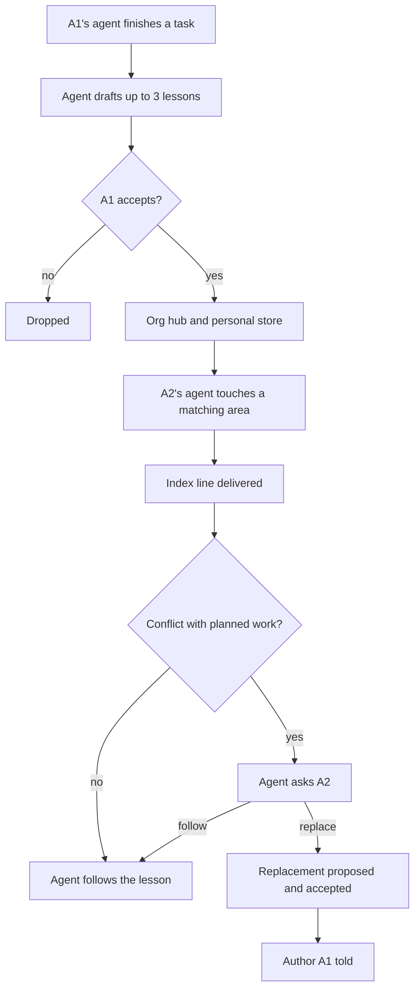
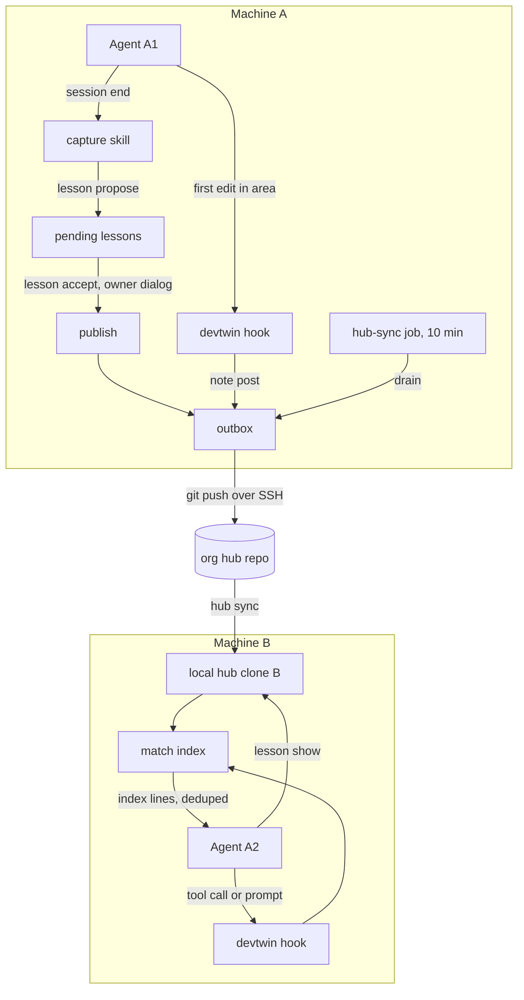
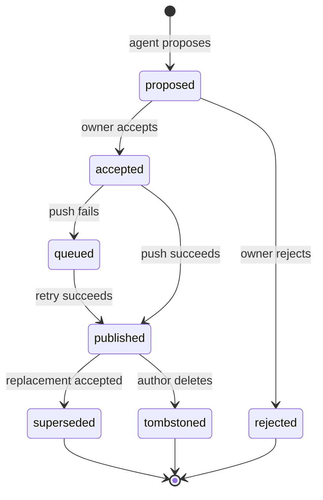
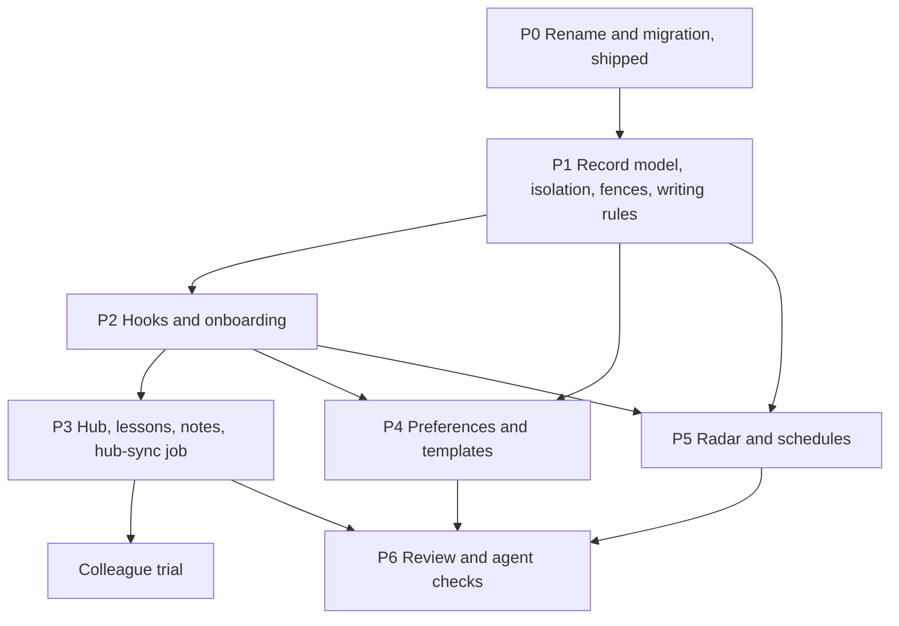

# devtwin Next Phase - Plan

## Goal Capsule

- **Objective:** Make devtwin a solo developer tool with an optional team layer. The tool captures what a developer knows and prefers. It moves approved lessons to colleagues' agents at the moment they need them. It keeps the developer current with their stack. Setup and change stay under the developer's control.
- **Product authority:** This Product Contract, then the Planning Contract, then repository instructions (`AGENTS.md`, `CONTRIBUTING.md`, `docs/SECURITY-MODEL.md`). The owner confirmed the scope on 2026-10-25 and chose one phased plan for all areas.
- **Execution profile:** Seven phases, P0 to P6, built in order. P0 (rename and live migration) shipped on `main` in commits `b5bf2e1` and `3b2f676`. Each phase ends with a green Verification Contract and the owner's review before the next phase starts. The colleague trial starts after P3, when the hub, lessons and notes exist.
- **Stop conditions:** Stop and ask the owner when a unit needs a new write location outside the fences listed in KTD7, when a change would publish anything off the machine without the consent model in KTD9 and KTD10, or when research shows a session-settled decision cannot work.
- **Tail ownership:** The owner approves every push, pull request and release. A commit-only request ends at the local commit.
- **Open blockers:** None.

---

## Product Contract

### Summary

devtwin becomes one tool, run through one command, that serves one developer first. A team can add a layer to it for each organization.

- **Team lessons:** agents draft lessons and the owner approves them. A private Git hub per organization shares them. An agent receives a lesson when it touches the matching area.
- **Overlap:** short automatic "working on" notes show when two people work in the same area.
- **Taste:** agents learn preferences from corrections and keep the developer's output formats.
- **Radar:** a weekly digest brings relevant releases and ideas, with guides for how to try them.
- **Setup review:** a monthly review lets the developer change the setup with agent help.
- **Onboarding:** an agent-led setup explains every permission.

### Problem Frame

A developer settles an approach while building with agents. A colleague in the same organization later works in the same area. The colleague does not know the earlier approach, and neither does the colleague's agent. The agent makes assumptions that differ from the settled approach. The team loses time, and the different assumptions lead to rework.

The same loss happens across projects and over time for one developer. Preferences ("use Playwright, not a browser"), report formats and lessons from past work exist only in the developer's head or in old sessions. Each new agent session starts without them.

Context has a cost. Giving every agent the full history of every decision uses time and tokens and adds noise. A useful system gives the right lesson at the right moment, and little else.

Developers also learn by trying new releases, tools and approaches. Today they find these by chance. Their setup drifts as their taste changes, and nothing helps them review it.

### Actors

- A1. Developer: owns their devtwin, approves every lesson, preference and setup change.
- A2. Colleague: a second developer in the same organization with their own devtwin.
- A3. Agent: Claude Code, Codex or another supported agent working for A1 or A2.
- A4. Organization hub: a private Git repository per organization that holds approved team lessons and "working on" notes.

### Key Decisions

- **Solo first, team as an add-on.** devtwin works fully for one developer. A developer joins an organization's hub separately for each organization. (session-settled: user-directed — chosen over a team-first tool, a single-org tool and a public-only tool: the owner works across several organizations.)
- **Lessons arrive just in time.** An agent gets a team lesson when it starts work on matching files, packages or topics, not in every session brief. (session-settled: user-directed — chosen over session-start delivery, a pre-plan checkpoint and on-request search: lowest token cost with the highest precision.)
- **Agents draft, owners approve.** At the end of a task, the agent proposes lessons in general form. Only lessons the owner accepts reach the hub. (session-settled: user-directed — chosen over merged-PR extraction, manual writing and auto-share: it keeps quality and leak control without much effort.)
- **A conflict stops the agent and asks.** The developer follows the lesson or proposes a replacement. The author learns about a replacement. (session-settled: user-directed — chosen over advice-only, hard rules and per-lesson strength: lessons go stale, and a colleague can be right.)
- **"Working on" notes are automatic, with one consent.** The developer consents once when joining an organization's hub. Notes then post without a per-note approval, with tight content limits. This is the only content that leaves the machine without a per-item yes. (session-settled: user-directed — chosen over opt-in notes, show-then-post and area-only notes: overlap detection only works if notes exist.)
- **Two places for lessons.** Team lessons stay in their organization's hub. A lesson also goes to the developer's private personal store, which follows them to every organization, only when the owner marks it "general" while accepting it. That mark is the reviewed copy, and the default is hub only. A lesson moves into another organization's hub only by a manual, reviewed copy. (session-settled: user-directed — chosen over org-only and an added public hub. The "general" mark was confirmed at planning time so one client's lessons cannot follow the developer into another client's sessions.)
- **The hub is a Git repository.** It needs no server, works offline and uses the organization's existing Git permissions. Matching happens on the developer's machine. Notes can arrive minutes late. (session-settled: user-approved — chosen over a hosted hub service and lessons in project repositories: smallest thing that serves a two-person trial, and keeps devtwin content out of client repositories.)
- **Every change stays developer-driven.** Agents propose; the developer decides. This applies to lessons, preferences, templates and setup review.

### Requirements

**Shared foundations**

- R1. devtwin has one command entry point for every capability in this plan.
- R2. Lessons, preferences, notes and radar items use one shared record model. That model has an owner, a scope (personal, project or organization), what the record applies to, evidence, a revisit date and replacement history.
- R3. Each record is either a project fact, which stays in its project, or a lesson, which is general and can move.
- R4. No content from one organization enters another organization's hub, digest or brief unless the developer copies it by hand. Package names are the one exception: a digest may rank by packages from any of the developer's projects, but never shows another organization's project names.
- R5. Every outbound item passes the existing sensitive-content check before it leaves the machine.
- R6. The developer can list, view and delete everything devtwin has published in their name. A delete stops every devtwin from delivering the item, and the interface states that Git history and colleagues' clones keep the text.

**Onboarding**

- R7. A new developer can start setup in two ways: by asking an agent in the clone, or by running the setup command. Both use the same steps and consent screens.
- R8. Each setup step states what it will touch, why, and how to undo it, and then waits for a yes.
- R9. Setup covers installing the agent skills, the personal profile, starter preferences and templates, the first project, joining an organization hub, and each scheduled job.
- R10. Each scheduled job (hub sync, weekly radar, security advisories, monthly review reminder) has its own consent and its own off switch. Notes use the consent given at hub join.
- R11. For each project, setup recommends agent sandbox settings, and a container setup when the project needs one. The developer applies them; devtwin does not apply them on its own.

**Team learning protocol**

- R12. At the end of a task, the agent proposes up to three lessons, in general form with no client-specific detail.
- R13. The developer accepts, edits or rejects each proposed lesson. An accepted lesson goes to the organization hub, and also to the personal store when the developer marks it "general".
- R14. When an agent starts work on files, packages or topics that match a team lesson, the agent receives that lesson.
- R15. Lesson delivery is layered. The agent first receives a one-line index entry and loads the full lesson only when it asks.
- R16. When the agent's planned work conflicts with a lesson, the agent stops and tells its developer which lesson conflicts and why.
- R17. In a conflict, the developer can follow the lesson or propose a replacement. An accepted replacement supersedes the old lesson, and its author is told.
- R18. A developer can manually copy a personal lesson into another organization's hub after review.
- R43. Lesson and note text written by another person reaches an agent as fenced, attributed, length-capped data, never as instructions.

**"Working on" notes**

- R19. On an agent's first edit in an area during a session in a hub-joined project, devtwin posts a "working on" note to that organization's hub.
- R20. A note holds only the area (paths or packages), one short line and the developer's handle and time. It expires after a few days.
- R21. When an agent touches an area that matches a colleague's active note, the agent tells its developer who is working there.
- R22. Notes go only to the hub of the project's organization.

**Preferences and taste**

- R23. When the developer corrects an agent, the agent proposes saving the correction as a preference. The developer confirms or declines.
- R24. Confirmed preferences reach every supported agent through its user-level instruction files, never a repository's own instruction files.
- R25. devtwin ships starter output templates for at least RCA, report and decision note, each in HTML or Markdown.
- R26. The developer can replace a starter template by pointing at an output they liked. devtwin saves that output's structure, with no client-specific content.
- R27. An agent may suggest one new output format when it fits, and asks before using it.

**Release radar**

- R28. The radar covers four kinds of item: releases in the developer's stack, new agent tools and skills, approaches and design ideas, and adjacent tech to try.
- R29. Relevance comes from the developer's real project stack and their stated interests.
- R30. Once a week, devtwin writes a digest in the developer's chosen format (HTML or Markdown) and shows a short desktop notification.
- R31. An urgent security fix for a package in the developer's stack triggers a notification at once.
- R32. Each item can open a short "how to try this" guide. devtwin creates no sandbox or project changes for it.
- R33. What the developer learns from trying an item can become a personal lesson through the same approval flow.

**Setup review**

- R34. Once a month, devtwin reminds the developer that a setup review is available, with a count of suggestions.
- R35. The review proposes changes to preferences, templates, skills, radar interests and accepted sandbox settings, based on corrections, unused items and radar findings.
- R36. The developer accepts or rejects each proposed change. Nothing changes without that decision.

**Writing standard**

- R37. devtwin's repository documentation follows STE-based rules, derived from ASD-STE100 Simplified Technical English.
- R38. A documentation check in CI enforces a defined subset of those rules.
- R39. Lessons, digests, guides and reports that agents write through devtwin follow the same rules.

**Naming**

- R40. The repository, package, documentation and command are renamed to devtwin. The existing GitHub repository is renamed in place, under the same account, and GitHub redirects the old URL.
- R41. No `devctx` command alias is kept. Existing installs move with `live migrate`, and the legacy `DEVCTX_KIT` variable is read for one transition with a deprecation note.
- R42. The rename includes a migration for existing live installs, covering the data folder and the installed skills.

### Key Flows

- F1. Lesson capture and delivery
  - **Trigger:** A1's agent finishes a task.
  - **Actors:** A1, A2, A3, A4
  - **Steps:** The agent drafts lessons. A1 accepts, edits or rejects each one. Accepted lessons go to the hub and the personal store. Later, A2's agent touches a matching area and receives the index line, then loads the full lesson if needed.
  - **Outcome:** A2's agent works with A1's approach.
  - **Covered by:** R12–R15
- F2. Lesson conflict
  - **Trigger:** A2's agent plans work that contradicts a delivered lesson.
  - **Actors:** A2, A3, A1
  - **Steps:** The agent stops and names the lesson and the reason. A2 follows the lesson or proposes a replacement. An accepted replacement supersedes the old lesson, and A1 is told.
  - **Outcome:** Either the old lesson is kept or a newer one replaces it; there is never a silent divergence.
  - **Covered by:** R16, R17
- F3. Overlap detection
  - **Trigger:** A1's agent makes its first edit in an area during a session in a hub-joined project.
  - **Actors:** A1, A2, A3, A4
  - **Steps:** devtwin posts a note with the area and one line. A2's agent later touches the same area and tells A2 that A1 is working there.
  - **Outcome:** A1 and A2 coordinate before either one builds a conflicting change.
  - **Covered by:** R19–R22
- F4. Onboarding
  - **Trigger:** A2 clones devtwin and asks an agent "set me up" or runs the setup command.
  - **Actors:** A2, A3
  - **Steps:** Each step explains what it touches, why and how to undo it, and then waits for a yes. Steps cover skills, profile, preferences, templates, the first project, the hub and each scheduled job.
  - **Outcome:** A2 has a working devtwin and knows what it does.
  - **Covered by:** R7–R11
- F5. Weekly radar
  - **Trigger:** The weekly scheduled job runs.
  - **Actors:** A1
  - **Steps:** devtwin collects items, ranks them by relevance to A1's stack and interests, writes the digest and notifies A1. A1 opens a "how to try this" guide for an item.
  - **Outcome:** A1 learns about relevant changes without searching.
  - **Covered by:** R28–R33

### Acceptance Examples

- AE1. **Covers R14, R15.** Given an accepted team lesson about a package, when A2's agent starts editing code that imports that package, then the agent receives the lesson's index line, and the full body loads only if the agent asks.
- AE2. **Covers R14.** Given a team lesson about one package, when A2's agent works only on unrelated files, then the agent receives nothing about that lesson.
- AE3. **Covers R16, R17.** Given a delivered lesson, when A2's agent plans a different approach, then it stops and asks A2 before making the change. When the lesson arrives only after an edit (Codex edit-triggered delivery), the agent re-checks that edit and offers to revert it. If A2 proposes a replacement and it is accepted, A1 is told.
- AE4. **Covers R4, R22.** Given that A1 works for two organizations, when A1 works in a project of the first organization, then no note or lesson goes to the second organization's hub.
- AE5. **Covers R20, R21.** Given A1's note on an area, when the note is older than its expiry, then A2's agent no longer reports it.
- AE6. **Covers R5.** Given a drafted lesson or note that contains a credential pattern, when devtwin tries to publish it, then publication is refused.
- AE7. **Covers R10.** Given that A1 switched off the radar job, when the week passes, then no fetch, digest or notification happens. Switching off the radar also switches off the security-advisory job.
- AE8. **Covers R23.** Given that A1 tells an agent "use Playwright, not a browser", when A1 confirms the proposal, then the next session of every supported agent receives that preference.

### Success Criteria

These are measured during the two-person trial with the owner and one colleague:

- A colleague's agent surfaces one of the owner's lessons, and it changes what the agent does, at least a few times.
- At least once, a "working on" note shows two people in the same area before either one builds the wrong thing.
- The extra context devtwin adds to a session stays under about 1,000 tokens unless the agent asks for more.

### Scope Boundaries

**Deferred for later**

- A hosted hub service, and an MCP query interface for the hub.
- A public community hub.
- Lessons stored inside project repositories, as a per-organization option.
- Sandboxes or worktrees created by "try it".

**Outside this product's identity**

- Automatic setup changes without the developer's decision.
- Sharing between organizations without a manual, reviewed copy.

<!-- ce-section: work-relationships -->
### How This Work Fits Together

This plan covers every area in seven phases. The dependencies between areas set the order:

- Rename (R40–R42) shipped first, so new code is built under the devtwin name.
- The shared record model (R2–R6) and the writing rules (R37–R39) enable everything after them.
- The hook layer enables just-in-time lessons (R14) and automatic notes (R19). Onboarding (R7–R11) installs it.
- Team learning and notes (R12–R22, R43) depend on onboarding, because a second developer must install devtwin. The colleague trial starts after them.
- Preferences (R23–R27) share the owner-approval gate with lessons and the instruction block with conflict handling.
- The radar (R28–R33) extends the existing stack watch and shares scheduled-job consent (R10) with the review reminder.
- Setup review (R34–R36) depends on signals from preferences, sandbox settings and the radar.
- The landing page is owned by another workstream.

### Dependencies / Assumptions

- Records already support decision, fact and experiment kinds with supersession by expected hash (`src/records/schema.mjs`, `src/records/store.mjs`). Lesson and preference kinds do not exist yet. Records are keyed by scope and project today (`src/identity/ids.mjs`).
- The hub module can write a private learning proposal from confirmed records but publishes nothing (`src/hubs/propose.mjs`, `docs/ARCHITECTURE.md`).
- Briefs are capped at 12 items and 24,576 body bytes (`src/context/brief.mjs`).
- The stack watch (the existing announcement watch) is manual, has no schedule, refuses a live config and matches whole words only (`docs/LIMITATIONS.md`).
- Claude Code and Codex both have hooks (checked against their docs on 2026-10-25). Claude Code tool events carry file paths. Codex tool events carry patch or command text, so Codex sees edits but not files it reads through the shell. Delivery therefore differs by agent.
- Git runs with global config disabled (`src/identity/git.mjs`), so the keychain credential helper is not available to devtwin's Git calls. `SSH_AUTH_SOCK` passes through.
- Hub sync, the radar, advisories and the review reminder are devtwin's first scheduled background jobs on a developer's machine.
- The full ASD-STE100 dictionary is not used. The CI check enforces a defined subset, and docs are described as "STE-based", not "STE-compliant".
- macOS is the only supported platform, as today. Schedules use launchd, and the owner dialog uses the system dialog.
- Hub identity rests on Git push access, not on signatures. Anyone with push access to a hub is trusted to post, and that trust is documented.

### Outstanding Questions

**Deferred to Implementation**

- Which feeds supply "approaches" and "adjacent tech" radar items. U19 starts with a small reviewed list and measures noise.
- Whether user-level Claude Code path-scoped rules can match files in any project. If they can, they may replace part of the hook delivery for Claude Code later.
- Whether a Codex hook trust hash covers only the config entry or also the script it runs. U8 tests this and keeps the config line stable either way.
- Whether Codex delivers PreToolUse `additionalContext` before its next tool call or only at the end of the turn. U23 measures it.
- The pass rate that counts as passing for the conflict-stop scenario. U23 sets it from the first five runs per agent, and the owner confirms it.

### Sources / Research

- `docs/plans/2026-10-16-001-feat-personal-harness-template-plan.md`: profile, setup skill and stack watch units.
- `docs/plans/2026-10-17-001-feat-organization-identity-routing-plan.md`: per-scope accounts and the public-read binding for release checks.
- `docs/HANDOFF.md`: bounded selected-record export and its exclusions.
- `docs/LIMITATIONS.md`: current limits of live mode, the watch and the installer.
- `src/storage/source-read.mjs`, `src/storage/fsx.mjs`: no-follow, size-capped private reads.
- Claude Code hooks and memory docs (code.claude.com/docs/en/hooks, /en/memory) and Codex hooks and AGENTS.md docs (learn.chatgpt.com/docs/hooks, /docs/agent-configuration/agents-md), read 2026-10-25.

---

## Planning Contract

**Product Contract preservation:** changed R4, R6, R10, R13, R19, R24, R35 and R41, the flow F3 trigger, AE3, AE7, the "Two places for lessons" Key Decision and the hooks assumption. These are clarifications from the 2026-10-25 planning and document review, and the owner confirmed each one. Added R43 (inbound text is data). R41 now drops the `devctx` command alias at the owner's direction.

### Key Technical Decisions

**Hub and transport**

- KTD1. **The org hub is a Git repository that devtwin clones locally.** All delivery reads the local clone. The network is used only by `hub sync` and publishing. (session-settled: user-approved — chosen over a hosted hub service and lessons in project repositories: no server holds client knowledge.)
- KTD2. **Hub layout is one file per item.** Lessons live at `lessons/<lsn_id>.md`, notes at `notes/<handle>/<note_id>.json` and tombstones at `tombstones/<id>.json`. `hub.json` carries `hubId` and `schemaVersion`. A developer only adds or removes their own files. On a rejected push, devtwin fetches, rebases, re-runs every precondition (including the predecessor check in KTD3), and retries up to three times. Then it queues the item in a local outbox. It never force-pushes.
- KTD3. **Hub records get their own identity.** A lesson ID is `lsn_` plus a hash of hub ID, author handle, request ID and creation time. The hub copy carries a back-reference to the local record hash. The full local record is never published. A replacement names its predecessor's hash. A second replacement of the same predecessor fails with `STALE_VERSION` after any fetch. "Contested" applies only when both were already pushed before either client saw the other.
- KTD4. **A scope binds to one hub by an explicit owner step.** `hub join` stores the binding, the developer's hub handle and the commit email. Routing never uses a remote URL, because remotes are evidence, not identity (`docs/LIMITATIONS.md`). A project with no binding has no hub.
- KTD18. **Hub remotes are SSH only, with a per-hub identity.** `hub join` refuses HTTPS remotes and remotes with user info, and checks reachability. Hub Git writes pass the recorded handle and email as per-command config, keep global config, hooks and filters disabled, and use an optional per-hub SSH command for the organization's key.
- KTD19. **Hub content is untrusted input.** Hubs are cloned and synced with symlinks off and no submodules. Every hub file is read through the existing no-follow, regular-file, size-capped reader. Non-regular entries are refused. File size, file count and JSON depth are capped for `hub.json`, notes and lessons.
- KTD20. **Authorship is a claimed handle.** A tombstone is honored only when its handle matches the target's author. A replacement from anyone goes through the supersession flow and the author is told. Agents show attribution as "claimed by <handle>". `docs/SECURITY-MODEL.md` states that hub identity rests on Git push access.

**Records and isolation**

- KTD5. **Record schema v2 adds lesson and preference kinds.** It also adds a `class` (fact or lesson), a `match` block (paths as repo-relative globs, packages, topics) and a new top-level `reach` field (personal, project or org). The existing `applicability.level` values stay unchanged. v1 records stay readable and are never rewritten.
- KTD21. **Personal and org records get their own homes.** A reserved `personal` store under `dataRoot/personal/records/` has its own ID scheme and the same bundle-hash integrity checks, without a registry or project binding. Org-level lessons live under the scope with no project. (session-settled: user-directed — chosen over project-only records and one flat personal file: general lessons and preferences must follow the developer, with per-record supersession.)
- KTD11. **Isolation checks run against every joined scope.** The identifier check moves from `src/hubs/propose.mjs` into a shared module. Outbound text is checked against the names, paths and hosts of all scopes, as whole words. Shared code hosts, and any host found in two or more scopes, are left out. Outbound checks run again when an outbox item is pushed. Inbound text is fenced, attributed as claimed, stripped of control characters and capped at 600 tokens per body.

**Delivery**

- KTD6. **Just-in-time delivery uses one thin hook command with a fast path.** `devtwin hook <event>` reads the agent's JSON from stdin and returns `additionalContext`. It makes no model call and no network call. It does not run the full pilot load or context resolution. It looks up the canonical repo root in a path-to-scope map stored with the match index, and trusts a kit-verification receipt that `agents install` and the session-start event refresh. A linked Git worktree resolves to its parent project through the Git common directory. The hook fails open on any error. Claude Code paths come from tool input. Codex paths come from `apply_patch` text and, on a best-effort basis, shell commands. User-prompt events also match topics and package names, so a lesson can arrive before the first edit. On Codex, an edit-triggered lesson arrives after that edit runs, and the capture skill then re-checks the edit. (session-settled: user-directed — chosen over session-start delivery: lowest token cost with the highest precision. Linked worktrees: user-directed — chosen over lessons-only and none: multi-agent work runs in child worktrees.)
- KTD22. **The hook takes no pilot lock and never rebuilds the index.** Per-session dedupe state is a small file per session written by atomic replace. Index rebuilds run only in `hub sync`, record commands and lesson commands. `hub sync` and scheduled jobs take a dedicated `hub-sync` lock that can be released by hand.
- KTD23. **A task is one agent session.** The session ID from the hook payload scopes the three-lesson proposal cap, note posting and dedupe.
- KTD8. **The hook triggers and the skill judges.** Hooks only match and emit index lines. Conflict detection (R16) is the agent's judgment, prompted by one line in the capture skill and later in the managed instruction block. No `deny` or `ask` hook decision is used for lessons, because the owner rejected hard rules. Lessons are guidance about approach only. An agent never runs commands, fetches URLs, installs packages or changes permissions because a lesson says so without asking its developer. (session-settled: user-directed — chosen over hard rules and advice-only: lessons go stale and a colleague can be right.)
- KTD17. **Token budget is measured, not assumed.** The hook logs injected bytes per session, and `devtwin budget report` summarizes them. Caps: preference block 300 tokens, session-start line 100, index lines 60 each with at most 4 per session, and one overflow line ("N more lessons match; run `devtwin lesson match`") at the cap. Colleague-note reports and status markers count against the same budget. Skill descriptions are about 300 tokens. Dedupe and the cap reset after compaction. Full bodies load only on request.

**Owner approval and consent**

- KTD9. **Owner-only actions need a hook block and a dialog.** The owner-only actions are lesson accept to a hub, lesson copy, published delete, hub join, pref accept, instructions apply and live migrate apply. devtwin's own hook denies these commands when an agent shell runs them, including through terminal wrappers. Each command also shows a macOS dialog with the exact content and needs a click. The terminal prompt alone is treated as protection against accidents, not as proof that the owner is present. (session-settled: user-directed — chosen over dialog-only and hook-only: two independent controls, including against an agent faking a terminal.)
- KTD10. **Notes are the one standing-consent action.** `hub join` records a consent with a digest of the note rules: at most 10 repo-relative paths, a line built mechanically from the branch name and the changed areas (never from prompt text or agent text), the handle, the time and a 72-hour expiry. The join screen shows the line format. Only the hook event path may post a note under this consent, at most six per session. Direct agent calls are refused. The sensitive and all-scope checks run before the outbox. If the rules change, the consent is void. (session-settled: user-directed — chosen over opt-in and show-then-post notes: overlap detection needs notes to exist.)
- KTD15. **Schedules use launchd with receipts.** Each job is a user LaunchAgent. It checks the live gate and its config flag first, writes a last-run receipt, and skips if it already ran within its period, so missed runs collapse into one run at wake. A disabled job makes no network call. The hub-sync job runs every 10 minutes, drains the outbox on every run, and is installed by the hub-join step. Its off switch states that both notes and lesson updates stop.
- KTD24. **Notification text never enters a script.** Notification text goes to the system notification command only as an argument. It is stripped of control characters and quotes and capped in length.

**Preferences, onboarding, radar, rename**

- KTD12. **Preferences go into user-level files only.** For Claude Code, devtwin owns one file, and a marker-delimited import block in `~/.claude/CLAUDE.md` points to it. For Codex, devtwin owns a marker-delimited block in `~/.codex/AGENTS.md`. The block is capped at 1,200 characters and round-trips edits outside its markers. Preference text passes the injection and isolation checks before rendering. Repository-owned instruction files stay untouched.
- KTD13. **Setup has one set of step primitives.** `setup plan|apply --step <id>` carries each step's what, why and undo. The `devtwin setup` terminal loop and the setup skill both call these primitives, so both entry points show the same consent screens. Steps whose features land in later phases are shown as "not available yet".
- KTD16. **The radar extends the stack watch.** The live-mode block on the watch lifts only through the new live-mode exception. Digests are per scope and rank by package names from any project, never showing another scope's project names. Security advisories are checked hourly, with at most three alerts a day and one per advisory. "How to try this" guides use a fixed template plus sourced links, and never copy instructions from feed text.
- KTD14. **The rename shipped without a command alias.** The package, command, skills, error codes, data folder and environment variable are devtwin (`b5bf2e1`). `live migrate` moves an existing install and never deletes the legacy folder (`3b2f676`). `DEVCTX_KIT` is read for one transition and reported as deprecated. (session-settled: user-directed — chosen over a 90-day `devctx` alias: nothing was released, and the owner's install is the only one.)
- KTD7. **New write locations are explicit, reviewed fence exceptions.** These are the hub clone root, the devtwin-owned instruction file, marker-delimited blocks in `~/.claude/CLAUDE.md` and `~/.codex/AGENTS.md`, hook entries in agent settings files, and launchd plists. Each is listed in the live config digest and in a new "Live-mode exceptions" section of `docs/LIVE.md` and `docs/SECURITY-MODEL.md`. Every other path stays refused.

### High-Level Technical Design

Component flow for lessons and notes:

Lesson lifecycle:

Phase sequencing:

### Implementation Constraints

- Keep the zero-dependency rule. Git runs through the existing child-process pattern with hooks and filters disabled (`src/identity/git.mjs`).
- Every state change uses preview then apply with a fingerprint (`src/storage/plan.mjs`). Agents never run an apply without an explicit yes in the session, and docs and skills keep the approval phrase next to each `--apply` (`test/docs.test.mjs`).
- New and migrated private folders are created 0700 and files 0600 with exclusive no-follow writes.
- Every new file goes into `scripts/package-allowlist.json`. Every new test name goes into `test/required-tests.json`. Every new acceptance check updates the counts in `.github/workflows/ci.yml`.
- Never write real client, repository or account names into tracked files. Fixtures use `example` scopes.

---

## Implementation Units

| U-ID | Title | Files touched | Depends on |
|---|---|---|---|
| U1 | Rename identifiers and package (shipped) | `package.json`, `bin/devtwin.mjs`, `src/errors.mjs`, `skills/` | none |
| U2 | Live-install migration (shipped) | `src/config/migrate.mjs`, `src/config/legacy.mjs` | U1 |
| U3 | Record schema v2 | `src/records/schema.mjs`, `schemas/record.schema.json`, `src/identity/ids.mjs` | U1 |
| U4 | Personal store, org home and isolation | `src/records/isolation.mjs`, `src/records/personal.mjs`, `src/records/store.mjs` | U3 |
| U5 | Fence exceptions | `src/config/pilot.mjs`, `src/config/live.mjs`, `docs/LIVE.md` | U1 |
| U22 | STE writing rules and linter | `src/writing/ste.mjs`, `scripts/check-writing.mjs`, CI | U1 |
| U6 | Match index and lesson reads | `src/lessons/index.mjs`, `src/lessons/match.mjs` | U3, U4 |
| U7 | Hook command and budget meter | `src/hooks/` | U6 |
| U8 | Hook and skill installation, owner-action block | `src/agents/hooks-install.mjs`, `skills/devtwin-capture/` | U5, U7 |
| U9 | Setup wizard | `src/setup/`, `skills/devtwin-setup/SKILL.md` | U8 |
| U10 | Hub join, sync, leave and the hub-sync job | `src/hubs/join.mjs`, `src/hubs/sync.mjs`, `src/hubs/git-write.mjs`, `src/schedule/launchd.mjs` | U4, U5, U6 |
| U11 | Lesson propose, accept and publish | `src/lessons/propose.mjs`, `src/lessons/publish.mjs`, `src/owner/dialog.mjs` | U8, U10 |
| U12 | Supersession and conflict | `src/lessons/supersede.mjs` | U11 |
| U13 | "Working on" notes | `src/notes/` | U7, U10 |
| U14 | Published items and tombstones | `src/hubs/published.mjs` | U11, U13 |
| U15 | Preference capture | `src/prefs/` | U4, U8, U11 |
| U16 | Managed instruction block | `src/agents/instructions.mjs` | U5, U15 |
| U17 | Output templates | `templates/outputs/`, `src/templates/outputs.mjs` | U4, U22 |
| U18 | Live-mode exception for the stack watch | `src/stack/check.mjs`, `src/stack/digest.mjs` | U5 |
| U19 | Radar sources, ranking and digest | `src/stack/`, `catalog/stack-sources.json` | U18, U22 |
| U20 | Radar, advisory and review schedules; notifications | `src/schedule/`, `src/schedule/notify.mjs` | U10, U9 |
| U21 | Setup review | `src/review/` | U15, U19, U20 |
| U23 | Real-agent acceptance scenarios | `scripts/agent-scenarios/` | U9, U12, U13, U16 |

### Phase P0: Rename (shipped)

### U1. Rename identifiers and package (shipped)

**Goal:** Rename the product to devtwin in every identifier.
**Requirements:** R40, R41; KTD14.
**Dependencies:** none.
**Files:** shipped in `b5bf2e1` (`package.json`, `bin/devtwin.mjs`, `src/errors.mjs`, `skills/devtwin-*`, docs and tests).
**Approach:** Done on `main`. No `devctx` command alias is kept. Remaining `devctx` text is limited to the legacy-migration code, legacy receipt recognition, the `DEVCTX_KIT` fallback lines, the migration section of `docs/LIVE.md`, and historical files under `docs/plans/` and `docs/research/`.
**Test expectation:** none -- shipped; the suite passed 509/509 on `30cb15e`.
**Verification:** `node bin/devtwin.mjs version` returns name `devtwin`.

### U2. Live-install migration (shipped)

**Goal:** Move an existing live install to devtwin safely.
**Requirements:** R42; KTD14.
**Dependencies:** U1.
**Files:** shipped in `3b2f676` (`src/config/migrate.mjs`, `src/config/legacy.mjs`, `src/agents/install.mjs`, `src/agents/inventory.mjs`).
**Approach:** Done on `main` as `live migrate`. It copies the store with the same modes, records a migration receipt, recovers from a crash on the next apply, and never deletes the legacy folder. The owner's own migration is an operational step.
**Test expectation:** none -- shipped with its tests.
**Verification:** The owner's live brief hash matches before and after `live migrate`.

### Phase P1: Foundations

### U3. Record schema v2

**Goal:** Add lesson and preference records with match fields and reach.
**Requirements:** R2, R3; KTD5.
**Dependencies:** U1.
**Files:** `src/records/schema.mjs`, `schemas/record.schema.json`, `src/records/store.mjs`, `src/identity/ids.mjs`, `src/context/brief.mjs`, `test/records-v2.test.mjs` (new), `docs/STORAGE.md`.
**Approach:** Add the kinds `lesson` and `preference`, a `class` field, a `match` block with capped path globs, package names and topics, and a top-level `reach` field. The reader accepts v1 and v2, and writers write v2. Path globs must be repo-relative, under the same deny rules as `file:` sources. ID helpers gain personal and org forms used by U4.
**Patterns to follow:** `validateDraft` allowlists and caps in `src/records/schema.mjs`.
**Test scenarios:**
- Happy path: a lesson draft with paths, packages and topics validates and round-trips.
- Edge case: a v1 record reads unchanged next to v2 records in one snapshot.
- Error path: an absolute path or `..` in a match glob is refused.
- Error path: a `preference` with project reach is refused.
- Integration: a v2 project lesson passes the handoff privacy check unchanged.
**Verification:** The old record tests pass unchanged and the v2 tests pass.

### U4. Personal store, org home and isolation

**Goal:** Store personal and org-level records, and block cross-scope leaks.
**Requirements:** R4, R5, R13, R43; KTD11, KTD21.
**Dependencies:** U3.
**Files:** `src/records/isolation.mjs` (new), `src/records/personal.mjs` (new), `src/records/store.mjs`, `src/hubs/propose.mjs`, `test/isolation.test.mjs` (new), `test/personal-store.test.mjs` (new).
**Approach:** Add the reserved personal store with its own reader, writer and integrity checks, and an org-level record folder under each scope. Move the identifier check out of `src/hubs/propose.mjs` into `isolation.mjs`. Outbound checks use whole-word matching across every scope, leaving out shared code hosts. Inbound rendering fences text, attributes it as claimed, strips control characters and caps its length.
**Patterns to follow:** `src/hubs/propose.mjs` identifier check; `src/handoff/privacy.mjs`; `termPattern` in `src/stack/match.mjs`.
**Test scenarios:**
- Covers AE4. A lesson accepted as general that mentions scope B's project name is refused when it comes from scope A.
- Covers AE6. A lesson body with a credential pattern is refused before publication.
- Happy path: a clean general lesson lands in the personal store and reads back with its hash checked.
- Happy path: a lesson that names `github.com` passes the outbound check.
- Edge case: a two-letter scope ID inside a longer word does not trigger a refusal.
- Edge case: inbound text with control characters and an "ignore previous instructions" line renders fenced and stripped.
- Error path: a tampered personal record is reported as corrupt.
**Verification:** The isolation and personal-store tests pass, and the hub proposal tests still pass after the move.

### U5. Fence exceptions

**Goal:** Allow the new write locations, and only those.
**Requirements:** R9, R19, R24, R30; KTD7.
**Dependencies:** U1.
**Files:** `src/config/pilot.mjs`, `src/config/live.mjs`, `schemas/pilot.schema.json`, `test/fence-exceptions.test.mjs` (new), `docs/LIVE.md`, `docs/SECURITY-MODEL.md`.
**Approach:** Add named write classes: `hubRoot`, `instructionTargets` (the devtwin-owned file plus marker blocks in `~/.claude/CLAUDE.md` and `~/.codex/AGENTS.md`), `hookTargets` and `launchAgents`. Each class lists exact paths that the owner approves in the live config, and the config digest covers them. `assertWritable` accepts a destination only when it is in an approved class. Edits to files the developer owns are limited to devtwin markers or keys, with a byte-exact backup in the run folder.
**Patterns to follow:** `assertWritable` and `skillDirsFor` in `src/config/pilot.mjs`.
**Test scenarios:**
- Happy path: an approved hook target accepts a write to devtwin's own entry.
- Error path: a write to an unapproved file in the same folder is refused.
- Error path: changing an approved class without re-approval fails with `GATE_REQUIRED`.
- Integration: a marker-block edit in a fixture `CLAUDE.md` keeps every byte outside the markers.
**Verification:** Every existing protected-home test still refuses, and the new classes pass their tests.

### U22. STE writing rules and linter

**Goal:** Enforce STE-based writing in docs and devtwin-generated text.
**Requirements:** R37, R38, R39.
**Dependencies:** U1.
**Files:** `src/writing/ste.mjs` (new), `scripts/check-writing.mjs` (new), `docs/WRITING.md` (new), `.github/workflows/ci.yml`, `package.json`, `test/writing.test.mjs` (new).
**Approach:** Define the rule subset: sentences of at most 25 words in procedures and 30 elsewhere, one instruction per step, a short banned-word list, and passive-voice and future-tense heuristics in procedures. The linter runs on `docs/`, `README.md` and `skills/`, skips code blocks and `docs/plans/`, and supports a reviewed allowlist. Later renderers for lessons, digests, guides and templates call the same module.
**Test scenarios:**
- Happy path: a compliant paragraph passes.
- Error path: a 31-word sentence fails, and the result gives the file and line.
- Edge case: text inside code fences is ignored.
**Verification:** CI runs the linter, and the current docs pass after fixes.

### Phase P2: Hooks and onboarding

### U6. Match index and lesson reads

**Goal:** Find relevant lessons for paths, packages and topics quickly and within budget.
**Requirements:** R14, R15; KTD17.
**Dependencies:** U3, U4.
**Files:** `src/lessons/index.mjs` (new), `src/lessons/match.mjs` (new), `src/lessons/commands.mjs` (new), `src/cli.mjs`, `test/lesson-match.test.mjs` (new).
**Approach:** Build an index file per scope from project records, org-level records and the personal store. U10 adds the hub clone as a source. The index also stores the path-to-scope map that the hook uses. `lesson match` returns index lines of at most 60 tokens each: title, a one-line "do or do not", claimed author and ID. `lesson show <id>` returns the fenced body.
**Patterns to follow:** `src/stack/match.mjs`; the brief's `review[]` index-line pattern.
**Test scenarios:**
- Covers AE1. Editing a file that imports a package with a lesson returns that lesson's index line.
- Covers AE2. Unrelated paths return nothing.
- Edge case: a tombstoned or superseded lesson never matches.
- Edge case: an expired revisit date returns the line marked "stale, revisit".
**Verification:** Matching on a 500-lesson fixture takes under 50 ms.

### U7. Hook command and budget meter

**Goal:** Deliver index lines from agent hooks quickly and measure what is injected.
**Requirements:** R14, R15; KTD6, KTD17, KTD22, KTD23.
**Dependencies:** U6.
**Files:** `src/hooks/commands.mjs` (new), `src/hooks/paths.mjs` (new), `src/hooks/session.mjs` (new), `src/cli.mjs`, `test/hooks.test.mjs` (new), `test/fixtures/hooks/` (Claude Code and Codex payloads).
**Approach:** `devtwin hook <event>` handles SessionStart, UserPromptSubmit, PreToolUse and PostToolUse on the fast path in KTD6, without a pilot lock. Session start emits one short line confirming the hook is live and counting matches. Paths come from Claude Code tool input, from Codex `apply_patch` text and, best effort, from shell commands. Topics and packages come from prompts. Dedupe and the cap reset after compaction, and the cap emits one overflow line. Injected bytes are logged, and `budget report` summarizes them.
**Patterns to follow:** `src/storage/fsx.mjs` atomic replace.
**Test scenarios:**
- Happy path: a Claude Code Edit payload on a matching file returns one index line.
- Happy path: a Codex `apply_patch` payload touching a matching path returns the same line.
- Happy path: a prompt naming a package with a lesson returns its line before any edit.
- Edge case: the same lesson in a second event of the same session is not repeated, and after a compact event it is delivered again.
- Edge case: a session's fifth match produces one overflow line instead of a fifth index line.
- Edge case: a linked worktree of a bound project receives that project's lessons.
- Error path: a missing kit, corrupt index or kill during a run returns an empty result with exit 0, and a following `lesson match` succeeds.
- Covers AE4. In a scope A repo, a scope B lesson never appears.
**Verification:** End-to-end p95 hook time, including Node startup, stays under 200 ms on a live-mode fixture. `budget report` totals match the logged bytes.

### U8. Hook and skill installation, owner-action block

**Goal:** Install the hook entries and the capture skill with a visible diff, and block owner-only commands from agents.
**Requirements:** R8, R9; KTD7, KTD8, KTD9.
**Dependencies:** U5, U7.
**Files:** `src/agents/install.mjs`, `src/agents/hooks-install.mjs` (new), `src/agents/inventory.mjs`, `src/hooks/owner-block.mjs` (new), `skills/devtwin-capture/SKILL.md` (new), `skills/devtwin-setup/SKILL.md`, `test/hooks-install.test.mjs` (new), `test/owner-block.test.mjs` (new).
**Approach:** `agents install` previews the exact settings diff for Claude Code (`~/.claude/settings.json`) and Codex (`~/.codex/hooks.json`) and applies it with the fingerprint. The hook line is byte-stable across kit updates. `agents status` reports each hook as installed, missing or untrusted, with Codex `/hooks` trust instructions. The PreToolUse hook denies agent shell commands that run an owner-only action from KTD9, including through terminal wrappers. The bundled skills add `devtwin-capture` and update `devtwin-setup`. Capture covers lesson drafting, preference capture, conflict handling and the guidance-only rule from KTD8.
**Patterns to follow:** the installer journal and receipts in `src/agents/install.mjs`.
**Test scenarios:**
- Happy path: install on a fixture home adds only devtwin's hook entries, and uninstall removes only them.
- Edge case: re-running install after a kit update leaves the hook line unchanged.
- Error path: a PreToolUse payload running `devtwin lesson accept` directly or through a terminal wrapper is denied.
- Error path: a settings file with a foreign devtwin-like entry is not adopted.
- Integration: `agents status` reports a removed hook as missing.
**Verification:** Install, uninstall and reinstall round-trip on a fixture home, and every owner-only command is denied from a hooked agent shell.

### U9. Setup wizard

**Goal:** Guide a new developer through setup with consent at every step.
**Requirements:** R7, R8, R9, R10, R11; KTD13.
**Dependencies:** U8.
**Files:** `src/setup/steps.mjs` (new), `src/setup/commands.mjs` (new), `src/setup/tty.mjs` (new), `src/setup/sandbox.mjs` (new), `skills/devtwin-setup/SKILL.md`, `src/cli.mjs`, `test/setup.test.mjs` (new), `docs/GETTING-STARTED.md`.
**Approach:** Define the steps as data: live folder, skills, hooks, profile, starter preferences and templates, first project, hub join, and each scheduled job. Each step has a what, a why, an undo and a plan/apply pair. Steps for later phases show "not available yet". `devtwin setup` is a terminal loop over those steps, and the skill calls the same primitives. The sandbox step reads the project scan and recommends agent sandbox settings, plus a container setup when the scan finds services. It records which recommendations the developer accepted, as preferences, and writes no agent setting.
**Patterns to follow:** `profile plan|apply`; the `skills/devtwin-setup` conversation flow.
**Test scenarios:**
- Happy path: running every available step on a fixture home reaches a working brief.
- Edge case: declining the hub step leaves solo mode, and later steps still run.
- Edge case: re-running setup shows completed steps as done and changes nothing.
- Covers F4. Each step's preview shows what, why and undo text before any write.
- Error path: the terminal loop without a TTY refuses and points to the skill.
**Verification:** A fresh fixture home completes setup with no write outside approved classes.

### Phase P3: Hub, lessons and notes

### U10. Hub join, sync, leave and the hub-sync job

**Goal:** Connect a scope to an org hub safely and keep a local copy current.
**Requirements:** R4, R10, R22; KTD1, KTD2, KTD4, KTD15, KTD18, KTD19.
**Dependencies:** U4, U5, U6.
**Files:** `src/hubs/join.mjs` (new), `src/hubs/sync.mjs` (new), `src/hubs/git-write.mjs` (new), `src/hubs/read.mjs` (new), `src/schedule/launchd.mjs` (new), `src/hubs/commands.mjs`, `src/config/store.mjs`, `src/lessons/index.mjs`, `src/storage/lock.mjs`, `test/hub-sync.test.mjs` (new; local bare-repo fixtures).
**Approach:** `hub join --remote` refuses non-SSH and user-info remotes, checks reachability, previews, then clones with symlinks off and no submodules. It records the handle, commit email, scope binding and note consent, and offers to install the hub-sync job. Join is an owner-only action. `hub sync` takes the `hub-sync` lock, fetches with a timeout, reads hub files through the no-follow capped reader, drains the outbox, and rebuilds the index with the hub as a source. `hub leave` previews revoking consent, removing the job, turning delivery off and deleting the clone, and keeps personal copies. A newer hub schema version makes the client read nothing and warn.
**Patterns to follow:** `src/identity/git.mjs` safe Git execution; `src/storage/source-read.mjs`.
**Test scenarios:**
- Happy path: join, then sync, makes a colleague's lesson matchable.
- Happy path: commit and push to a bare-repo fixture work with no global Git config.
- Edge case: an offline sync keeps the old clone, and the brief shows "hub last synced N h ago".
- Edge case: leave removes delivery and the job, and keeps personal copies.
- Error path: an HTTPS remote is refused at join.
- Error path: a lesson committed as a symlink to a file outside the clone is refused, and nothing is read from the target.
- Error path: an oversized note file is refused.
- Error path: a hub with a newer schema version is read-only with a warning.
**Verification:** Two fixture machines sharing a bare repo exchange lessons and notes with only the hub-sync job running.

### U11. Lesson propose, accept and publish

**Goal:** Turn agent drafts into owner-approved team lessons.
**Requirements:** R12, R13, R18; KTD3, KTD9, KTD23.
**Dependencies:** U8, U10.
**Files:** `src/lessons/propose.mjs` (new), `src/lessons/publish.mjs` (new), `src/owner/dialog.mjs` (new), `src/lessons/commands.mjs`, `skills/devtwin-capture/SKILL.md`, `test/lessons.test.mjs` (new), `test/owner-dialog.test.mjs` (new).
**Approach:** `lesson propose --session <id>` lets an agent write up to three private pending lessons per session. `lesson accept|edit|reject` is for the owner. Accept takes a target (hub, or hub plus general). A hub target shows the owner dialog with the exact lesson text. Publish writes one file, commits, pushes, and on rejection re-runs preconditions after each rebase, up to three times, then queues to the outbox. `lesson copy --to-scope` covers R18 with the same checks and dialog. The dialog module is shared by every owner-only action.
**Patterns to follow:** `record propose` and `record publish`.
**Test scenarios:**
- Happy path: propose, accept to the hub after a dialog click, and the colleague fixture receives the lesson.
- Error path: accept with a hub target when the dialog is dismissed publishes nothing.
- Error path: accept run through a terminal wrapper from a hooked agent shell is denied before the dialog.
- Error path: a fourth proposal in one session is refused.
- Edge case: a rejected push after three retries lands in the outbox, and `status` shows it.
- Edge case: accept as general also writes the personal store.
**Verification:** No path publishes a lesson without the owner dialog.

### U12. Supersession and conflict

**Goal:** Replace stale lessons safely and tell the author.
**Requirements:** R16, R17; KTD3, KTD8.
**Dependencies:** U11.
**Files:** `src/lessons/supersede.mjs` (new), `src/context/brief.mjs`, `skills/devtwin-capture/SKILL.md`, `test/lesson-supersede.test.mjs` (new).
**Approach:** `lesson supersede-propose` names the predecessor's hash. Publish checks the predecessor after every fetch, including inside the retry loop. Two successors that were both pushed before either client saw the other are delivered as "contested". Authors find replacements of their own lessons on sync, and these appear in their next brief. Until U16 lands, the capture skill alone carries the conflict-stop rule.
**Patterns to follow:** `supersedeRecord` with expected hashes.
**Test scenarios:**
- Covers AE3. A replacement that is accepted and published appears in the author's next brief.
- Edge case: concurrent replacements from two fixtures leave one winner. The second push fails with `STALE_VERSION` after its rebase, and its local commit is dropped.
- Edge case: a raced double push shows both lessons as contested.
**Verification:** The superseded lesson stops matching on every fixture after sync.

### U13. "Working on" notes

**Goal:** Show live overlap between colleagues.
**Requirements:** R19, R20, R21, R22; KTD10, KTD23.
**Dependencies:** U7, U10.
**Files:** `src/notes/post.mjs` (new), `src/notes/commands.mjs` (new), `src/hooks/commands.mjs`, `test/notes.test.mjs` (new).
**Approach:** The first edit in an area during a session in a hub-bound project posts a note to the outbox under the standing consent. The line is built mechanically from the branch name and the changed areas. Only the hook path can post, at most six notes per session. A newer note from the same developer in the same area replaces the older one. Own notes are never reported back. A colleague's matching note is reported once per session per area, within the budget. Queued notes older than half their expiry are dropped. Revoking consent stops posting and offers to tombstone active notes.
**Patterns to follow:** U7 session dedupe.
**Test scenarios:**
- Covers F3. A note from fixture A is reported to fixture B's agent editing the same path.
- Covers AE5. A note past its expiry is not reported.
- Error path: a direct agent call to `note post` outside the hook path is refused.
- Error path: a note with 11 paths, or a seventh note in one session, is refused.
- Error path: a note post after the rules changed fails until consent is given again.
- Edge case: the note line never contains prompt text, even when the prompt names the area.
- Edge case: a developer's own note is never reported to them.
**Verification:** Notes go only to the bound hub of the current project's scope.

### U14. Published items and tombstones

**Goal:** Let a developer see and delete what devtwin published for them.
**Requirements:** R6; KTD20.
**Dependencies:** U11, U13.
**Files:** `src/hubs/published.mjs` (new), `src/hubs/commands.mjs`, `test/published.test.mjs` (new).
**Approach:** `published list` reads the author's own items from the hub clone, so it still works after local data is lost. `published delete` is an owner-only action. It previews the removal, pushes a commit that deletes the file and adds a tombstone, and prints the history caveat. Clients apply a tombstone only when its handle matches the target's author, and then purge cached copies.
**Test scenarios:**
- Happy path: a deleted lesson stops matching on the colleague fixture after sync.
- Error path: a tombstone from a different handle is ignored, and the lesson keeps matching.
- Edge case: list works from a fresh clone with an empty local store.
- Integration: the delete preview shows the Git-history caveat.
**Verification:** No delivery happens after a valid tombstone has been seen.

### Phase P4: Preferences and templates

### U15. Preference capture

**Goal:** Turn corrections into owner-confirmed preferences.
**Requirements:** R23; KTD9, KTD12.
**Dependencies:** U4, U8, U11.
**Files:** `src/prefs/commands.mjs` (new), `src/prefs/store.mjs` (new), `skills/devtwin-capture/SKILL.md`, `test/prefs.test.mjs` (new).
**Approach:** `pref propose` lets the agent write a pending preference after a correction. `pref accept` is an owner-only action with the dialog. `pref decline` is remembered, and that preference is not proposed again. Preference text passes the injection and isolation checks. The skill proposes at most once per kind of correction per session.
**Test scenarios:**
- Covers AE8. Accepting "use Playwright, not a browser" after a dialog click stores a personal preference.
- Error path: `pref accept` from a hooked agent shell is denied.
- Error path: a preference body with a client name fails the isolation check.
- Edge case: a previously declined preference is refused at propose time.
**Verification:** Preferences never enter a hub or a handoff packet.

### U16. Managed instruction block

**Goal:** Deliver preferences and the conflict rule to every agent session.
**Requirements:** R24, R27; KTD8, KTD12, KTD17.
**Dependencies:** U5, U15.
**Files:** `src/agents/instructions.mjs` (new), `src/agents/commands.mjs`, `test/instructions.test.mjs` (new).
**Approach:** `instructions plan|apply` renders the block: preferences, the conflict-stop line, the guidance-only rule, the one-new-format rule and the lesson lookup hint. For Claude Code it writes the devtwin-owned file and a marker-delimited import block in `~/.claude/CLAUDE.md`. For Codex it replaces a marker-delimited block in `~/.codex/AGENTS.md`. Apply is an owner-only action. Over 1,200 characters, the oldest preferences are dropped with a warning.
**Test scenarios:**
- Covers AE8. After apply, both fixture instruction files contain the preference.
- Happy path: the rendered block contains the conflict-stop and guidance-only lines.
- Edge case: text outside the markers in both files round-trips byte for byte.
- Edge case: a block over the cap drops the oldest preference and warns.
- Error path: a repository-level `AGENTS.md` is never a target.
**Verification:** A fresh agent session on each fixture sees the block.

### U17. Output templates

**Goal:** Ship starter formats and let developers save their own.
**Requirements:** R25, R26.
**Dependencies:** U4, U22.
**Files:** `templates/outputs/rca.md`, `templates/outputs/rca.html`, `templates/outputs/report.md`, `templates/outputs/report.html`, `templates/outputs/decision.md`, `templates/outputs/decision.html` (all new), `src/templates/outputs.mjs` (new), `test/output-templates.test.mjs` (new).
**Approach:** `template list|show` lists starter and personal templates. `template from --file` extracts headings and section order from an output the developer liked, runs the isolation and sensitive checks, and saves it as a personal template that overrides the starter of the same kind.
**Test scenarios:**
- Happy path: a saved template replaces the starter RCA for `template show rca`.
- Error path: a source file containing a credential pattern is refused, and the result says where.
- Edge case: a file with no headings is refused as "no structure".
**Verification:** The starter templates pass the STE check from U22.

### Phase P5: Radar and schedules

### U18. Live-mode exception for the stack watch

**Goal:** Let the stack watch run in live mode under a reviewed exception.
**Requirements:** R28; KTD16.
**Dependencies:** U5.
**Files:** `src/stack/check.mjs`, `src/stack/digest.mjs`, `docs/LIVE.md`, `docs/SECURITY-MODEL.md`, `test/stack-live.test.mjs` (new).
**Approach:** Replace the hard `GATE_REQUIRED` with a check for an approved `stackWatch` live exception that names hosts and caps. Requests stay unauthenticated and capped below the public rate limit. Digests are written per scope.
**Test scenarios:**
- Happy path: with the exception approved, `stack check` runs in a live fixture.
- Error path: without it, the old `GATE_REQUIRED` stays.
- Edge case: one scope's digest never lists another scope's project names.
**Verification:** The existing stack tests pass unchanged.

### U19. Radar sources, ranking and digest

**Goal:** Bring all four item kinds into a ranked weekly digest with try-it guides.
**Requirements:** R28, R29, R30, R31, R32, R33, R39; KTD16.
**Dependencies:** U18, U22.
**Files:** `catalog/stack-sources.json`, `src/stack/catalog.mjs`, `src/stack/rank.mjs` (new), `src/stack/render-html.mjs` (new), `src/stack/guide.mjs` (new), `src/stack/digest.mjs`, `test/radar.test.mjs` (new).
**Approach:** Add source groups for agent tools, approaches and adjacent tech. Interests come from the profile and from package names in the developer's project stacks. Ranking weights stack matches above interest matches and drops items below a threshold. The digest renders in the chosen format. `radar guide <item>` writes a fixed-template "how to try this" note with sourced links and creates nothing else. An experiment result becomes a personal lesson through `lesson propose`.
**Test scenarios:**
- Happy path: a fixture feed with a release for a stack package ranks first.
- Edge case: an item that matches only a weak interest is dropped below the threshold.
- Edge case: one advisory produces at most one alert, and at most three alerts are produced a day.
- Error path: a feed entry containing instruction-like text is not copied into a guide.
- Integration: the HTML and Markdown digests contain the same items.
**Verification:** Digest output passes the STE check.

### U20. Radar, advisory and review schedules; notifications

**Goal:** Run the radar, advisory and review jobs on schedule with consent and a working off switch.
**Requirements:** R10, R30, R31, R34; KTD15, KTD24.
**Dependencies:** U10, U9.
**Files:** `src/schedule/commands.mjs` (new), `src/schedule/notify.mjs` (new), `src/schedule/launchd.mjs`, `test/schedule.test.mjs` (new).
**Approach:** `schedule plan|apply|status|off --job <id>` covers radar-weekly, advisory-hourly and review-monthly, reusing the launchd module from U10. Each run checks the live gate, the config flag and the last-run receipt first. Switching off the radar also switches off advisories. Notifications pass text only as an argument, stripped and capped.
**Test scenarios:**
- Covers AE7. A disabled radar job makes no request and writes no digest, and advisories stop too.
- Edge case: two runs inside one period produce one digest.
- Error path: an advisory title containing a quote and a script payload is shown as plain text and runs nothing.
- Error path: a plist outside the approved folder is refused.
- Error path: a job with a failing live gate records a failed receipt and makes no request.
- Integration: `status` reports installed, loaded and last run for each job.
**Verification:** `off` unloads and removes the job, and a later run is a no-op.

### Phase P6: Review and agent checks

### U21. Setup review

**Goal:** Offer a monthly, developer-driven review of the setup.
**Requirements:** R34, R35, R36.
**Dependencies:** U15, U19, U20.
**Files:** `src/review/collect.mjs` (new), `src/review/commands.mjs` (new), `src/agents/inventory.mjs`, `test/review.test.mjs` (new).
**Approach:** `review plan` collects suggestions from declined and overridden preferences, accepted sandbox settings against the latest project scan, skill and template use recorded by the hook log, and radar items marked interesting. `review apply` takes one accept or reject decision per line and runs each accepted change through its own plan/apply.
**Test scenarios:**
- Happy path: an accepted suggestion changes only its own target.
- Happy path: a changed project scan produces a sandbox-setting suggestion.
- Edge case: zero suggestions produce no reminder.
- Error path: apply with no per-line decisions refuses.
**Verification:** Nothing changes without a per-line decision.

### U23. Real-agent acceptance scenarios

**Goal:** Prove the behavior with real Claude Code and Codex sessions.
**Requirements:** Success Criteria; AE1, AE2, AE3, AE4, AE8.
**Dependencies:** U9, U12, U13, U16.
**Files:** `scripts/agent-scenarios/` (new), `docs/HARNESS.md`, `scripts/acceptance.mjs`.
**Approach:** Run a scripted set of scenarios on a disposable fixture home. Each scenario runs on both agents and is judged from the hook log and the transcript. The scenarios are: delivery, unrelated files, the Codex read-only gap, Codex edit-then-lesson re-check, conflict stop (five runs per agent), "accept all" refusal, a terminal-wrapper publish attempt, preference delivery, budget, prompt injection (including a lesson that says to run a command), org isolation, linked worktrees, failure and compaction, and the setup wizard. The suite is a deferred acceptance check, like `fresh-agent-smoke`, and the owner runs it.
**Execution note:** These runs use visible interactive terminals, not headless sessions.
**Test expectation:** none -- the scenarios are the test, run manually with recorded evidence.
**Verification:** Recorded evidence meets the success criteria.

---

## Verification Contract

| Gate | Command | Applies to |
|---|---|---|
| Unit and integration tests | `npm test` | every unit; new names added to `test/required-tests.json` |
| Package audit | `npm run check:package` | every unit; new files added to `scripts/package-allowlist.json` |
| Acceptance | `node scripts/acceptance.mjs` with the counts in `.github/workflows/ci.yml` | every phase end |
| Whitespace and clean tree | `git diff --check` | every unit |
| Writing linter | `node scripts/check-writing.mjs` | P1 onward, after U22 |
| Real-agent scenarios | `scripts/agent-scenarios/` | P6, run by the owner |

---

## Definition of Done

- Every unit's test scenarios exist and pass, and every gate in the Verification Contract is green.
- Each phase ends with a green suite and the owner's review before the next phase starts.
- No write lands outside the approved fence classes, and every new class is documented in `docs/LIVE.md` and `docs/SECURITY-MODEL.md`.
- No owner-only action runs without the owner dialog, and the hook denies each one from agent shells.
- No tracked file contains a real client, repository or account name.
- Docs describe only implemented routes. `docs/LIMITATIONS.md` states the Codex shell-read gap, the Codex late-delivery case, the Git-history caveat for deletes and the push-access trust model of hubs.
- Abandoned or experimental code from approaches that did not work is removed from the diff.

---

## Risks

| Risk | Mitigation |
|---|---|
| Colleague lesson text tries to steer agents | Fenced, claimed, capped inbound text (KTD11); the guidance-only rule (KTD8); injection scenarios in U23 |
| An agent approves its own publish or preference | Hook block plus owner dialog (KTD9); terminal-wrapper tests in U8, U11 and U23 |
| A hub member plants a symlink or oversized file | Symlinks off, no-follow capped reads (KTD19); U10 tests |
| A hub member impersonates or deletes a colleague's lesson | Handle-matched tombstones and claimed attribution (KTD20) |
| A hook fails silently and no lessons arrive | The session-start line confirms the hook is live; `agents status` reports hook state |
| Widening the fence opens unintended writes | Exact-path classes in the config digest (KTD7); a refusal test for each class |
| Codex hook trust resets after every kit update | A byte-stable hook line (U8) |
| Public API rate limits starve the radar | Per-run caps below the limit (KTD16) |

---

## Documentation / Operational Notes

- The rename and migration have shipped. The owner's live install still sits at `~/.devctx` on commit `aa8de74`. Moving it is an owner-run `live migrate`, which also re-pins the kit.
- `~/.zshrc` exports `DEVCTX_KIT`. After the migration, the owner renames it to `DEVTWIN_KIT`.
- New docs: `docs/WRITING.md`. Updated docs: `docs/LIVE.md`, `docs/SECURITY-MODEL.md`, `docs/STORAGE.md`, `docs/GETTING-STARTED.md`, `docs/HARNESS.md`, `docs/LIMITATIONS.md`, `docs/ROADMAP.md`, `README.md`.
